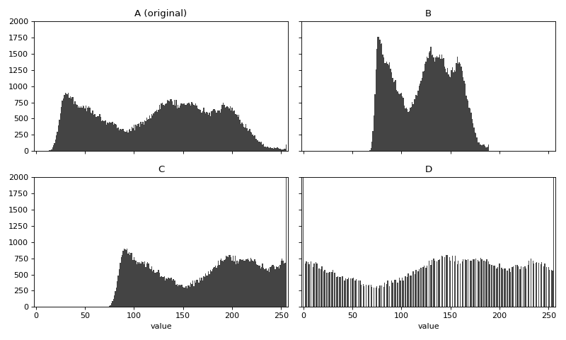
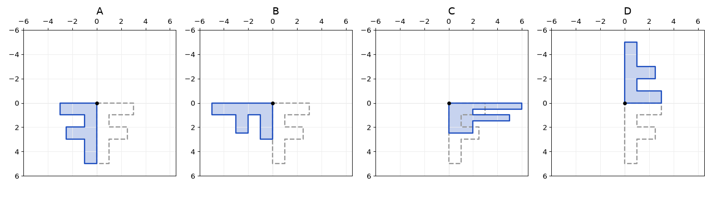

# עיבוד תמונה – חוברת תרגילים

**עודכן לאחרונה: 10.11.2026**

התרגילים של הקורס ירוכזו בקובץ הזה. המטלות ב-moodle יהיו מתוך הקובץ הזה (למשל "תרגילים 1–6").

הקובץ יעודכן במהלך הסמסטר.

## הנחיות כלליות

- הערות (comments) בקוד - יש לכתוב באנגלית. (וכמובן גם שמות משתנים - למרות ש-python תומך בשמות משתנים בעברית)
- פתרונות ניתן להגיש באחד משני אופנים:
  - ב-GitHub, על ידי העלאה למאגר האישי. שימו לב שלא לשנות את הקבצים לאחר זמן הגשת התרגיל.
  - על ידי העלאת הקבצים ישירות ל-moodle ב"מטלה". יש להעלות את הקבצים המקוריים (קבצי py או md וכד') ולא צילומי מסך של קוד.
- בכל תרגיל כתוב מה מגישים ובאיזה קובץ: בתחילת התרגיל, ליד הסעיף עצמו, או בסוף התרגיל. יש להגיש את הקבצים בשמות האלו.
- קובץ התשובות של כל תרגיל הוא הקובץ שבו כותבים את התשובות במילים: `exNN.md` או `exNN.docx`, למשל `ex07.md`.
- כשהקוד של כמה סעיפים נמצא באותו קובץ, סמנו כל סעיף בהערה (למשל <code dir="ltr"># Part 3</code>) לפני הקוד שלו.
- חלק מהתרגילים הם תרגילי תכנות - יש להגיש את קבצי ה-python .
- בחלק מהתרגילים יש שאלות מילוליות - אפשר לכתוב את התשובות בקובץ md או בקובץ Word, לבחירתכן. השימוש ב-md הופך להיות נפוץ מפני שמנועי ה-AI "אוהבים" פורמט טקסטואלי. גם git מיועד בעיקר לקבצים טקסטואליים. יחד עם זאת, נכון להיום, אין תמיכה טובה בעברית בעורך של Visual Studio Code. ישנם תוספים שונים שניתן לנסות, וניתן לכתוב ב-Word ואז לבקש ממנוע AI להמיר ל-md.
- חלק מהתרגילים יהיו תרגילי כיתה שאותם נפתור במהלך השיעור. גם אם פתרתן תרגיל בכיתה - יש להגיש אותו ב-moodle.
- מותר להשתמש בבינה מלאכותית, אבל חובה להבין את הקוד. יהיו בחנים ומבחן שיהיו ללא בינה מלאכותית, ולכן יש לוודא שאתן מבינות מה שהגשתן.
- סעיפים שמסומנים **בלי בינה מלאכותית** הם תרגול לבחנים ולמבחן: מומלץ לעשות אותם בעצמכן.
- התקנת הספריות נעשית בטרמינל של VS Code, בעזרת הפקודה הבאה:

```bash
pip install numpy opencv-python matplotlib pillow
```

הערה: הספריה pillow מותקנת אוטומטית על ידי matplotlib.

אם ההתקנה לא מצליחה, אפשר לעבוד בינתיים בדפדפן, בשירות Google Colab שבכתובת הבאה:

```text
https://colab.research.google.com
```

## מערכים של NumPy וייצוג תמונה בזיכרון

### תרגיל 1 – תכונות של מערך (בלי בינה מלאכותית)

נתון הקוד הבא:

```python
import numpy as np

a = np.array([[10, 100, 200],
              [50, 150, 250]], dtype=np.uint8)
```

לפני שאתן מריצות, כתבו מה לדעתכן יהיה הערך של כל אחד מהביטויים הבאים:

```python
a.dtype
a.shape
a.ndim
a.size
a.nbytes
a[1, 2]
a[0, 1]
a + 10
a - 20
a * 2
a.max()
a.max(axis=0)
a.max(axis=1)
```

אחר כך הריצו את הקוד ובדקו.

לכל ביטוי שבו טעיתן – הסבירו מה הייתה הטעות.

להגשה: טבלה עם שלוש עמודות – הביטוי, התחזית שלכן, והתוצאה בפועל.

את הטבלה יש להגיש בקובץ בשם ex01.md . כדי ליצור טבלה בקובץ md, העתיקו את הדוגמה הבאה והוסיפו שורה לכל ביטוי:

```markdown
| expression | my guess | actual result |
|------------|----------|---------------|
| a.dtype    | uint8    | uint8         |
| a.shape    | (3, 2)   | (2, 3)        |
```

השורה השנייה (עם המקפים) חייבת להופיע מתחת לשורת הכותרות. אין צורך ליישר את העמודות: מספיק שבכל שורה יהיה אותו מספר של קווים אנכיים.

את הקוד יש להגיש בקובץ בשם ex01.py .

### תרגיל 2 – יצירת מערכים

1. צרו תמונה שחורה בגווני אפור בגובה 100 ורוחב 200 פיקסלים. השתמשו ב-`np.zeros`, עם `np.uint8` כטיפוס הנתונים.
2. בעזרת `np.full` צרו תמונה לבנה באותו גודל.
3. צרו תמונה צבעונית בגובה 100 ורוחב 200 שכולה צבע אחד לבחירתכן. מה צריך להיות ה-shape של המערך?
4. הדפיסו את `shape`, `ndim`, `size` ו-`nbytes` של שלוש התמונות.
5. כמה בתים תופסת בזיכרון תמונה צבעונית בגודל 1920 על 1080? ותמונה של 12 מגה-פיקסל? חשבו בעצמכן, ואז בדקו את התשובה בעזרת `np.zeros(...).nbytes` בקוד.
6. צרו את המערך הבא, ובדקו מה עושה כל אחת מהשורות שאחריו:

```python
b = np.arange(12).reshape(3, 4)
print(b)
print(b.sum())
print(b.sum(axis=0))
print(b.sum(axis=1))
print(b[2, 3], b[-1, -1])
```

הסבירו במילים שלכן מה המשמעות של `axis=0` ושל `axis=1` בכל פונקציה.

**קבצים להגשה:**

- בקובץ `ex02.py` – הקוד של כל הסעיפים. סמנו כל סעיף בהערה (למשל <code dir="ltr"># Part 3</code>) לפני הקוד שלו.
- בקובץ `ex02.md` (או `ex02.docx`) – התשובות במילים: ה-shape בסעיף 3, החישוב בסעיף 5, וההסבר בסעיף 6.

### תרגיל 3 – גלישה של ערכים

1. **בלי בינה מלאכותית:** בתרגיל זה נבדוק מה קורה כשערך לא נכנס בטיפוס (overflow, גלישה). מה תהיה התוצאה של כל אחת מהשורות הבאות? כתבו תחזית ורק אז הריצו.

```python
x = np.array([100, 200, 250], dtype=np.uint8)
print(x + 10)
print(x + 100)
print(x - 150)
print(x * 2)
print(x.astype(np.int16) + 100)
print(x * 1.5)
print((x * 1.5).dtype)
```

2. נסו גם את השורה הבאה. מה קרה? מדוע לדעתכן NumPy מתנהג כך?

```python
print(x + 300)
```

3. כתבו פונקציה <code dir="ltr">add_safe(x, b)</code> שמקבלת מערך מטיפוס `np.uint8` ומספר שלם, ומחזירה מערך מטיפוס `np.uint8` שבו כל ערך גדול מ-255 הופך ל-255 וכל ערך קטן מ-0 הופך ל-0. השתמשו ב-`astype` וב-`np.clip`, ללא לולאות. בדקו את הפונקציה עם `b=100` ועם `b=-150` והסבירו את התוצאות.
4. הסבירו: מדוע לא מספיק לכתוב את הקוד הבא?

```python
np.clip(x + 100, 0, 255)
```

5. בונוס: חזרו על סעיף 1 עם `dtype=np.int8`. מה הטווח של `int8`? מה קורה ב-<code dir="ltr">127 + 1</code>?

**קבצים להגשה:**

- בקובץ `ex03.py` – הקוד של סעיפים 1, 2, 3 (ושל סעיף 5, אם עשיתן אותו). סמנו כל סעיף בהערה (למשל <code dir="ltr"># Part 3</code>) לפני הקוד שלו.
- בקובץ `ex03.md` (או `ex03.docx`) – התשובות במילים:
  - סעיף 1: טבלה כמו בתרגיל 1 – השורה, התחזית שלכן, והתוצאה בפועל.
  - סעיפים 2, 3 ו-4: ההסברים.
  - סעיף 5 (בונוס): התשובות.

## קריאה והצגה של תמונות, בהירות וניגודיות

בתרגילים הבאים השתמשו בתמונה משלכן, או בתמונות שבתיקייה `images` של הקורס. הקוד בתיקייה `code` יכול לשמש נקודת התחלה.

בתרגילים שבהם מציגים תמונות, שמרו את החלון לקובץ בעזרת `plt.savefig`. שימו לב: יש לקרוא ל-`plt.savefig` לפני הקריאה ל-`plt.show`, כי אחרי `plt.show` החלון כבר ריק.

```python
plt.savefig("ex04.png")
plt.show()
```

### העברת שם קובץ התמונה ב"שורת הפקודה"

בתרגילים 4–6, התוכנית צריכה לקבל את שם קובץ התמונה כארגומנט בשורת הפקודה, ולא כשם קבוע בתוך הקוד. כך אפשר להריץ את אותה תוכנית על תמונות שונות. למשל, הפקודה הבאה (ב-terminal) מריצה את התוכנית `ex04.py` ומעבירה לה את שם הקובץ <code dir="ltr">../images/ocean_300_400.jpg</code>:

```bash
python ex04.py ../images/ocean_300_400.jpg
```

בתוך כל תוכנית Python, הרשימה `sys.argv` מכילה את שם התוכנית ואחריו את המילים שנכתבו אחריו בשורת הפקודה:

```python
import sys

if len(sys.argv) != 2:
    print("Usage: python ex04.py <image file>")
    sys.exit(1)

filename = sys.argv[1]
```

שימו לב: הכפתור ▷ של VS Code מריץ את התוכנית בלי ארגומנטים, ולכן אם רוצים להעביר ארגומנטים בשורת הפקודה - יש להריץ אותה מהטרמינל.

### תרגיל 4 – קריאה והצגה של תמונה

1. בעזרת `cv2.imread` קראו תמונה צבעונית. הדפיסו את ה-`type`, ה-`dtype` וה-`shape` שלה, ואת ערך הפיקסל השמאלי העליון.
2. מה מחזירה `cv2.imread` אם שם הקובץ שגוי? בדקו, והוסיפו לקוד בדיקה מתאימה.
3. הציגו את התמונה בעזרת `plt.imshow` פעמיים: פעם בלי המרה, ופעם אחרי המרה של סדר הצבעים (מ-BGR ל-RGB) בעזרת הפונקציה המתאימה. מה ההבדל, ולמה?
4. הציגו כל אחד משלושת ערוצי הצבע כתמונה בגווני אפור, זה לצד זה, באותו חלון. בחרו תמונה עם אזורים צבעוניים ברורים: איזה אזור בהיר בכל ערוץ ולמה?
5. קראו את אותה תמונה עם `cv2.IMREAD_GRAYSCALE`. מה ה-`shape` עכשיו?

**קבצים להגשה:**

- בקובץ `ex04.py` – הקוד של כל הסעיפים. סמנו כל סעיף בהערה (למשל <code dir="ltr"># Part 3</code>) לפני הקוד שלו.
- בקובץ `ex04.png` – החלון עם התמונה המקורית ושלושת הערוצים (סעיף 4).
- בקובץ `ex04.md` (או `ex04.docx`) – התשובות במילים: מה מחזירה הפונקציה בסעיף 2, ההבדל בסעיף 3, האזורים הבהירים בסעיף 4, וה-shape בסעיף 5.

### תרגיל 5 – שינוי בהירות בשתי ספריות

1. כתבו פונקציה <code dir="ltr">brighten(img, b, method)</code> שמוסיפה את `b` לכל הפיקסלים בתמונה בגווני אפור. הפרמטר `method` יכול לקבל את הערכים הבאים:

```text
"np"    ->  img + b
"cv2"   ->  cv2.add(img, b)
"clip"  ->  your add_safe from exercise 3
```

2. הפעילו את הפונקציה עם `b=100` בשלוש השיטות, והציגו את ארבע התמונות (כולל המקור) זו לצד זו. בקריאה ל-`plt.imshow` השתמשו בפרמטרים `vmin=0, vmax=255` כדי שהתצוגה תהיה נכונה.
3. בתוצאה של שיטת <code dir="ltr">"np"</code> מופיעים אזורים כהים במקומות שהיו בהירים מאוד במקור. הסבירו מדוע.
4. מה קורה עם `b=-100` בכל שיטה? רמז: בדקו מה עושה הפונקציה `cv2.subtract` ומתי כדאי להשתמש בה.
5. הציגו שוב את התוצאות, הפעם בלי `vmin` ו-`vmax`. מה השתנה? מדוע?

**קבצים להגשה:**

- בקובץ `ex05.py` – הקוד של כל הסעיפים. סמנו כל סעיף בהערה (למשל <code dir="ltr"># Part 3</code>) לפני הקוד שלו.
- בקובץ `ex05.png` – ארבע התמונות מסעיף 2.
- בקובץ `ex05_no_vmin.png` – אותן תמונות, בלי `vmin` ו-`vmax` (סעיף 5).
- בקובץ `ex05.md` (או `ex05.docx`) – ההסברים לסעיפים 3, 4 ו-5.

### תרגיל 6 – ניגודיות

הגדלת ניגודיות פשוטה: מכפילים כל פיקסל בפקטור `k` קבוע.

1. הפעילו `img * 1.5` על תמונה בגווני אפור. מה ה-`dtype` של התוצאה? מה הערך המקסימלי?

2. החזירו את התוצאה לתמונה תקינה מטיפוס `np.uint8` והציגו אותה לצד המקור.

3. השוו ל-`img * 2` (כפל במספר שלם). מה ההבדל, ולמה?

4. נסו גם `k=0.5`. מה קרה לתמונה?

5. בונוס: כפל ב-`k` מגדיל גם את הבהירות. כדי לשנות רק את הניגודיות אפשר "למתוח" סביב הממוצע:

   ```python
   m = img.mean()
   result = (img - m) * k + m
   ```

   ממשו, הציגו עבור כמה ערכים של `k`, והסבירו מה קורה לפיקסלים שמתחת לממוצע ולפיקסלים שמעליו. מה ה-`dtype` של `img - m`? האם יש כאן סכנה של גלישה?

**קבצים להגשה:**

- בקובץ `ex06.py` – הקוד של כל הסעיפים. סמנו כל סעיף בהערה (למשל <code dir="ltr"># Part 3</code>) לפני הקוד שלו.
- בקובץ `ex06.png` – המקור לצד התוצאות של סעיפים 2, 3 ו-4.
- בקובץ `ex06.md` (או `ex06.docx`) – התשובות במילים לסעיפים 1, 3 ו-4 (ולסעיף 5, אם עשיתן אותו).

## אינדקסים, חיתוכים ומהירות

### תרגיל 7 – חיתוכים

את התשובות המילוליות של תרגיל זה כתבי בקובץ `ex07.docx` (או `ex07.md`).
את התוכנית בקובץ `ex07.py`.

1. כתבי תוכנית שקוראת תמונה צבעונית לתוך המשתנה `img`
   (שם הקובץ מועבר בשורת הפקודה, כמו בתרגילים 4 עד 6),
   ומדפיסה את ה-shape של כל אחד מהביטויים הבאים:

   ```python
   img[10, 20]
   img[:, :, 0]
   img[100:200, 50:150]
   img[::2, ::2]
   img[::-1, :]
   img[:, ::-1, :]
   img[0]
   img[:, 0]
   ```

   כל ביטוי בשורה נפרדת, בפורמט הבא:

   ```text
   <expression>: shape: <shape>
   ```

   למשל:

   ```text
   img[10, 20]: shape: (3,)
   ```

   לאחר מכן על התוכנית להציג בחלון אחד, זו לצד זו, את התוצאות של החיתוך, ההקטנה והשיקופים,
   כל אחת עם הביטוי שלה ככותרת.

2. בקובץ התשובות המילוליות כתבי טבלה עם כל הביטויים שבסעיף 1 ועבור כל ביטוי תיאור של מה הוא מחזיר.
   למשל, אחד הביטויים מחזיר תמונת ראי, וביטויים אחרים מחזירים תמונה הפוכה, תמונה מוקטנת וכדומה.

3. הריצי את הקוד הבא (אין צורך להגיש אותו):

   ```python
   a = np.zeros((4, 4), dtype=np.uint8)
   crop = a[1:3, 1:3]
   crop[:] = 9
   print(a)

   b = np.zeros((4, 4), dtype=np.uint8)
   crop2 = b[1:3, 1:3].copy()
   crop2[:] = 9
   print(b)
   ```

   הסבירי (בקובץ התשובות המילוליות) את שתי התוצאות: מה ההבדל ביניהן, ולמה.

4. הוסיפי לתוכנית קוד שמייצר "מסגרת" שחורה ברוחב 10 פיקסלים מסביב לתמונה (אותה תמונה שפתחת בסעיף 1).
   את המסגרת יש לייצר בעזרת 4 שורות של חיתוכים (slices), בלי לולאות.
   הציגי את התמונה עם המסגרת.

### תרגיל 8 – מהירות: לולאות לעומת מערכים

את התשובות המילוליות של תרגיל זה כתבו בקובץ `ex08.docx` (או `ex08.md`).

1. הריצו את `code/loop_vs_numpy.py` על תמונה.

2. שנו את גודל התמונה (למשל בעזרת <code dir="ltr">img[::2, ::2]</code>, או עם תמונות בגדלים שונים) ומלאו טבלה. אפשר להעתיק את התבנית הבאה:

   ```markdown
   | img.size | loop (ms) | numpy (ms) | speedup |
   |----------|-----------|------------|---------|
   |          |           |            |         |
   |          |           |            |         |
   |          |           |            |         |
   ```

   בעמודה הראשונה כתבו את מספר הערכים בתמונה (גובה × רוחב × 3). בעמודה האחרונה כתבו פי כמה NumPy מהיר יותר מהלולאה:

   ```text
   speedup = loop_time / numpy_time
   ```

   **להגשה:** בקובץ התשובות – הטבלה. אם שיניתן את הקוד של `loop_vs_numpy.py`, הגישו גם אותו, בקובץ `ex08.py`.

3. איך גדל זמן הריצה של הלולאה כשהתמונה גדלה פי 4?

   **להגשה:** בקובץ התשובות – התשובה.

4. הריצו כל מדידה כמה פעמים. האם התוצאות זהות? למה לדעתכן?

   **להגשה:** בקובץ התשובות – התשובה.

5. סכמו במשפט אחד: מה המסקנה מהטבלה?

   **להגשה:** בקובץ התשובות – המשפט.

### תרגיל 9 – המרה לגווני אפור

את התשובות המילוליות של תרגיל זה כתבי בקובץ `ex09.docx` (או `ex09.md`).

1. תמונה צבעונית נקראה בעזרת `cv2.imread`. מה הבעיה בקוד הבא? רמז: חשבי על ה-`dtype` של הערוצים.

   ```python
   gray = (img[:, :, 0] + img[:, :, 1] + img[:, :, 2]) / 3
   ```

   בקובץ התשובות המילוליות יש להסביר מה הבעיה.
   אפשר לכתוב קוד כדי לנסות ולהבין את הבעיה - אבל אין צורך להגיש אותו.

2. תקני את הקוד, כך שיחשב את הממוצע של שלושת הערוצים נכון. מצאי שתי דרכים שונות.

   יש לכתוב קוד (בקובץ `ex09.py`) שמחשב את הממוצע בשתי דרכים. אין צורך להציג את התמונה.

3. ממשי (בקובץ `ex09.py`) המרה לגווני אפור לפי הנוסחה

   ```text
   Y = 0.299 R + 0.587 G + 0.114 B
   ```

   ממשי את ההמרה ללא לולאות: השתמשי ב-broadcasting ובפונקציה `sum` עם הפרמטר `axis` המתאים. זכרי שב-OpenCV הערוצים מסודרים בסדר B, G, R ולא בסדר הרגיל.

4. השווי את התוצאה של החישוב שלך ל-<code dir="ltr">cv2.cvtColor(img, cv2.COLOR_BGR2GRAY)</code>:
   על התוכנית להדפיס את ההפרש המקסימלי בין שתי התמונות.
   שימי לב: החישוב ה"פשוט" הוא על ידי חיסור של שני מערכים מטיפוס `np.uint8` – חשבי מה יכול להשתבש?

   את הקוד יש לממש בקובץ `ex09.py`.
   בקובץ התשובות המילוליות הסבירי מה יכול להשתבש בחיסור וכיצד התגברת על הבעיה.

5. הוסיפי לתוכנית קוד שמציג זו לצד זו את התמונה של הממוצע הפשוט ואת התמונה לפי הנוסחה. האם רואים הבדל?
   רשמי בקובץ התשובות האם את רואה הבדל.

### תרגיל 10 – מסכות בוליאניות

את התשובות המילוליות של תרגיל זה כתבי בקובץ `ex10.docx` (או `ex10.md`).
את הקוד בקובץ `ex10.py`.

1. כתבי תוכנית שקוראת תמונה צבעונית והופכת אותה לאפור.
   על התוכנית להדפיס כמה פיקסלים בהירים מ-200, וכמה כהים מ-50.
   השתמשי בביטוי כמו `img > 200`
   ובפונקציה `sum`, ללא לולאות.

2. הוסיפי לתוכנית קוד שמייצר תמונה בשחור-לבן בלבד: פיקסל שערכו גדול מ-128 יהיה 255, ואחרת 0.
   שימי לב שלא מדובר בגווני אפור אלא בשחור ולבן בלבד.
   מצאי שתי דרכים: השמה עם מסכה, ושימוש ב-`np.where` במקום השמה.
   אין צורך להציג את התמונה.

3. הוסיפי קוד שצובע באדום את כל הפיקסלים שבהירותם (בגווני אפור) גדולה מ-200.
   הדרכה: שימי לב שניתן ליצור מסכה עם ממדים <code dir="ltr">(H, W)</code>
   ואז להשתמש בה כדי לבחור פיקסלים במערך בגודל <code dir="ltr">(H, W, 3)</code> של התמונה הצבעונית.
   הציגי את התמונה המקורית ליד התמונה עם הפיקסלים הצבועים.

## היסטוגרמות

### תרגיל 11 – היסטוגרמה של תמונה צבעונית

את התשובות המילוליות של תרגיל זה כתבו בקובץ `ex11.docx` (או `ex11.md`).

1. כתבו תוכנית שקוראת תמונה צבעונית (שם הקובץ מועבר בשורת הפקודה),
   ומציגה בחלון אחד את התמונה, ולידה את ההיסטוגרמות של שלושת הערוצים.
   ציירו את שלוש ההיסטוגרמות באותה מערכת צירים, כל אחת בצבע של הערוץ שלה: כחול, ירוק ואדום.
   אפשר לחשב את ההיסטוגרמות בכל אחת מהדרכים שראינו בשיעור.

   **להגשה:** הקוד בקובץ `ex11.py`.

2. צלמו (או מצאו) שתי תמונות: אחת שצולמה בתנאי תאורה טובים,
   ואחת שצולמה בלילה או בתנאים קשים (תאורה חלשה, ערפל, אור חזק מאחורי מה שמצלמים).
   הריצו את התוכנית על שתיהן.
   בקובץ התשובות תארו את ההבדלים בין ההיסטוגרמות: באיזה חלק של הטווח 0 עד 255 נמצאים רוב הערכים?
   איזה חלק מהטווח מנוצל? האם יש הבדל בין הערוצים?

   **להגשה:** שתי התמונות, בקבצים `ex11_good.jpg` ו-`ex11_poor.jpg`. בקובץ התשובות – התיאור.

3. בונוס: הוסיפו לתוכנית הדפסה של אחוז הערכים שהם 0, ואחוז הערכים שהם 255, בכל ערוץ.
   בקובץ התשובות הסבירו: מה המשמעות של אחוז גבוה של ערכים שהם 255?

   **להגשה:** הקוד בקובץ `ex11.py`. בקובץ התשובות – ההסבר.

### תרגיל 12 – בהירות, ניגודיות והיסטוגרמה

את התשובות המילוליות של תרגיל זה כתבו בקובץ `ex12.docx` (או `ex12.md`).

1. כתבו תוכנית שקוראת תמונה בגווני אפור (שם הקובץ מועבר בשורת הפקודה),
   ומציגה בחלון אחד ארבע תמונות, ומתחת לכל תמונה את ההיסטוגרמה שלה:

   - המקור.
   - הבהרה: הוספה של 50 לכל פיקסל, בלי גלישה.
   - הגדלת ניגודיות סביב הממוצע, עם <code dir="ltr">k = 1.5</code> (כמו בתרגיל 6, סעיף 5).
   - הקטנת ניגודיות סביב הממוצע, עם <code dir="ltr">k = 0.5</code>.

   הציגו את התמונות עם `vmin=0, vmax=255`, והשתמשו באותו טווח בציר ה-x בכל ההיסטוגרמות (0 עד 255), כדי שאפשר יהיה להשוות ביניהן.

   **להגשה:** הקוד בקובץ `ex12.py`.

2. בקובץ התשובות תארו מה קרה להיסטוגרמה בכל אחד מהשינויים: האם היא זזה? התרחבה? הצטמצמה?
   מה קרה בקצוות, ליד 0 וליד 255?
   אחרי הגדלת הניגודיות מופיעים בהיסטוגרמה "רווחים": ערכים שאף פיקסל לא קיבל. הסבירו מדוע.

   **להגשה:** בקובץ התשובות – התיאור וההסבר.

3. שאלה בסגנון המבחן: ההיסטוגרמה A שלמטה שייכת לתמונה מקורית.
   ההיסטוגרמות B, C ו-D שייכות לאותה תמונה, אחרי שינוי אחד מתוך: הבהרה, הכהיה, הגדלת ניגודיות, הקטנת ניגודיות
   (לא כל השינויים בהכרח מופיעים).
   איזה שינוי נעשה בכל אחת מהן? הסבירו איך אפשר לזהות זאת מההיסטוגרמה.

   

   **להגשה:** בקובץ התשובות – התשובה וההסבר.

## מודלים של צבע

### תרגיל 13 – לשנות רק את הבהירות

את התשובות המילוליות של תרגיל זה כתבו בקובץ `ex13.docx` (או `ex13.md`).

1. כתבו תוכנית שקוראת תמונה צבעונית (שם הקובץ מועבר בשורת הפקודה),
   ומותחת את הניגודיות שלה בשיטת min-max בשלוש דרכים:

   - כל אחד מהערוצים B, G, R בנפרד.
   - רק הערוץ V, אחרי המרה ל-HSV.
   - רק הערוץ Y, אחרי המרה ל-YCrCb.

   התוכנית מציגה בחלון אחד את המקור ואת שלוש התוצאות,
   ומדפיסה את הערכים של הפיקסל <code dir="ltr">[10, 10]</code> בכל אחת מארבע התמונות.

   **להגשה:** הקוד בקובץ `ex13.py`.

2. הריצו את התוכנית על התמונה `red_rectangles.png` שבתיקייה `images`.
   בקובץ התשובות הסבירו: באיזו מהדרכים השתנו הצבעים, ולמה? היעזרו בערכים שהתוכנית הדפיסה.

   **להגשה:** בקובץ התשובות – ההסבר.

3. הריצו את התוכנית על התמונה שצילמתן בתנאים קשים בתרגיל 11. האם המתיחה שינתה משהו?
   אם התוצאה כמעט זהה למקור, הדפיסו את המינימום והמקסימום של כל ערוץ, והסבירו בקובץ התשובות למה.

   **להגשה:** בקובץ התשובות – התשובה וההסבר.

4. בונוס: במקום min-max, מתחו את הטווח שבין האחוזון ה-1 לאחוזון ה-99, בעזרת `np.percentile`,
   כמו בשקף "A real photo at night". הריצו על התמונה שלכן ועל `parking_night.jpg` שבתיקייה `images`.

   **להגשה:** הקוד בקובץ `ex13.py`. בקובץ התשובות – מה השתנה.

### תרגיל 14 – HSV

את התשובות המילוליות של תרגיל זה כתבו בקובץ `ex14.docx` (או `ex14.md`).

1. כתבו פונקציה <code dir="ltr">my_hsv(r, g, b)</code> שמקבלת צבע אחד ומחזירה את <code dir="ltr">(h, s, v)</code>
   בטווחים של OpenCV: H בין 0 ל-179, ו-S ו-V בין 0 ל-255.
   השתמשו בנוסחאות מהשקף "HSV of one pixel", בפייתון רגיל: בלי NumPy ובלי OpenCV.

   התוכנית מדפיסה, לכל אחד מהצבעים הבאים, את התוצאה של הפונקציה שלכן לצד התוצאה של OpenCV:

   ```python
   colors = [(200, 150, 100), (128, 128, 128), (255, 0, 0), (0, 255, 0),
             (0, 0, 255), (50, 100, 200), (255, 255, 0)]      # (R, G, B)
   ```

   כך מחשבים את התוצאה של OpenCV לצבע אחד:

   ```python
   pixel = np.uint8([[[b, g, r]]])          # an image of 1 x 1 pixels: B, G, R
   h, s, v = cv2.cvtColor(pixel, cv2.COLOR_BGR2HSV)[0, 0]
   ```

   הבדל של 1 בגלל עיגול הוא תקין.

   **להגשה:** הקוד בקובץ `ex14.py`.

2. בקובץ התשובות הסבירו: מה הערכים של H ושל S עבור הצבע האפור <code dir="ltr">(128, 128, 128)</code>, ולמה ל-H אין משמעות עבורו?

   **להגשה:** בקובץ התשובות – ההסבר.

3. בחירה לפי צבע: צלמו (או מצאו) תמונה שיש בה עצם בצבע ברור, שאינו צהוב.
   הוסיפו לתוכנית קוד שמציג את התמונה באפור, ורק את העצם בצבע המקורי שלו – כמו בשקף "Selecting by color".
   בקובץ התשובות כתבו באיזה טווח של H בחרתן ולמה, ומה קורה אם מוותרים על התנאים על S ועל V.

   **להגשה:** הקוד בקובץ `ex14.py`, והתמונה בקובץ `ex14.jpg`. בקובץ התשובות – ההסבר.

4. בונוס: בחרו עצם אדום. למה צריך כאן שני טווחים של H?

   **להגשה:** הקוד בקובץ `ex14.py`. בקובץ התשובות – ההסבר.

## טרנספורמציות גיאומטריות

### תרגיל 15 – מטריצות של טרנספורמציות

את התשובות המילוליות של תרגיל זה כתבו בקובץ `ex15.docx` (או `ex15.md`).

1. כתבו תוכנית שמגדירה את האות F כמערך של נקודות: שורה אחת של x ושורה אחת של y.

   ```python
   F = np.array([[0, 3, 3, 1, 1, 2.5, 2.5, 1, 1, 0],    # x
                 [0, 0, 1, 1, 2, 2, 3, 3, 5, 5]])      # y
   ```

   הגדירו מטריצה S שמכפילה רק את y פי 2, ומטריצה R שמסובבת ב-30 מעלות, כמו בשקף "Scaling and rotation".
   התוכנית מציגה בחלון אחד ארבעה גרפים: האות אחרי S, אחרי R, אחרי <code dir="ltr">R @ S</code> ואחרי <code dir="ltr">S @ R</code>.
   בכל גרף מופיעה גם האות המקורית, בקו מקווקו.
   התוכנית גם מדפיסה את המטריצות <code dir="ltr">R @ S</code> ו-<code dir="ltr">S @ R</code>.

   אפשר לצייר צורה בעזרת `ax.fill`. כדי שהציר y יפנה למטה, כמו בתמונה, הוסיפו לכל גרף את שתי השורות האחרונות:

   ```python
   ax.fill(pts[0], pts[1], alpha=0.5)     # pts: an array of points, shape (2, n)
   ax.invert_yaxis()                      # y down, as in an image
   ax.set_aspect("equal")                 # the same scale on both axes
   ```

   **להגשה:** הקוד בקובץ `ex15.py`.

2. בקובץ התשובות ענו:

   - לאיזה כיוון, על המסך, סובבה R את האות: עם כיוון השעון או נגדו? למה?
   - מה ההבדל בין <code dir="ltr">R @ S</code> לבין <code dir="ltr">S @ R</code>: איזו פעולה נעשית ראשונה בכל אחת מהן?
   - הוסיפו לתוכנית בדיקה בעזרת `np.allclose`: האם <code dir="ltr">R @ S</code> שווה ל-<code dir="ltr">S @ R</code>, כאשר S מכפילה גם את x וגם את y פי 2? הסבירו את התוצאה.

   **להגשה:** הקוד בקובץ `ex15.py`. בקובץ התשובות – התשובות.

3. סיבוב סביב המרכז: הוסיפו לתוכנית את המטריצה M בגודל 3×3, שמסובבת תמונה ברוחב 400 ובגובה 300 ב-30 מעלות סביב המרכז,
   כמו בשקף "Rotating around the center: code". התוכנית מדפיסה:

   - את M.
   - את התוצאה של הפקודה הבאה, ואם היא שווה לשתי השורות העליונות של M (בעזרת `np.allclose`):

     ```python
     cv2.getRotationMatrix2D((cx, cy), -30, 1.0)
     ```

   - לאן M מעבירה את המרכז <code dir="ltr">(cx, cy)</code>, ולאן את הפינה השמאלית העליונה <code dir="ltr">(0, 0)</code>.

   בקובץ התשובות הסבירו: למה המרכז לא זז? לאן הגיעה הפינה, ומה זה אומר על התמונה אחרי הסיבוב?
   ולמה בפקודה של OpenCV כתוב <code dir="ltr">-30</code> ולא 30?

   **להגשה:** הקוד בקובץ `ex15.py`. בקובץ התשובות – ההסברים.

4. שאלה בסגנון המבחן: בכל אחד מהגרפים A עד D, הקו המקווקו הוא האות F המקורית, והצורה הכחולה היא התוצאה של אחת מהמטריצות הבאות.
   הציר y מצביע למטה, כמו בתמונה, והנקודה השחורה היא הראשית <code dir="ltr">(0, 0)</code>.

   ```python
   M1 = np.array([[2, 0], [0, 0.5]])
   M2 = np.array([[0, -1], [1, 0]])
   M3 = np.array([[0, 1], [-1, 0]])
   M4 = np.array([[-1, 0], [0, 1]])
   M5 = np.array([[1, 0], [0, -1]])
   ```

   

   איזו מטריצה מתאימה לכל גרף? אחת המטריצות לא מופיעה.
   הסבירו כל תשובה במשפט אחד: למשל, לאן המטריצה מעבירה את הנקודה <code dir="ltr">(0, 5)</code>, הקצה התחתון של האות.
   אחרי שעניתן, אפשר לבדוק בעזרת התוכנית מסעיף 1.

   **להגשה:** בקובץ התשובות – התשובה וההסבר.

5. בונוס: כתבו פונקציה <code dir="ltr">rotation(deg)</code> שמחזירה את המטריצה R של סיבוב ב-deg מעלות,
   ובדקו בעזרת `np.allclose`:

   ```python
   rotation(30) @ rotation(60)       # == rotation(90)?
   np.linalg.inv(rotation(30))       # == rotation(-30)? == rotation(30).T?
   ```

   בקובץ התשובות הסבירו במילים למה שתי הבדיקות יוצאות כך.

   **להגשה:** הקוד בקובץ `ex15.py`. בקובץ התשובות – ההסבר.

## הזזת פיקסלים בתמונה: מיפוי ואינטרפולציה

### תרגיל 16 – מיפוי קדימה ומיפוי לאחור

את התשובות המילוליות של תרגיל זה כתבו בקובץ `ex16.docx` (או `ex16.md`).

1. כתבו תוכנית שקוראת תמונה צבעונית (שם הקובץ מועבר בשורת הפקודה), ומגדילה אותה פי 1.5 במיפוי קדימה (forward mapping):
   כל פיקסל <code dir="ltr">(x, y)</code> של המקור נכתב בפיקסל <code dir="ltr">(round(1.5 x), round(1.5 y))</code> של התוצאה.
   גודל התוצאה: הגובה והרוחב של המקור כפול 1.5, מעוגלים.
   כתבו את הקוד בלי לולאות, בעזרת `np.indices`, כמו בשקף "A vectorized warp". למשל:

   ```python
   ys, xs = np.indices((h, w))            # y, x of every source pixel
   dx = np.round(1.5 * xs).astype(int)    # where each source pixel goes
   dy = np.round(1.5 * ys).astype(int)
   out[dy, dx] = img                      # out: a black image of the new size
   ```

   שמרו גם מערך בוליאני `written` בגודל התוצאה, שבו True במקומות שנכתב בהם ערך.
   התוכנית מדפיסה כמה פיקסלים בתוצאה לא קיבלו ערך, מתוך כמה,
   ומציגה את המקור ואת התוצאה זו לצד זו.

   **להגשה:** הקוד בקובץ `ex16.py`.

2. בקובץ התשובות הסבירו:

   - למה בדיוק זה מספר הפיקסלים שלא קיבלו ערך? (רמז: כמה פיקסלים בתוצאה כן קיבלו ערך?)
   - הוסיפו לתוכנית הדפסה של <code dir="ltr">np.round(1.5 * np.arange(8))</code>. אילו עמודות של התוצאה נשארו ריקות?
     ולמה 4.5 עוגל ל-4, אבל 1.5 עוגל ל-2? (חפשו מה עושה `np.round` עם מספר שמסתיים ב-0.5.)

   **להגשה:** הקוד בקובץ `ex16.py`. בקובץ התשובות – ההסברים.

3. הוסיפו לתוכנית הגדלה פי 1.5 במיפוי לאחור (backward mapping), עם השכן הקרוב:
   כל פיקסל <code dir="ltr">(x, y)</code> של התוצאה מקבל את הערך של הפיקסל <code dir="ltr">(round(x / 1.5), round(y / 1.5))</code> של המקור.
   השתמשו ב-`np.clip` כדי לא לחרוג מגבולות המקור.
   הציגו את המקור ואת שתי התוצאות זו לצד זו, והדפיסו גם כאן כמה פיקסלים לא קיבלו ערך.

   בקובץ התשובות הסבירו: למה במיפוי לאחור אין "חורים"? וכמה פיקסלים של התוצאה, בממוצע, מקבלים את הערך של כל פיקסל של המקור?

   **להגשה:** הקוד בקובץ `ex16.py`. בקובץ התשובות – ההסבר.

4. בונוס: הקטנה. צרו "לוח שחמט" שבו כל משבצת היא פיקסל אחד, והקטינו אותו פי 4 בשתי דרכים:

   ```python
   board = (np.indices((400, 400)).sum(axis=0) % 2 * 255).astype(np.uint8)
   nearest = cv2.resize(board, None, fx=0.25, fy=0.25, interpolation=cv2.INTER_NEAREST)
   area = cv2.resize(board, None, fx=0.25, fy=0.25, interpolation=cv2.INTER_AREA)
   ```

   הציגו את שלוש התמונות עם `vmin=0, vmax=255` ועם `interpolation="nearest"`, והדפיסו את הערכים השונים בכל אחת (בעזרת `np.unique`).
   בקובץ התשובות הסבירו את התוצאה: איזו מהשתיים נראית, מרחוק, כמו הלוח המקורי, ולמה?

   **להגשה:** הקוד בקובץ `ex16.py`. בקובץ התשובות – ההסבר.

### תרגיל 17 – סיבוב תמונה: לולאה, NumPy ו-OpenCV

את התשובות המילוליות של תרגיל זה כתבו בקובץ `ex17.docx` (או `ex17.md`).

1. כתבו תוכנית שקוראת תמונה צבעונית (שם הקובץ מועבר בשורת הפקודה), ומסובבת אותה ב-30 מעלות סביב המרכז, בארבע דרכים:

   - לולאה, השכן הקרוב: הקוד מהשקף "Backward mapping: a loop".
   - בלי לולאות, השכן הקרוב: הקוד מהשקף "A vectorized warp".
   - הפקודה `cv2.warpAffine` עם <code dir="ltr">flags=cv2.INTER_NEAREST</code>.
   - הפקודה `cv2.warpAffine` בלי פרמטר נוסף (אינטרפולציה בילינארית).

   את M אפשר לקחת מתרגיל 15, או לחשב בעזרת `cv2.getRotationMatrix2D` ולהוסיף לה את השורה <code dir="ltr">[0, 0, 1]</code>:

   ```python
   M2 = cv2.getRotationMatrix2D((cx, cy), -30, 1.0)    # 2x3, for cv2.warpAffine
   M = np.vstack([M2, [0, 0, 1]])                       # 3x3, for np.linalg.inv
   ```

   התוכנית מדפיסה את זמן הריצה של כל דרך (את הזמן הקצר מבין 5 הרצות; את הלולאה מספיק להריץ פעם אחת),
   מדפיסה אם התוצאה של הלולאה זהה לתוצאה בלי לולאות (בעזרת `np.array_equal`),
   ובכמה פיקסלים התוצאה בלי לולאות שונה מהתוצאה של OpenCV עם השכן הקרוב.
   לבסוף היא מציגה את ארבע התוצאות.

   מספר קטן של פיקסלים שונים מ-OpenCV הוא תקין: OpenCV מחשבת את הקואורדינטות בדיוק מוגבל,
   ולכן קואורדינטה שקרובה מאוד ל-0.5 יכולה להתעגל לכיוון השני.

   **להגשה:** הקוד בקובץ `ex17.py`.

2. הוסיפו לגרסה בלי הלולאות הדפסה של הצורה וה-dtype של כל אחד מהביטויים הבאים:

   ```python
   ys
   coords
   sx
   c
   inside
   img[r[inside], c[inside]]
   ```

   הדפיסו כל ביטוי בשורה משלו, בפורמט הבא:

   ```text
   <expression>: shape: <shape>, dtype: <dtype>
   ```

   בקובץ התשובות כתבו טבלה: מה מכיל כל אחד מהם? ומה המספר הראשון בצורה של הביטוי האחרון?

   **להגשה:** הקוד בקובץ `ex17.py`. בקובץ התשובות – הטבלה.

3. בקובץ התשובות הסבירו את ההבדלים בזמני הריצה: למה הגרסה בלי לולאות מהירה כל כך יותר מהלולאה,
   אף שהיא עושה את אותו החישוב? ולמה OpenCV מהירה עוד יותר?

   **להגשה:** בקובץ התשובות – ההסבר.

4. הציגו זה לצד זה את אותו ריבוע של 40 × 40 פיקסלים מתוך התוצאה של השכן הקרוב ומתוך התוצאה הבילינארית.
   בחרו ריבוע שעובר בו הגבול בין התמונה המסובבת לבין הרקע השחור.
   הציגו עם <code dir="ltr">interpolation="nearest"</code>: אחרת Matplotlib מחליקה בעצמה את התמונה המוגדלת.
   בקובץ התשובות תארו את ההבדל, והסבירו ממה הוא נובע.

   **להגשה:** הקוד בקובץ `ex17.py`. בקובץ התשובות – התיאור וההסבר.

5. בונוס: כתבו גרסה בלי לולאות של אינטרפולציה בילינארית, לפי השקף "Bilinear interpolation",
   והשוו אותה ל-`cv2.warpAffine`: מה ההפרש המקסימלי בין התוצאות, הרחק מהגבול של התמונה?

   **להגשה:** הקוד בקובץ `ex17.py`. בקובץ התשובות – ההפרש.
