# Introduction

## The human eye

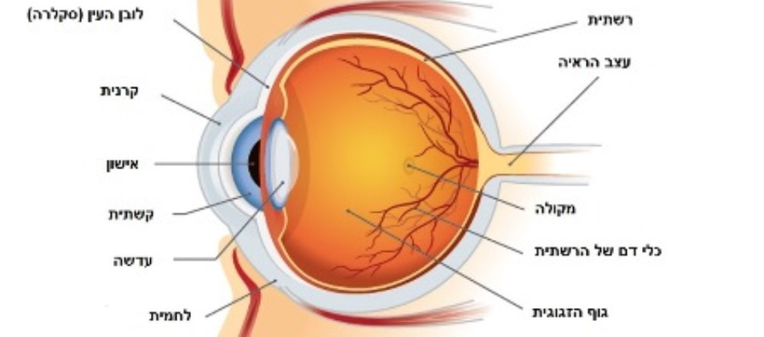{width=100%}

[Source: Soroka Medical Center website]{.small}

## The retina

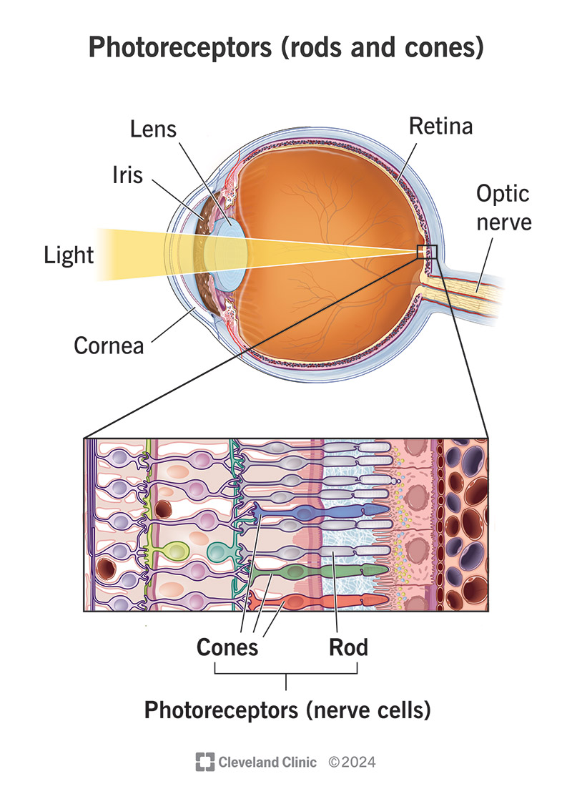{height=600}

## Sensitivity to color

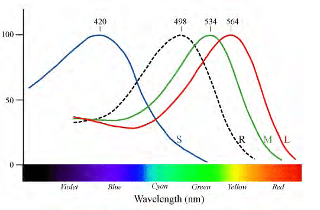{width=80%}

[Source: researchgate.net/figure/Normalized-spectral-sensitivity-of-retinal-rod-and-cone-cells_fig7_265155524]{.small}

## RGB color model

:::: {.columns}
::: {.column width="30%"}
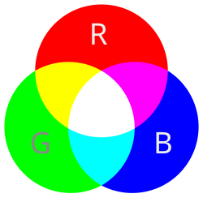{width=100%}
:::
::: {.column width="70%"}
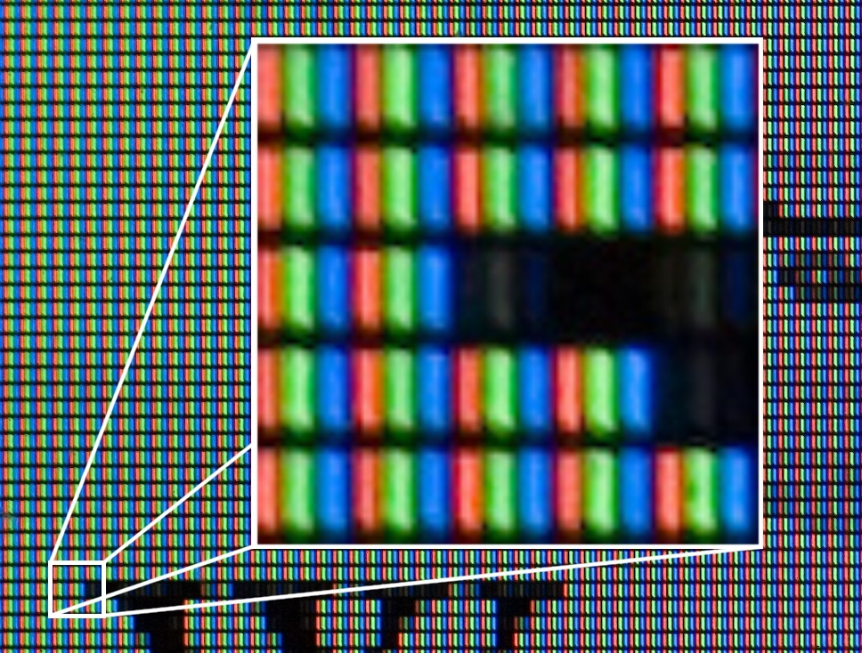{width=100%}
:::
::::

## RGB vs CMYK

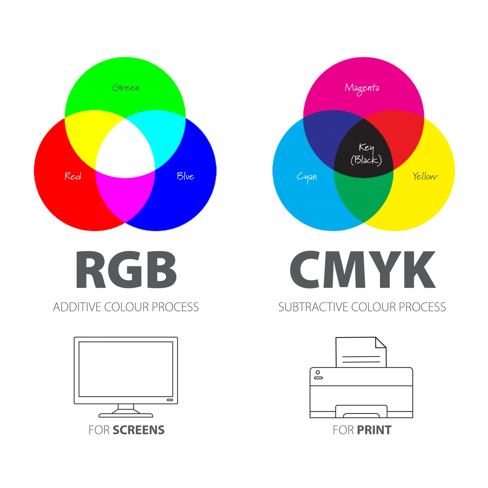{height=600}

# Images in memory

## An image as a 3D array

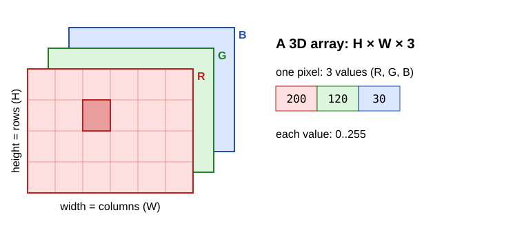{width=100%}

## An image is an array of numbers

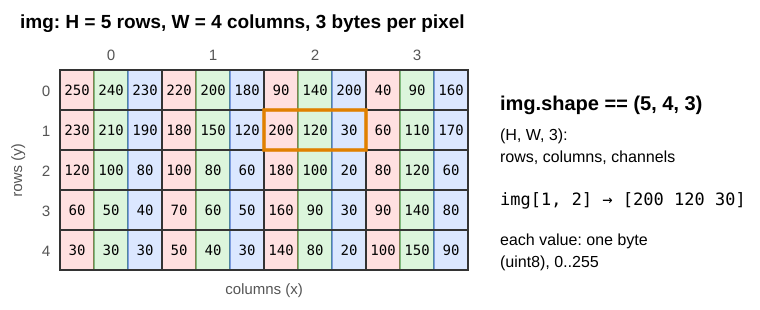{width=100%}

## In memory: one block of bytes

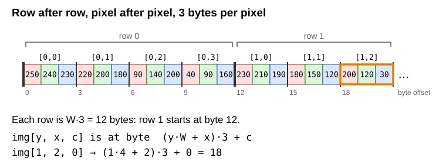{width=100%}

## Three planes: a logical view

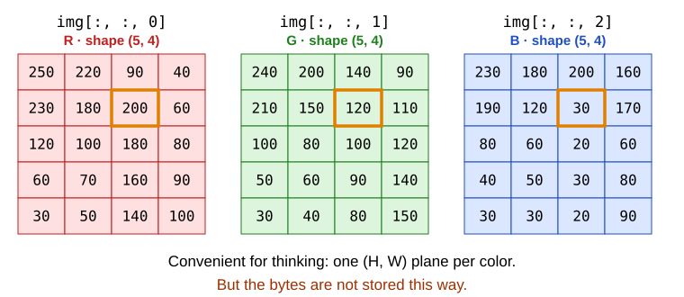{width=100%}

## One channel is a view

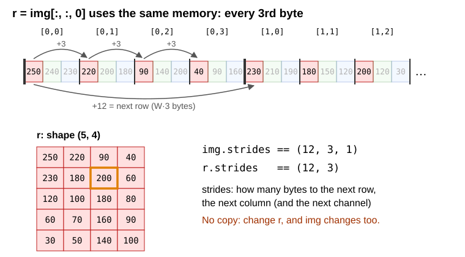{width=100%}

## OpenCV: B, G, R

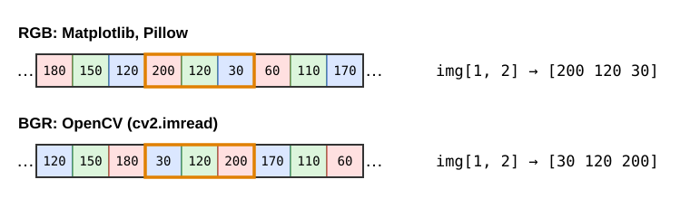{width=85%}

- `cv2.imread` gives **B, G, R**: `img[:, :, 0]` is the **blue** channel.
- Matplotlib expects R, G, B: `cv2.cvtColor(img, cv2.COLOR_BGR2RGB)`.
- Why? History: OpenCV started at Intel in 1999, when B, G, R was common
  in cameras and in Windows bitmaps (BMP files store B, G, R). It stayed for compatibility.

## Three planes, or one

- Color image: `shape == (H, W, 3)` — rows, columns, channels.
- Grayscale image: `shape == (H, W)` — one plane.
- Rows first: `img[row, col]` — that is `img[y, x]`, **not** `img[x, y]`.
- Size: 1920 × 1080 × 3 = 6,220,800 bytes ≈ 6 MB (before compression).
- JPEG/PNG files are compressed; in memory the image is the full array.

## A byte

- 8 bits → 2^8^ = 256 values → `0 .. 255`.
- `00000000` = 0, `11111111` = 255.
- 0 = no light (black), 255 = full intensity.
- What is 255 + 1 in one byte?

. . .

`11111111 + 1 = 1 00000000` → the 9th bit does not fit → **0**

# NumPy

## Why not Python lists?

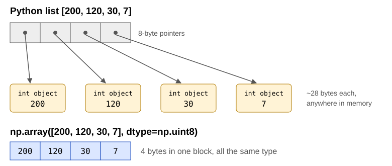{width=100%}

## Why not Python loops?

Brighten a 300 × 400 color image (360,000 values):

| | time |
|---|---|
| Python loop | ~100 ms |
| NumPy | ~1 ms |

- About 100× faster. A 12-megapixel photo with a loop: **~10 seconds**.
- NumPy runs the loop in compiled C code, over one block of memory of one type.
- See `code/loop_vs_numpy.py`.

## Every array has a type: `dtype`

```python
import numpy as np

a = np.array([[10, 100, 200],
              [50, 150, 250]], dtype=np.uint8)
```

| dtype | bytes | range |
|---|---|---|
| `np.uint8` | 1 | 0 .. 255 |
| `np.int16` | 2 | −32,768 .. 32,767 |
| `np.int32` | 4 | about ±2.1 billion |
| `np.float32` | 4 | ~7 significant digits |
| `np.float64` | 8 | ~16 significant digits |

Images are almost always `uint8`.

## Array attributes

```python
a.dtype      # uint8
a.shape      # (2, 3)  -> (rows, columns)
a.ndim       # 2       -> number of dimensions
a.size       # 6       -> number of elements
a.itemsize   # 1       -> bytes per element
a.nbytes     # 6       -> size * itemsize
a[1, 2]      # 250     -> row 1, column 2
```

For a color image: `shape == (H, W, 3)`, `ndim == 3`.

## Creating arrays

```python
np.zeros((3, 4), dtype=np.uint8)            # all 0
np.ones((3, 4), dtype=np.float32)           # all 1.0
np.full((3, 4), 7, dtype=np.uint8)          # all 7
np.arange(12)                               # 0, 1, ..., 11
np.arange(12).reshape(3, 4)                 # same values, shape (3, 4)
np.zeros((480, 640, 3), dtype=np.uint8)     # a black color image
```

## Operations are elementwise

```python
a + 10        # adds 10 to every element
a * 2         # multiplies every element
a + a         # element by element
a.min(), a.max(), a.mean(), a.sum()
a.max(axis=0) # max of each column
a.max(axis=1) # max of each row
```

No loops: one expression works on the whole array.

## `max(axis=...)`: the axis you name disappears

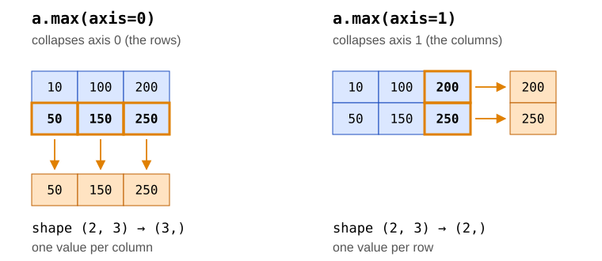{width=100%}

- The axis you give is the one that is **collapsed**: all values along it become one value.
- `axis=0` runs down the rows → one result per column. `axis=1` runs along a row → one result per row.
- The same for `min`, `sum`, `mean`, ...

## A 3D array: `axis=1`

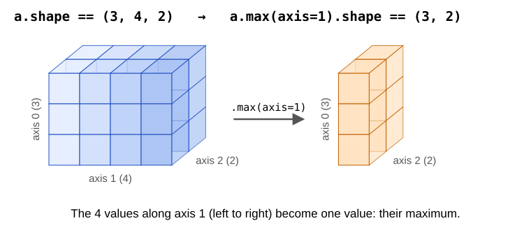{width=100%}

- Shape `(3, 4, 2)` without axis 1 → `(3, 2)`. Rule: remove the named axis from the shape.

## `axis=1`, with numbers

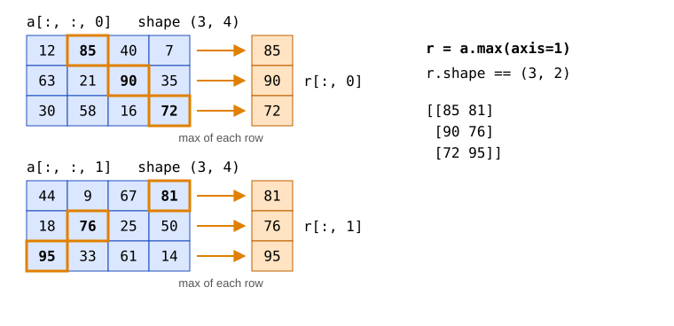{width=100%}

Each depth slice `a[:, :, d]` is a 2D plane — like a color channel `img[:, :, c]`.

## Images: `axis` can be a tuple

For an image `img` with shape `(H, W, 3)`:

```python
img.max(axis=2)          # (H, W): the brightest channel of each pixel
img.mean(axis=(0, 1))    # (3,):   the mean of each channel (B, G, R)
img.max(axis=(0, 1))     # (3,):   the max of each channel
img.max()                # one number: the max of everything
```

- `axis=(0, 1)` collapses rows **and** columns: all H × W values of a channel become one number.
- The result has one value per channel: shape `(3,)`, a 1D array of 3 values.
- `img.max(axis=(0, 1))` gives the same as `img.max(axis=0).max(axis=0)`, in one step.
- No `axis` at all: every axis disappears, and the result is one number.

## Overflow: `uint8` wraps around

```python
a = np.array([[10, 100, 200],
              [50, 150, 250]], dtype=np.uint8)
a + 10
# [[ 20 110 210]
#  [ 60 160   4]]     <- 250 + 10 = 260 = 256 + 4
a - 20
# [[246  80 180]     <- 10 - 20 = -10 = 246 - 256
#  [ 30 130 230]]
```

- The result of `uint8 + int` is `uint8`, computed **modulo 256**.
- No error, no warning.

## Other surprises

```python
a + 300       # OverflowError: Python integer 300 out of bounds for uint8
a * 1.5       # float64 array: [[ 15. 150. 300.] [ 75. 225. 375.]]
a.sum()       # 760 (NumPy uses a bigger type for sums)
```

The safe way back to an image:

```python
b = a * 1.5                                  # float64
c = np.clip(b, 0, 255).astype(np.uint8)      # [[ 15 150 255] [ 75 225 255]]
```

- `np.clip` — values below 0 become 0, above 255 become 255.
- `astype` — converts to another type. Without `clip`, out-of-range values give garbage.

## Exercises

Exercises 1–3 in the exercises file.

# Libraries

## Python image libraries

- **Pillow (PIL)**: "object oriented", keeps metadata, easy to install, slower.
- **OpenCV (`cv2`)**: written in C/C++ with a Python wrapper. Industry standard, optimized for speed.
  Images are NumPy arrays.
- **NumPy**: n-dimensional arrays with fast operations.
- **Matplotlib**: plots — and showing images.

```bash
pip install numpy opencv-python matplotlib pillow
```

## Command-line arguments: `sys.argv`

```bash
python ex04.py ../images/ocean.jpg
```

```python
import sys

print(sys.argv)          # ['ex04.py', '../images/ocean.jpg']
filename = sys.argv[1]   # the first argument after the program name
```

- `sys.argv` is a list of strings: the program name, then each word typed after it.
- No argument → `sys.argv` is `['ex04.py']`, and `sys.argv[1]` raises `IndexError`.
- A name with spaces needs quotes: `python ex04.py "my photo.jpg"`.
- The path is relative to the folder the terminal is in, not to the `.py` file.

## Checking the arguments

```python
import sys

if len(sys.argv) != 2:
    print("Usage: python ex04.py <image file>")
    sys.exit(1)

filename = sys.argv[1]
```

- `sys.exit(1)` stops the program. A non-zero value means "something went wrong".
- In VS Code, the ▷ Run button passes no arguments: run the program from the terminal instead.

## Reading an image with OpenCV

```python
import sys
import cv2

filename = sys.argv[1]      # check len(sys.argv) first, as before
img = cv2.imread(filename)
if img is None:
    print("failed to read", filename)
    sys.exit(1)
print(type(img), img.dtype, img.shape)
# <class 'numpy.ndarray'> uint8 (400, 300, 3)
print(img[0, 0])
# [122 133 117]   <- B, G, R !
```

- `cv2.imread` does **not** raise an error for a missing file — it returns `None`.
- `cv2.imread(name, cv2.IMREAD_GRAYSCALE)` → 2D array.

## Showing an image with Matplotlib

```python
import matplotlib.pyplot as plt

rgb = cv2.cvtColor(img, cv2.COLOR_BGR2RGB)   # OpenCV: BGR, Matplotlib: RGB
plt.imshow(rgb)
plt.savefig("rgb.png")    # save the figure to a file
plt.show()

gray = cv2.imread(filename, cv2.IMREAD_GRAYSCALE)
plt.imshow(gray, cmap="gray", vmin=0, vmax=255)
plt.show()
```

- Without `vmin=0, vmax=255`, Matplotlib stretches each gray image to its own min..max —
  and brightness changes become invisible.
- Call `plt.savefig` **before** `plt.show()`: once the window is closed, the figure is gone.

## The channels

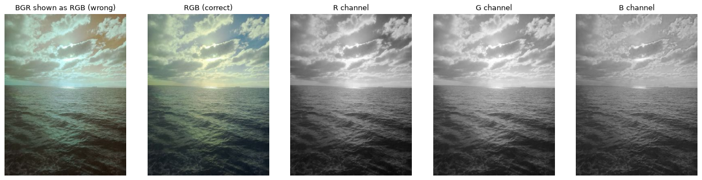{width=100%}

`code/show_image.py`

## Brightness and contrast

- **Brightness**: add a constant to every pixel — `img + b`.
- **Contrast**: multiply every pixel by a factor — `img * k`.
- What happens to pixels that go above 255?

## NumPy vs OpenCV

```python
img + 100                  # NumPy: wraps around (modulo 256)
cv2.add(img, 100)          # OpenCV: saturates — above 255 becomes 255
```

NumPy, done right:

```python
img16 = img.astype(np.int16)           # room for values above 255
bright16 = img16 + 100                 # int16: no wrap-around
clipped = np.clip(bright16, 0, 255)    # back into 0..255 (still int16)
bright = clipped.astype(np.uint8)      # an image again
```

- Why `int16`? Because `uint8 + 100` already wrapped around before `clip` could see it.
- `code/brightness_contrast.py`

## The result

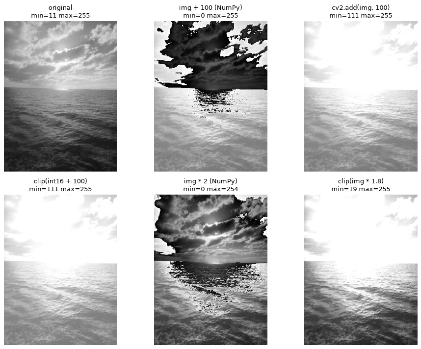{height=600}

## Exercise

Exercises 4–6 in the exercises file.

# Indexing and vectorization

## Indexing and slicing

```python
img[10, 20]          # one pixel: [B G R]
img[10, 20, 2]       # one value: the R of that pixel
img[:, :, 2]         # the R plane, shape (H, W)
img[100:200, 50:150] # a crop: rows 100..199, columns 50..149
img[::2, ::2]        # every second row and column: half size
img[::-1, :]         # rows in reverse: upside down
img[:, ::-1]         # columns in reverse: mirror
```

`start:stop:step` — like Python lists, but one per dimension.

## Views, not copies

```python
crop = img[100:200, 50:150]
crop[:] = 0              # img changes too!

crop = img[100:200, 50:150].copy()
crop[:] = 0              # img does not change
```

- Slicing gives a **view**: a new array object that uses the same memory.
- Fast (nothing is copied), but changes go to the original.
- Use `.copy()` when you need an independent array.

## 💡 Is it a view?

```python
crop = img[100:200, 50:150]
crop2 = img[100:200, 50:150].copy()

img.flags.owndata              # True: img owns its memory
crop.flags.owndata             # False: crop uses img's memory
crop.base is img               # True: base = the array that owns the memory
crop2.base                     # None: a copy owns its memory
np.shares_memory(img, crop)    # True
np.shares_memory(img, crop2)   # False
```

## 💡 View or copy?

```python
r = img[:, :, 2]               # one channel
np.shares_memory(img, r)       # True: a view
r[:] = 0                       # img has no red now

mask = img < 80
dark = img[mask]               # the dark values, shape (n,)
np.shares_memory(img, dark)    # False: a boolean mask gives a copy
dark[:] = 0                    # img does not change
img[mask] = 0                  # but this writes into img
```

## Broadcasting

```python
img.shape                               # (400, 300, 3)
weights = np.array([0.114, 0.587, 0.299])   # B, G, R
(img * weights).shape                   # (400, 300, 3)
```

- Shapes are compared from the **last** dimension.
- Sizes must be equal, or one of them must be 1 (or missing).
- `(400, 300, 3) * (3,)` → each pixel's 3 values are multiplied by the 3 weights.
- `img + 10` is broadcasting too: a scalar fits any shape.

## 💡 Broadcasting along other axes

```python
img.shape                               # (400, 300, 3)
m = img.mean(axis=2)                    # (400, 300): mean of each pixel
img - m                                 # ValueError!
m = img.mean(axis=2, keepdims=True)     # (400, 300, 1)
(img - m).shape                         # (400, 300, 3)
```

- `(400, 300)` is lined up from the right: 300 against 3 → error.
- `keepdims=True` keeps the squashed axis, with size 1.
- A size-1 axis is stretched to match: each pixel's mean is subtracted from its 3 channels.

## Broadcasting example: grayscale

The eye is most sensitive to green and least to blue:

$$Y = 0.299\,R + 0.587\,G + 0.114\,B$$

```python
weights = np.array([0.114, 0.587, 0.299])          # B, G, R
gray = (img * weights).sum(axis=2)                 # float64, shape (H, W)
gray = np.clip(gray, 0, 255).astype(np.uint8)

gray_cv = cv2.cvtColor(img, cv2.COLOR_BGR2GRAY)    # OpenCV: almost the same
```

- `img * weights` is **broadcasting**: `(H, W, 3) * (3,)` → each pixel's B, G, R times the 3 weights.
- `axis=2` — sum over the channels; the result has one dimension less.

## Boolean masks

```python
mask = gray > 200         # array of True/False, same shape as gray
mask.sum()                # how many pixels are brighter than 200
gray[mask] = 255          # set only those pixels
gray[gray < 50] = 0       # in one line

result = np.where(mask, 255, 0).astype(np.uint8)   # if / else for every pixel
```

## Timing code

```python
import time

start = time.perf_counter()
result = brighten_loop(img, 50)
elapsed = time.perf_counter() - start
print(f"{elapsed * 1000:.2f} ms")
```

- Measure, don't guess.
- Measure more than once — the first run is often slower.
- `code/loop_vs_numpy.py`

## Exercises

Exercises 7–10 in the exercises file.

# Point operations

## Point operations

The new value of a pixel depends only on its old value: `out = f(img)`.

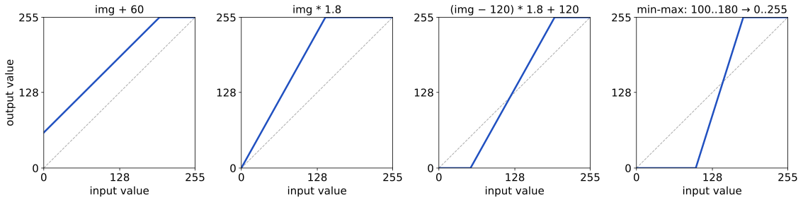{width=100%}

- Dashed: `out = img` (no change). Above 255 or below 0: clipped.
- Brightness moves the line up; contrast makes it steeper.

## Contrast around the mean

```python
f = img.astype(np.float64)
m = f.mean()
out = (f - m) * 1.8 + m                        # stretch around the mean
out = np.clip(out, 0, 255).astype(np.uint8)
```

- `img * 1.8` stretches around **0**: the image also gets brighter (mean 123 → 221).
- `(img - m) * 1.8 + m` keeps the mean: dark gets darker, bright gets brighter.

## Min-max normalization

$$out = \frac{img - min}{max - min} \cdot 255$$

```python
f = img.astype(np.float64)
out = (f - f.min()) / (f.max() - f.min()) * 255
out = np.round(out).astype(np.uint8)            # already 0..255: no clip

out = cv2.normalize(img, None, 0, 255, cv2.NORM_MINMAX)   # OpenCV: the same
```

- The darkest pixel becomes 0, the brightest becomes 255.
- One very dark or very bright pixel is enough to spoil it.

## Min-max: the result

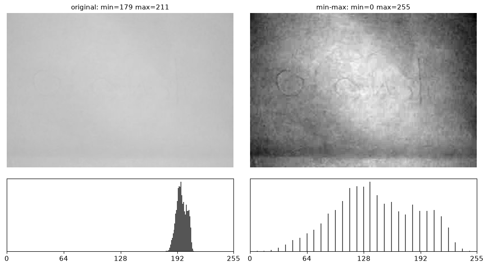{height=600}

# Histograms

## What is a histogram?

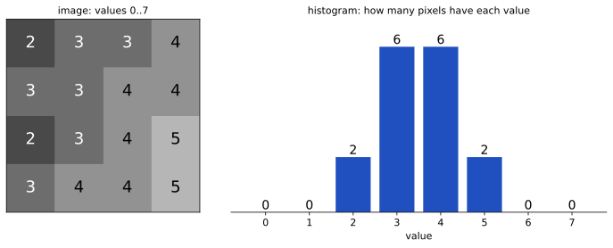{width=100%}

- For each value: how many pixels have it.
- The sum of the histogram is the number of pixels (16 here).
- Where the pixels are is lost — only how many.

## Computing a histogram: a loop

```python
hist = np.zeros(256, dtype=np.int64)
for v in img.ravel():
    hist[v] += 1
```

- `ravel()` — the image as one long 1D array.
- One Python step per pixel: 120,000 steps for a 400 × 300 image, ~25 ms.
- Why `int64`? A count can be as large as the number of pixels: `uint8` stops at 255, `int16` at 32,767.

## 💡 A loop over a list is faster

```python
hist = np.zeros(256, dtype=np.int64)   # a NumPy array
for v in img.ravel():                  # a NumPy array
    hist[v] += 1                       # ~25 ms

hist = [0] * 256                       # a Python list
for v in img.ravel().tolist():         # a list of Python ints
    hist[v] += 1                       # ~3 ms
```

- One element of a NumPy array is read as a new NumPy object (`np.uint8`, `np.int64`), and converted back when written: slow.
- A list holds Python `int`s: no conversions.
- NumPy is fast on whole arrays, slow one element at a time. Fastest: no Python loop at all (`np.bincount`, next).

## Computing a histogram: `np.bincount`

```python
hist = np.bincount(img.ravel(), minlength=256)   # ~0.15 ms
# hist: int64, shape (256,)

np.bincount(np.array([3, 3, 5]))                 # [0 0 0 2 0 1]
```

- Returns `hist`, where `hist[v]` = the number of pixels with value `v`.
- `minlength=256` — without it, the result stops at the largest value (5 above).
- Integers ≥ 0 only: a `float` image raises `TypeError`.

## Computing a histogram: `np.histogram`

```python
hist, edges = np.histogram(img, bins=256, range=(0, 256))   # ~2 ms
# hist: int64, shape (256,)
# edges: float64, shape (257,): 0, 1, 2, ..., 256

hist, edges = np.histogram(img, bins=8, range=(0, 256))
edges[:4]                # [ 0. 32. 64. 96.]: 8 bins, 32 values each
```

- Returns two arrays: the counts, and the bin edges (one more than the bins).
- Works with any numbers (also `float` images) and with wider bins.
- No `ravel()` needed: it flattens the image by itself.

## Computing a histogram: `cv2.calcHist`

```python
hist = cv2.calcHist([img], [0], None, [256], [0, 256])   # ~0.05 ms
hist.dtype            # float32
hist.shape            # (256, 1) in OpenCV 4, (256,) in OpenCV 5
hist = hist.ravel()   # (256,) in both
```

- The arguments are lists: images, channels, mask, number of bins, range.
- `[0]` — the channel; for a color image `[2]` is R (B, G, R!).
- Mask: `None` counts all pixels; a `uint8` mask counts only where it is not 0.
- Counts come back as `float32`, not integers.

## Drawing a histogram

```python
plt.bar(np.arange(256), hist, width=1)
plt.xlim(0, 255)
plt.show()

plt.hist(img.ravel(), bins=256, range=(0, 256))    # counts and draws
```

For a color image: one histogram per channel, `img[:, :, c]`.

## What a histogram tells

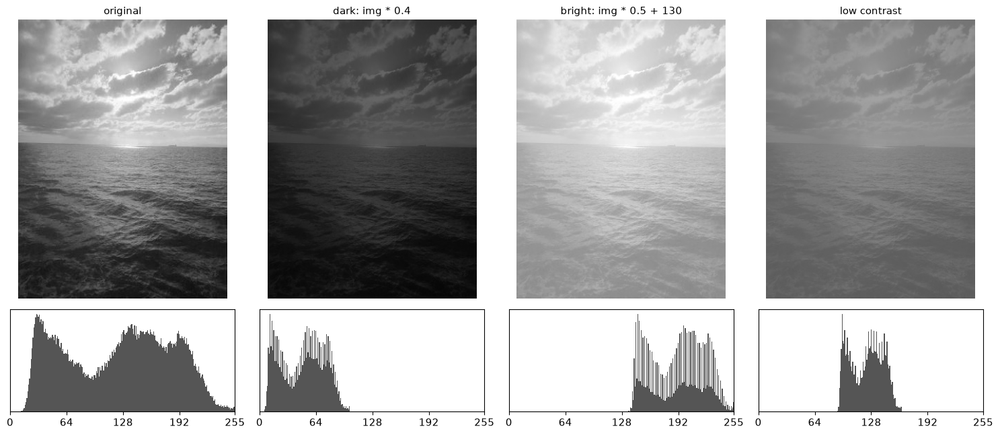{width=100%}

- Dark: on the left. Bright: on the right. Low contrast: narrow.
- Spikes and gaps: a point operation sent several values to one value, or skipped values.

# Histogram equalization

## The idea

- Min-max stretches linearly: a narrow histogram becomes wide, but keeps its shape.
- Equalization: about the same number of pixels for every range of values.
- Values that many pixels have get more room.
- The tool: the cumulative histogram (CDF).

## The CDF

The 4 × 4 image from before, values 0..7:

| value | 0 | 1 | 2 | 3 | 4 | 5 | 6 | 7 |
|---|---|---|---|---|---|---|---|---|
| `hist` | 0 | 0 | 2 | 6 | 6 | 2 | 0 | 0 |
| `cdf` | 0 | 0 | 2 | 8 | 14 | 16 | 16 | 16 |
| new value | 0 | 0 | 0 | 3 | 6 | 7 | 7 | 7 |

- `cdf[v]` = how many pixels have a value ≤ `v`: `hist.cumsum()`.
- new value = round(7 · (`cdf` − 2) / (16 − 2)). 2 is the first non-zero `cdf`, 16 the number of pixels.
- Values 2, 3, 4, 5 become 0, 3, 6, 7: the whole range is used.

## Equalization in NumPy

```python
hist = np.bincount(img.ravel(), minlength=256)
cdf = hist.cumsum()
cdf_min = cdf[cdf > 0].min()                     # the first non-zero value
lut = np.round(255 * (cdf - cdf_min) / (cdf[-1] - cdf_min))
lut = np.clip(lut, 0, 255).astype(np.uint8)
eq = lut[img]                                    # each pixel: lut[its value]

eq_cv = cv2.equalizeHist(img)                    # OpenCV: exactly the same
```

- `cdf[-1]` — the last value of the CDF: the number of pixels.
- `lut[img]` — an array as an index: each value in `img` picks its new value from `lut` (a *lookup table*).

## Equalization: the result

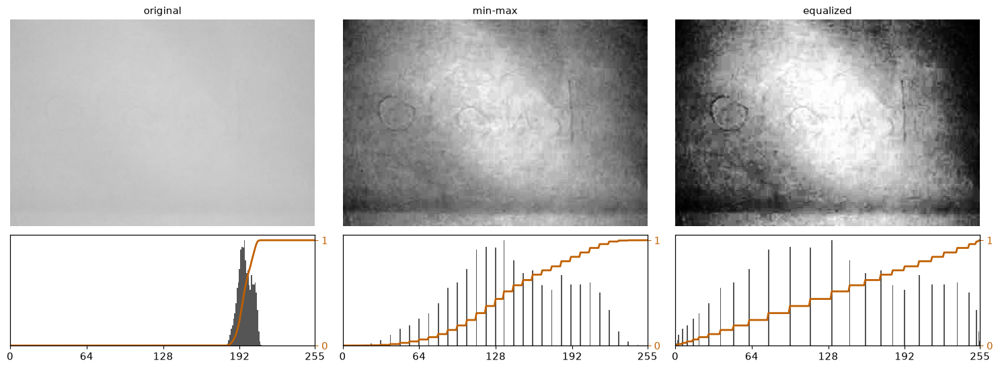{width=100%}

- Orange: the CDF (0 to 1). After equalization it is close to a straight line.
- Not linear: it can also amplify noise and change the look of an image.

# Color models

## An example: dark red

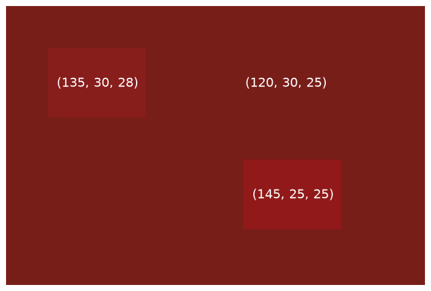{height=400}

- Three regions, all dark red, with low contrast. The (R, G, B) of each region is written on it.
- The file: `images/red_rectangles.png` (PNG, so the values are exact).

## Stretching R, G, B separately

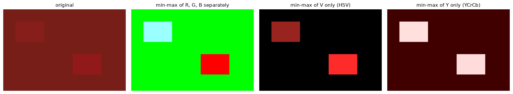{width=100%}

- Min-max on each channel separately: R, G and B are each stretched to 0..255.
- The original is all dark red, but the result is green, light cyan and red. Why? Next slide.

## Stretching R, G, B separately: the numbers

| region | original (R, G, B) | after stretching |
|---|---|---|
| background | <span class="swatch" style="background: rgb(120, 30, 25)"></span> (120, 30, 25) | <span class="swatch" style="background: rgb(0, 255, 0)"></span> (0, 255, 0) |
| top-left rectangle | <span class="swatch" style="background: rgb(135, 30, 28)"></span> (135, 30, 28) | <span class="swatch" style="background: rgb(153, 255, 255)"></span> (153, 255, 255) |
| bottom-right rectangle | <span class="swatch" style="background: rgb(145, 25, 25)"></span> (145, 25, 25) | <span class="swatch" style="background: rgb(255, 0, 0)"></span> (255, 0, 0) |

- Ranges: R 120..145, G 25..30, B 25..28. Each one becomes 0..255.
- G = 30 is the **largest** G in the image → 255, although 30 is very little green.
- A difference of 5 levels in G (invisible) becomes a difference of 255.
- The ratio between R, G and B is the color. To keep the color, change only the brightness.

## Stretching around each channel's mean

```python
f = img.astype(np.float64)
m = f.mean(axis=(0, 1))               # one mean per channel, shape (3,)
out = np.clip((f - m) * 2 + m, 0, 255).astype(np.uint8)
```

| region | original | ×2 | ×5 |
|---|---|---|---|
| background | <span class="swatch" style="background: rgb(120, 30, 25)"></span> (120, 30, 25) | <span class="swatch" style="background: rgb(117, 30, 24)"></span> (117, 30, 24) | <span class="swatch" style="background: rgb(110, 31, 24)"></span> (110, 31, 24) |
| top-left rectangle | <span class="swatch" style="background: rgb(135, 30, 28)"></span> (135, 30, 28) | <span class="swatch" style="background: rgb(147, 30, 30)"></span> (147, 30, 30) | <span class="swatch" style="background: rgb(185, 31, 39)"></span> (185, 31, 39) |
| bottom-right rectangle | <span class="swatch" style="background: rgb(145, 25, 25)"></span> (145, 25, 25) | <span class="swatch" style="background: rgb(167, 20, 24)"></span> (167, 20, 24) | <span class="swatch" style="background: rgb(235, 6, 24)"></span> (235, 6, 24) |

- A gentler stretch: differences are multiplied by 2 (or 5), not blown up to 255.
- The regions stay red. With ×5, the small differences start to show as color.

## The RGB color cube

:::: {.columns}
::: {.column width="55%"}
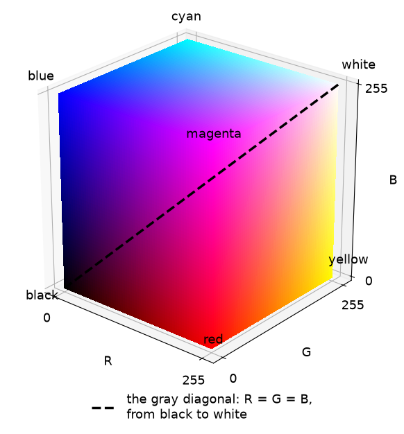{width=100%}
:::
::: {.column width="45%"}
- Every color is a point (R, G, B) in a cube, 0..255 on each axis.
- Corners: black, white, red, green, blue, and their mixes: yellow, cyan, magenta.
- The diagonal from black to white: R = G = B, all the grays.
- Along the diagonal: brightness. Away from it: color.
:::
::::

## Looking along the gray diagonal

:::: {.columns}
::: {.column width="55%"}
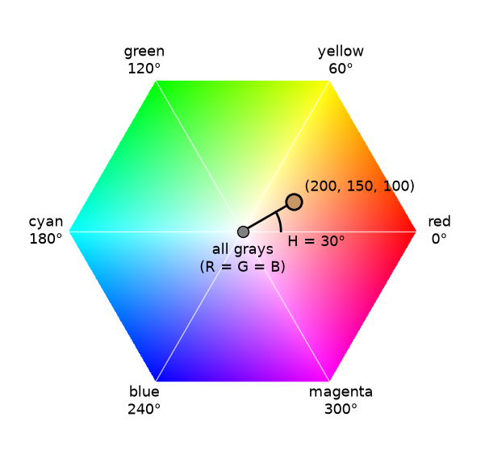{width=100%}
:::
::: {.column width="45%"}
- Look at the cube from white toward black: a hexagon. All grays fall on the center.
- **Hue** (H): the angle around the center. Red 0°, yellow 60°, green 120°, ...
- The distance from the center is `max − min`: 0 for gray.
- **Saturation** (S): that distance, relative to the brightness.
:::
::::

## HSV of one pixel

(R, G, B) = (200, 150, 100):

```text
V = max(R, G, B)                    = 200
S = (max − min) / max = 100 / 200   = 0.5    OpenCV: 0.5 · 255 → 127
H = 60° · (G − B) / (max − min)     = 30°    OpenCV: 30 / 2 = 15
```

```python
pixel = np.uint8([[[100, 150, 200]]])      # an image of 1 x 1 pixels: B, G, R
cv2.cvtColor(pixel, cv2.COLOR_BGR2HSV)     # [[[ 15 127 200]]]
```

- H depends on which channel is the largest (add 360° if negative):
  R: 60° · (G − B) / (max − min); G: 120° + 60° · (B − R) / (max − min); B: 240° + 60° · (R − G) / (max − min).
- Gray (max = min): S = 0, and H has no meaning (OpenCV gives 0).

## HSV

- **H** (hue): which color — the angle around the gray center.
- **S** (saturation): how strong the color is, `(max − min) / max`. 0 = gray.
- **V** (value): the brightness, `max(R, G, B)`.

```python
hsv = cv2.cvtColor(img, cv2.COLOR_BGR2HSV)
```

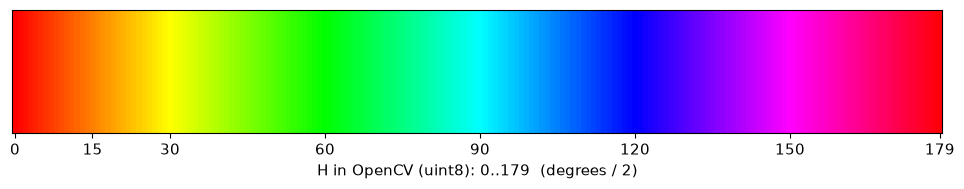{width=75%}

- In `uint8`, H is **0..179** (degrees / 2): 360 does not fit in a byte. S and V are 0..255.

## HSV: the channels

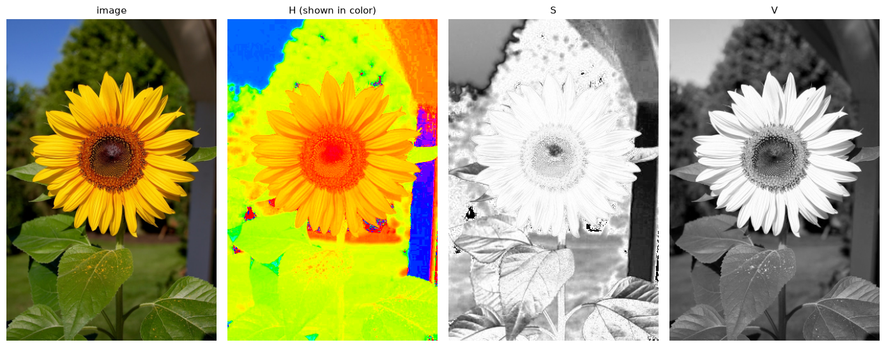{width=100%}

## YCrCb

- **Y**: the brightness — the grayscale formula `0.299 R + 0.587 G + 0.114 B`.
- **Cr**, **Cb**: how much more red / blue than gray. 128 = none.

```python
ycc = cv2.cvtColor(img, cv2.COLOR_BGR2YCrCb)    # the order: Y, Cr, Cb
y = ycc[:, :, 0]                                # the same as COLOR_BGR2GRAY
```

- Used in JPEG and in video: the eye is less sensitive to color than to brightness,
  so Cr and Cb can be stored with less detail.

## Change only the brightness

```python
hsv = cv2.cvtColor(img, cv2.COLOR_BGR2HSV)
hsv[:, :, 2] = cv2.equalizeHist(hsv[:, :, 2])    # or min-max on V
out = cv2.cvtColor(hsv, cv2.COLOR_HSV2BGR)

ycc = cv2.cvtColor(img, cv2.COLOR_BGR2YCrCb)
ycc[:, :, 0] = cv2.equalizeHist(ycc[:, :, 0])    # Y
out = cv2.cvtColor(ycc, cv2.COLOR_YCrCb2BGR)
```

- Convert, change one channel, convert back.
- H and S (or Cr and Cb) are not touched: the color stays.

## A real photo at night

```python
def stretch(ch):                          # one channel, uint8
    lo, hi = np.percentile(ch, [1, 99])   # skip the extreme 1%
    out = (ch.astype(np.float64) - lo) / (hi - lo) * 255
    return np.clip(out, 0, 255).astype(np.uint8)

per_channel = np.dstack([stretch(img[:, :, c]) for c in range(3)])
hsv[:, :, 2] = stretch(hsv[:, :, 2])      # only V
```

- Plain min-max does nothing here: the street lights are 255, and some shadows are 0.
- `np.percentile(ch, [1, 99])` — the values below which 1% and 99% of the pixels are.
- `np.dstack` — stacks the 3 stretched channels back into one `(H, W, 3)` image.

## A real photo at night: the result

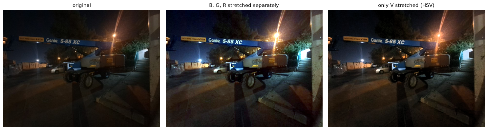{width=100%}

- 1%..99% ranges: B 2..111, G 6..118, R 4..146. B is stretched the most.
- B, G, R separately: average B / R goes from 0.70 to 0.94 — the orange cast of the street lights
  is mostly gone. The colors change (sometimes wanted: a simple white balance).
- Only V: average B / R stays 0.69 — the colors stay as they were, only brighter.

## Selecting by color

```python
hsv = cv2.cvtColor(img, cv2.COLOR_BGR2HSV)
h, s, v = hsv[:, :, 0], hsv[:, :, 1], hsv[:, :, 2]
mask = (h >= 15) & (h <= 35) & (s >= 100) & (v >= 100)   # yellow

gray = cv2.cvtColor(img, cv2.COLOR_BGR2GRAY)
out = cv2.cvtColor(gray, cv2.COLOR_GRAY2BGR)   # gray, but 3 channels
out[mask] = img[mask]                          # color only in the mask
```

- `&` — "and", element by element. The parentheses are required.
- Red is at both ends of H: `(h <= 10) | (h >= 170)`.
- `cv2.inRange(hsv, (15, 100, 100), (35, 255, 255))` — the same mask, as 0 / 255.

## Selecting by color: the result

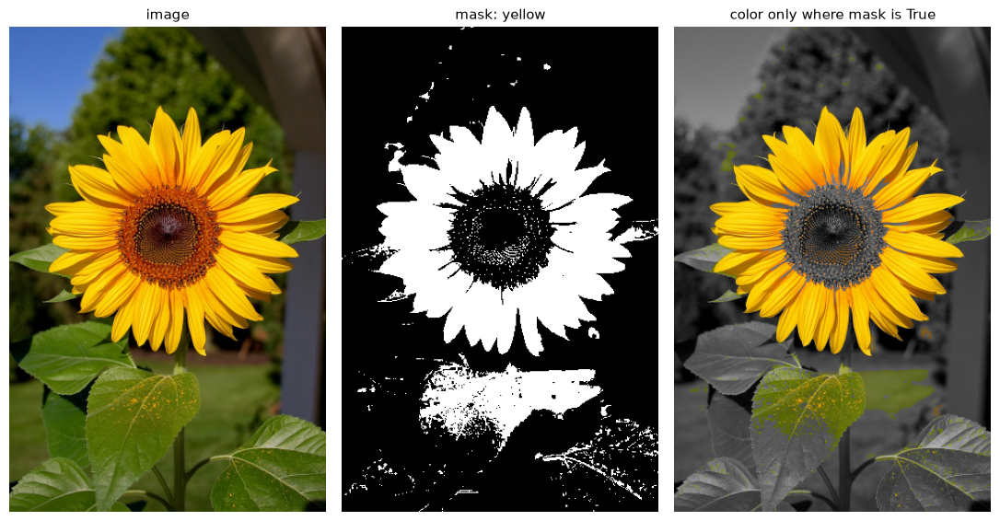{height=600}

# Geometric transformations

## Moving pixels

- Point operations change the **values** of the pixels.
- Geometric transformations change their **positions**: scale, rotate, translate, mirror.
- Two questions:
  - Where does each pixel go? — a matrix.
  - Which value does an output pixel get, between the pixels? — interpolation.

## Coordinates

- The pixel in row `r`, column `c` is the point `(x, y) = (c, r)`.
- x to the right, **y down**. The origin `(0, 0)` is the top-left pixel.
- Arrays: `img[y, x]` — row first. Matrices and OpenCV: `(x, y)`.

## Matrix times vector

$$
\begin{bmatrix} a & b \\ c & d \end{bmatrix}
\begin{bmatrix} x \\ y \end{bmatrix} =
\begin{bmatrix} a x + b y \\ c x + d y \end{bmatrix}
$$

```python
A = np.array([[1, 2],
              [3, 4]])
p = np.array([5, 6])
A @ p          # [17 39]        matrix product
A * p          # [[ 5 12]       element by element (broadcasting)!
               #  [15 24]]
```

## Scaling and rotation

$$
S = \begin{bmatrix} s_x & 0 \\ 0 & s_y \end{bmatrix}
\qquad
R(\theta) = \begin{bmatrix} \cos\theta & -\sin\theta \\ \sin\theta & \cos\theta \end{bmatrix}
$$

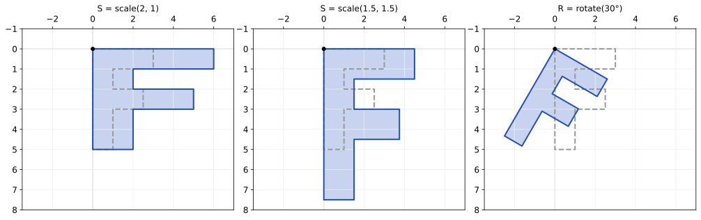{width=100%}

- Dashed: before. Blue: after. The black dot is the origin — it never moves.

## Rotation: which way?

- In math (y up), `R(θ)` with θ > 0 turns **counter-clockwise**.
- In an image (y down), the same matrix turns **clockwise** on the screen.
- `cv2.getRotationMatrix2D(center, angle, scale)`: angle > 0 is counter-clockwise on the screen —
  it uses `R(−angle)`.

## Order matters

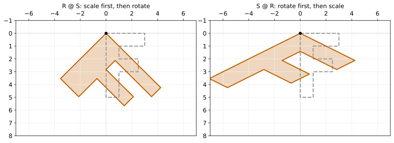{width=90%}

- `R @ S @ p`: first `S`, then `R` — the matrix next to the point acts first.
- `R @ S` and `S @ R` are different transformations.
- Multiply the matrices once, then apply one matrix to all the points.

## Translation is not a 2×2 matrix

- Translation: `(x, y)` → `(x + tx, y + ty)`.
- Any 2×2 matrix sends `(0, 0)` to `(0, 0)`, so it cannot translate.
- The trick — **homogeneous coordinates**: add a 1, `(x, y)` → `(x, y, 1)`.

## Homogeneous coordinates

$$
T = \begin{bmatrix} 1 & 0 & t_x \\ 0 & 1 & t_y \\ 0 & 0 & 1 \end{bmatrix}
\qquad
T \begin{bmatrix} x \\ y \\ 1 \end{bmatrix} = \begin{bmatrix} x + t_x \\ y + t_y \\ 1 \end{bmatrix}
\qquad
R = \begin{bmatrix} \cos\theta & -\sin\theta & 0 \\ \sin\theta & \cos\theta & 0 \\ 0 & 0 & 1 \end{bmatrix}
$$

- Every transformation is now a 3×3 matrix, and composing is multiplying: `M = T @ R @ S`.
- The last row is always `[0, 0, 1]`. OpenCV uses only the top 2 rows: a 2×3 matrix, `M[:2]`.

## Rotating around the center

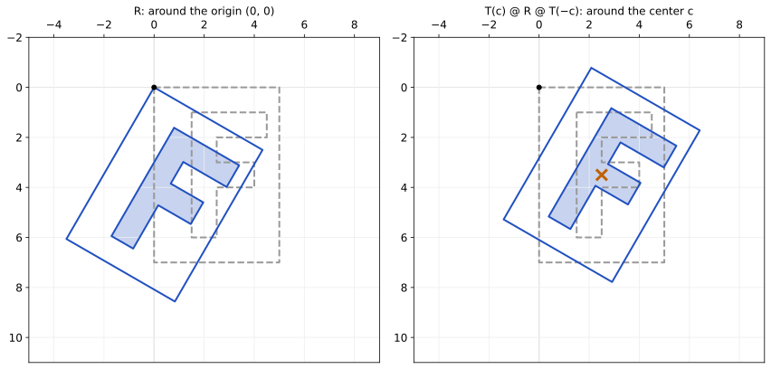{width=85%}

- `R` alone rotates around `(0, 0)` — the top-left corner.
- Around the center `c`: move `c` to the origin, rotate, move back — `T(c) @ R @ T(−c)`.

## Rotating around the center: code

```python
cx, cy = (w - 1) / 2, (h - 1) / 2          # the center pixel
to_origin = np.array([[1, 0, -cx],
                      [0, 1, -cy],
                      [0, 0, 1]])
back = np.array([[1, 0, cx],
                 [0, 1, cy],
                 [0, 0, 1]])
M = back @ rotate @ to_origin               # rotate: R as a 3x3 matrix

cv2.getRotationMatrix2D((cx, cy), -30, 1.0)  # == M[:2] for a 30° rotate
```

- The center stays in place; every other point turns around it.

# Warping images

## Forward mapping: holes

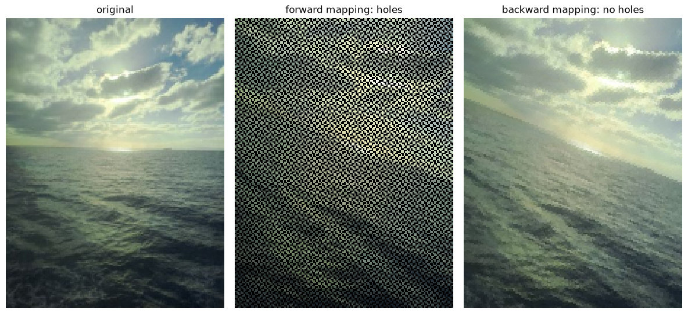{height=420}

- Forward: for each **source** pixel, compute where it goes, and round.
- Some output pixels get no value (holes), others get two.

## Backward mapping

- For each **output** pixel `(x, y)`: where did it come from?
  `(sx, sy, 1) = M⁻¹ (x, y, 1)` — the inverse matrix.
- Every output pixel gets exactly one value: no holes.
- `(sx, sy)` is usually not a whole number → interpolation.
- If `(sx, sy)` is outside the source image: black.

## Backward mapping: a loop

```python
M_inv = np.linalg.inv(M)                 # the inverse, computed once
out = np.zeros_like(img)
for y in range(h):
    for x in range(w):
        sx, sy, _ = M_inv @ (x, y, 1)    # where does (x, y) come from?
        c, r = round(sx), round(sy)      # the nearest source pixel
        if 0 <= r < h and 0 <= c < w:
            out[y, x] = img[r, c]
```

- `round` — **nearest neighbor**: the value of the closest pixel.
- About 1 second for a 400 × 300 image.

## Interpolation

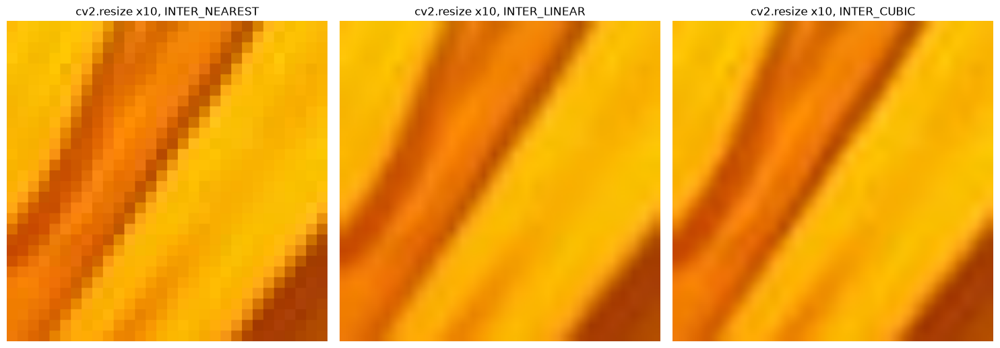{width=100%}

- **Nearest neighbor**: the closest pixel. Fast, blocky.
- **Bilinear**: a weighted average of the 4 surrounding pixels. Smooth.
- **Bicubic**: 16 pixels (4 × 4). Sharper edges, slower.

## Bilinear interpolation

:::: {.columns}
::: {.column width="45%"}
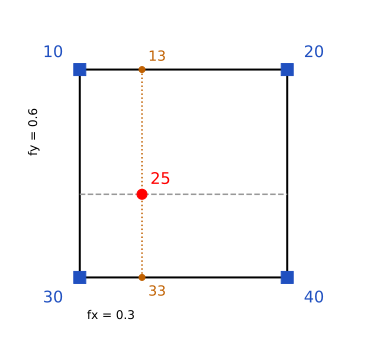{width=100%}
:::
::: {.column width="55%"}
- `fx`, `fy` — the fractional parts of `sx`, `sy`.
- Top, along x: 10 + 0.3 · (20 − 10) = 13.
- Bottom, along x: 30 + 0.3 · (40 − 30) = 33.
- Then along y: 13 + 0.6 · (33 − 13) = **25**.
- The closer a corner, the larger its weight.
:::
::::

## Where exactly is a pixel?

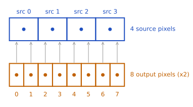{.nostretch width=42%}

- Resize ×2, matching the **centers**: `src = (dst + 0.5) / 2 − 0.5`.
- `cv2.resize`: `[0 100 200 250]` → `[0 25 75 125 175 212.5 237.5 250]`
- `src = dst / 2`: `[0 50 100 150 200 225 250 250]` — half a pixel off.
- No 0.5: `cv2.warpAffine`, `INTER_NEAREST`. With 0.5: `INTER_NEAREST_EXACT`.

## A vectorized warp

```python
ys, xs = np.indices((h, w))                  # y, x of every output pixel
coords = np.stack([xs.ravel(), ys.ravel(), np.ones(h * w)])   # (3, h*w)
sx, sy, _ = np.linalg.inv(M) @ coords        # all pixels in one product
c = np.round(sx).astype(int).reshape(h, w)
r = np.round(sy).astype(int).reshape(h, w)

inside = (r >= 0) & (r < h) & (c >= 0) & (c < w)
out = np.zeros_like(img)
out[inside] = img[r[inside], c[inside]]      # all pixels at once
```

- `np.indices((2, 3))` → y: `[[0 0 0] [1 1 1]]`, x: `[[0 1 2] [0 1 2]]`.
- `img[r, c]` with arrays `r`, `c`: one pixel for each pair `(r[i], c[i])`.

## The result

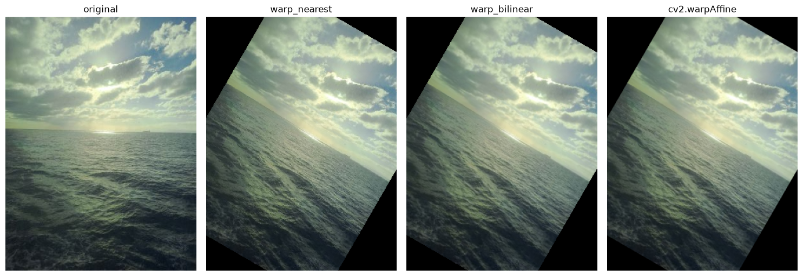{width=100%}

- Bilinear in NumPy and bilinear in `cv2.warpAffine` differ by at most 1–2 inside the image.

## OpenCV

```python
M = cv2.getRotationMatrix2D((cx, cy), 30, 1.0)               # 2x3
out = cv2.warpAffine(img, M, (w, h))                          # bilinear
out = cv2.warpAffine(img, M, (w, h), flags=cv2.INTER_NEAREST)

small = cv2.resize(img, None, fx=0.5, fy=0.5, interpolation=cv2.INTER_AREA)
big = cv2.resize(img, (2 * w, 2 * h), interpolation=cv2.INTER_CUBIC)
```

- Sizes in OpenCV are **(width, height)** — the opposite of `img.shape`.
- Shrinking: `INTER_AREA` averages the pixels; nearest and bilinear skip pixels.

## How fast?

Rotating a 400 × 300 color image by 30°:

| | time |
|---|---|
| Python loop, nearest | ~1000 ms |
| NumPy, nearest | ~10 ms |
| NumPy, bilinear | ~45 ms |
| `cv2.warpAffine`, bilinear | ~0.3 ms |

- Loop → NumPy: ~100× faster. NumPy → OpenCV: ~100× faster again.
- OpenCV's first call is slower (~100 ms): measure more than once.
