# Introduction

## The human eye

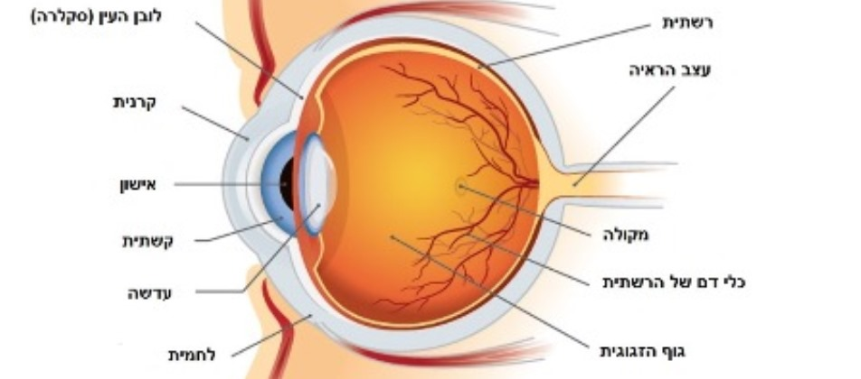{width=100%}

[Source: Soroka Medical Center website]{.small}

## The retina

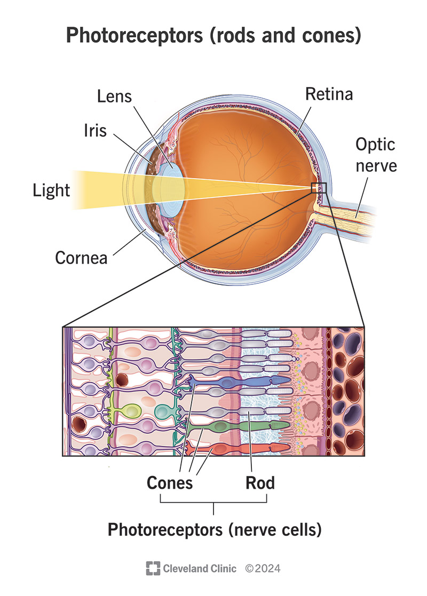{height=600}

## Sensitivity to color

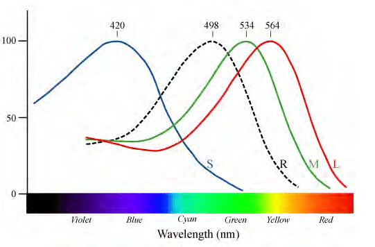{width=80%}

[Source: researchgate.net/figure/Normalized-spectral-sensitivity-of-retinal-rod-and-cone-cells_fig7_265155524]{.small}

## RGB color model

:::: {.columns}
::: {.column width="30%"}
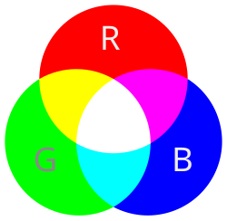{width=100%}
:::
::: {.column width="70%"}
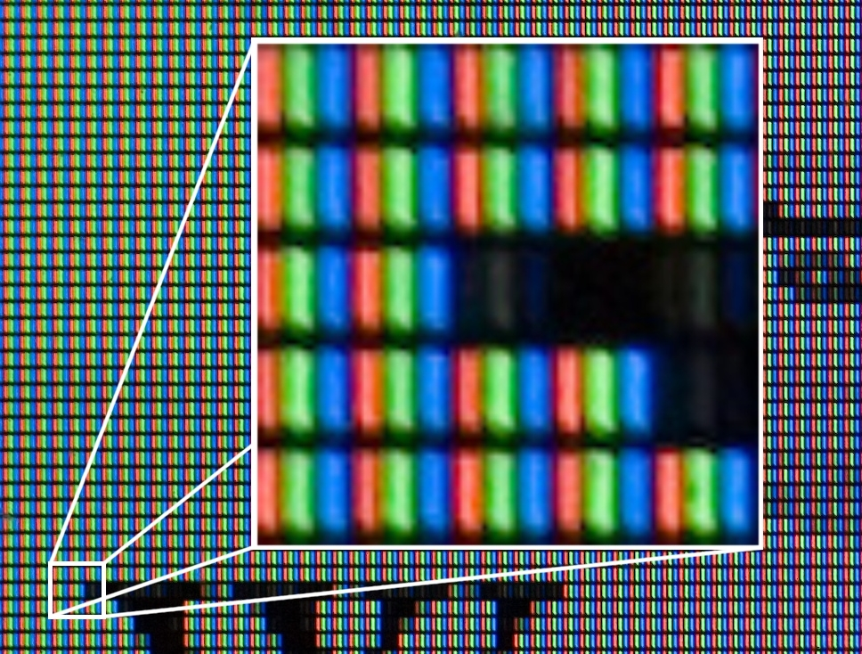{width=100%}
:::
::::

## RGB vs CMYK

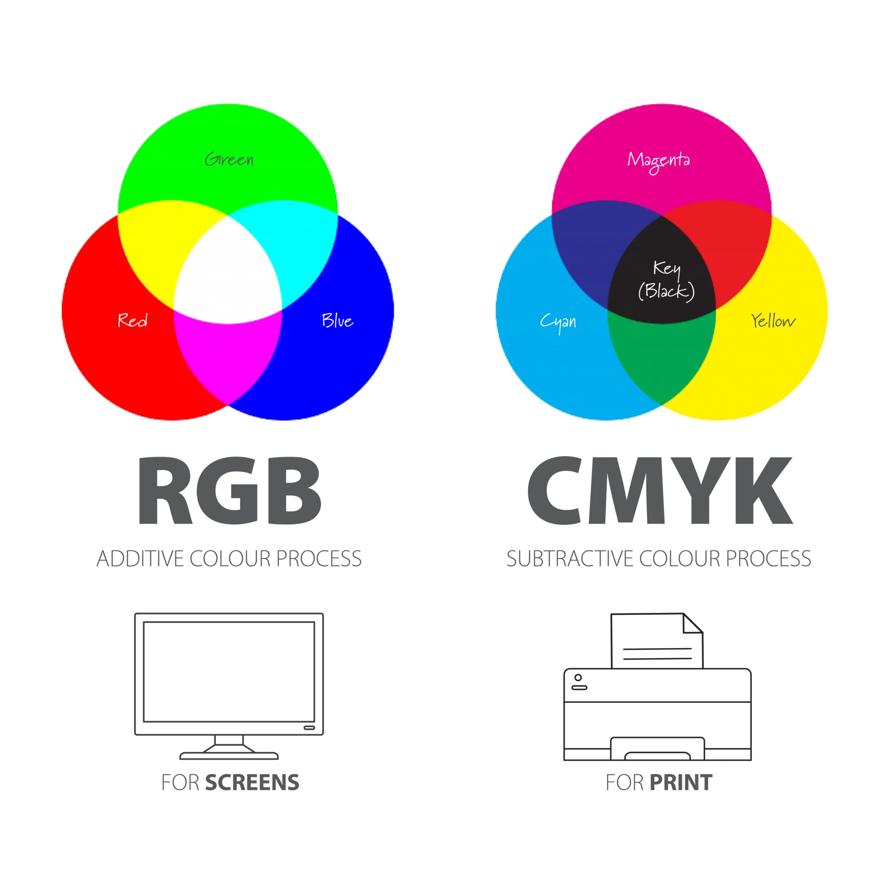{height=600}

# Images in memory

## An image as a 3D array

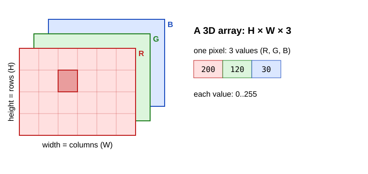{width=100%}

## An image is an array of numbers

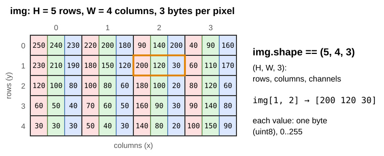{width=100%}

## In memory: one block of bytes

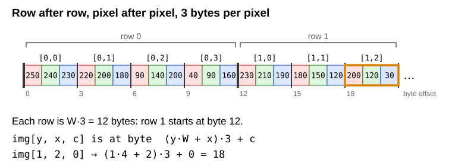{width=100%}

## Three planes: a logical view

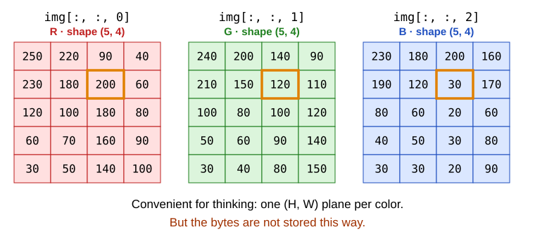{width=100%}

## One channel is a view

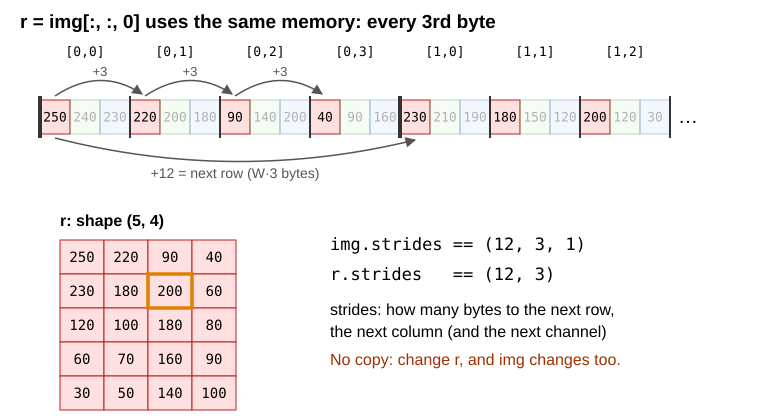{width=100%}

## OpenCV: B, G, R

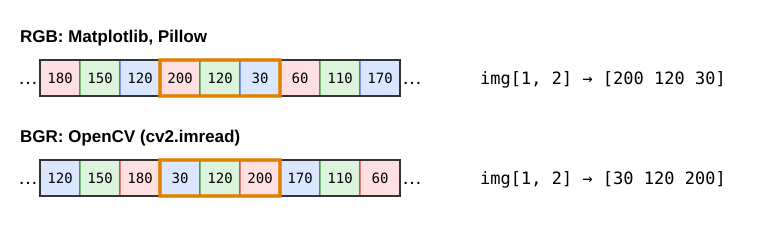{width=85%}

- `cv2.imread` gives **B, G, R**: `img[:, :, 0]` is the **blue** channel.
- Matplotlib expects R, G, B: `cv2.cvtColor(img, cv2.COLOR_BGR2RGB)`.
- Why? History: OpenCV started at Intel in 1999, when B, G, R was common
  in cameras and in Windows bitmaps (BMP files store B, G, R). It stayed for compatibility.

## Three planes, or one

- Color image: `shape == (H, W, 3)` — rows, columns, channels.
- Grayscale image: `shape == (H, W)` — one plane.
- Rows first: `img[row, col]` — that is `img[y, x]`, **not** `img[x, y]`.
- Size: 1920 × 1080 × 3 = 6,220,800 bytes ≈ 6 MB (before compression).
- JPEG/PNG files are compressed; in memory the image is the full array.

## A byte

- 8 bits → 2^8^ = 256 values → `0 .. 255`.
- `00000000` = 0, `11111111` = 255.
- 0 = no light (black), 255 = full intensity.
- What is 255 + 1 in one byte?

. . .

`11111111 + 1 = 1 00000000` → the 9th bit does not fit → **0**

# NumPy

## Why not Python lists?

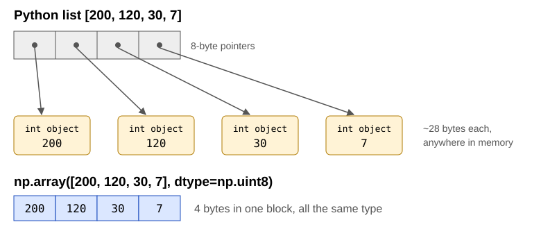{width=100%}

## Why not Python loops?

Brighten a 300 × 400 color image (360,000 values):

| | time |
|---|---|
| Python loop | ~100 ms |
| NumPy | ~1 ms |

- About 100× faster. A 12-megapixel photo with a loop: **~10 seconds**.
- NumPy runs the loop in compiled C code, over one block of memory of one type.
- See `code/loop_vs_numpy.py`.

## Every array has a type: `dtype`

```python
import numpy as np

a = np.array([[10, 100, 200],
              [50, 150, 250]], dtype=np.uint8)
```

| dtype | bytes | range |
|---|---|---|
| `np.uint8` | 1 | 0 .. 255 |
| `np.int16` | 2 | −32,768 .. 32,767 |
| `np.int32` | 4 | about ±2.1 billion |
| `np.float32` | 4 | ~7 significant digits |
| `np.float64` | 8 | ~16 significant digits |

Images are almost always `uint8`.

## Array attributes

```python
a.dtype      # uint8
a.shape      # (2, 3)  -> (rows, columns)
a.ndim       # 2       -> number of dimensions
a.size       # 6       -> number of elements
a.itemsize   # 1       -> bytes per element
a.nbytes     # 6       -> size * itemsize
a[1, 2]      # 250     -> row 1, column 2
```

For a color image: `shape == (H, W, 3)`, `ndim == 3`.

## Creating arrays

```python
np.zeros((3, 4), dtype=np.uint8)            # all 0
np.ones((3, 4), dtype=np.float32)           # all 1.0
np.full((3, 4), 7, dtype=np.uint8)          # all 7
np.arange(12)                               # 0, 1, ..., 11
np.arange(12).reshape(3, 4)                 # same values, shape (3, 4)
np.zeros((480, 640, 3), dtype=np.uint8)     # a black color image
```

## Operations are elementwise

```python
a + 10        # adds 10 to every element
a * 2         # multiplies every element
a + a         # element by element
a.min(), a.max(), a.mean(), a.sum()
a.max(axis=0) # max of each column
a.max(axis=1) # max of each row
```

No loops: one expression works on the whole array.

## `max(axis=...)`: the axis you name disappears

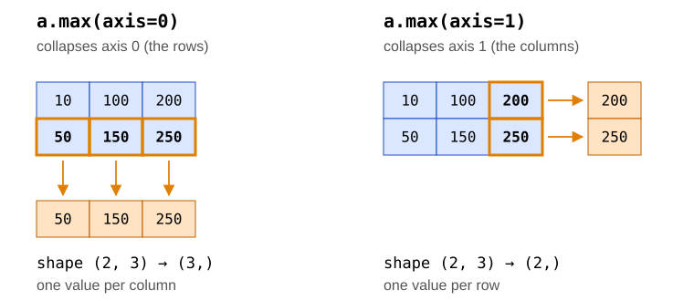{width=100%}

- The axis you give is the one that is **collapsed**: all values along it become one value.
- `axis=0` runs down the rows → one result per column. `axis=1` runs along a row → one result per row.
- The same for `min`, `sum`, `mean`, ...

## A 3D array: `axis=1`

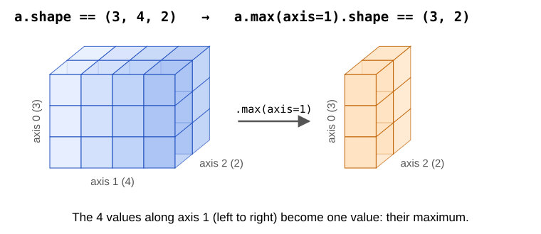{width=100%}

- Shape `(3, 4, 2)` without axis 1 → `(3, 2)`. Rule: remove the named axis from the shape.
- For an image `img` with shape `(H, W, 3)`:

```python
img.max(axis=2)        # (H, W): the brightest channel of each pixel
img.max(axis=(0, 1))   # (3,):   the max of each channel
```

## `axis=1`, with numbers

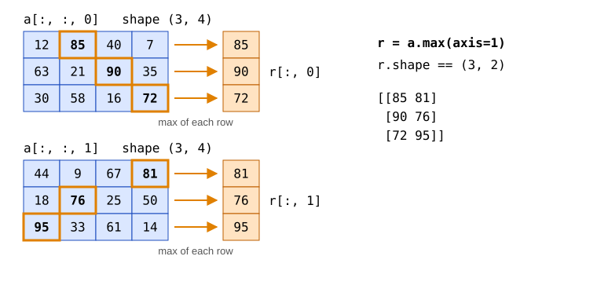{width=100%}

Each depth slice `a[:, :, d]` is a 2D plane — like a color channel `img[:, :, c]`.

## Overflow: `uint8` wraps around

```python
a = np.array([[10, 100, 200],
              [50, 150, 250]], dtype=np.uint8)
a + 10
# [[ 20 110 210]
#  [ 60 160   4]]     <- 250 + 10 = 260 = 256 + 4
a - 20
# [[246  80 180]     <- 10 - 20 = -10 = 246 - 256
#  [ 30 130 230]]
```

- The result of `uint8 + int` is `uint8`, computed **modulo 256**.
- No error, no warning.

## Other surprises

```python
a + 300       # OverflowError: Python integer 300 out of bounds for uint8
a * 1.5       # float64 array: [[ 15. 150. 300.] [ 75. 225. 375.]]
a.sum()       # 760 (NumPy uses a bigger type for sums)
```

The safe way back to an image:

```python
b = a * 1.5                                  # float64
c = np.clip(b, 0, 255).astype(np.uint8)      # [[ 15 150 255] [ 75 225 255]]
```

- `np.clip` — values below 0 become 0, above 255 become 255.
- `astype` — converts to another type. Without `clip`, out-of-range values give garbage.

## Exercises

Exercises 1–3 in the exercises file.

# Libraries

## Python image libraries

- **Pillow (PIL)**: "object oriented", keeps metadata, easy to install, slower.
- **OpenCV (`cv2`)**: written in C/C++ with a Python wrapper. Industry standard, optimized for speed.
  Images are NumPy arrays.
- **NumPy**: n-dimensional arrays with fast operations.
- **Matplotlib**: plots — and showing images.

```bash
pip install numpy opencv-python matplotlib pillow
```

## Command-line arguments: `sys.argv`

```bash
python ex04.py ../images/ocean.jpg
```

```python
import sys

print(sys.argv)          # ['ex04.py', '../images/ocean.jpg']
filename = sys.argv[1]   # the first argument after the program name
```

- `sys.argv` is a list of strings: the program name, then each word typed after it.
- No argument → `sys.argv` is `['ex04.py']`, and `sys.argv[1]` raises `IndexError`.
- A name with spaces needs quotes: `python ex04.py "my photo.jpg"`.
- The path is relative to the folder the terminal is in, not to the `.py` file.

## Checking the arguments

```python
import sys

if len(sys.argv) != 2:
    print("Usage: python ex04.py <image file>")
    sys.exit(1)

filename = sys.argv[1]
```

- `sys.exit(1)` stops the program. A non-zero value means "something went wrong".
- In VS Code, the ▷ Run button passes no arguments: run the program from the terminal instead.

## Reading an image with OpenCV

```python
import sys
import cv2

filename = sys.argv[1]      # check len(sys.argv) first, as before
img = cv2.imread(filename)
if img is None:
    print("failed to read", filename)
    sys.exit(1)
print(type(img), img.dtype, img.shape)
# <class 'numpy.ndarray'> uint8 (400, 300, 3)
print(img[0, 0])
# [122 133 117]   <- B, G, R !
```

- `cv2.imread` does **not** raise an error for a missing file — it returns `None`.
- `cv2.imread(name, cv2.IMREAD_GRAYSCALE)` → 2D array.

## Showing an image with Matplotlib

```python
import matplotlib.pyplot as plt

rgb = cv2.cvtColor(img, cv2.COLOR_BGR2RGB)   # OpenCV: BGR, Matplotlib: RGB
plt.imshow(rgb)
plt.savefig("rgb.png")    # save the figure to a file
plt.show()

gray = cv2.imread(filename, cv2.IMREAD_GRAYSCALE)
plt.imshow(gray, cmap="gray", vmin=0, vmax=255)
plt.show()
```

- Without `vmin=0, vmax=255`, Matplotlib stretches each gray image to its own min..max —
  and brightness changes become invisible.
- Call `plt.savefig` **before** `plt.show()`: once the window is closed, the figure is gone.

## The channels

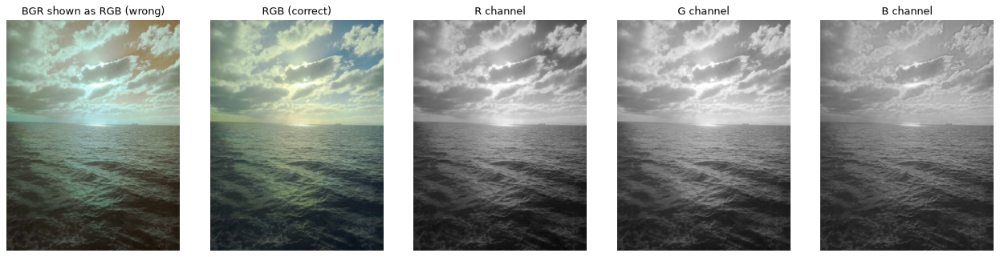{width=100%}

`code/show_image.py`

## Brightness and contrast

- **Brightness**: add a constant to every pixel — `img + b`.
- **Contrast**: multiply every pixel by a factor — `img * k`.
- What happens to pixels that go above 255?

## NumPy vs OpenCV

```python
img + 100                  # NumPy: wraps around (modulo 256)
cv2.add(img, 100)          # OpenCV: saturates — above 255 becomes 255
```

NumPy, done right:

```python
img16 = img.astype(np.int16)           # room for values above 255
bright16 = img16 + 100                 # int16: no wrap-around
clipped = np.clip(bright16, 0, 255)    # back into 0..255 (still int16)
bright = clipped.astype(np.uint8)      # an image again
```

- Why `int16`? Because `uint8 + 100` already wrapped around before `clip` could see it.
- `code/brightness_contrast.py`

## The result

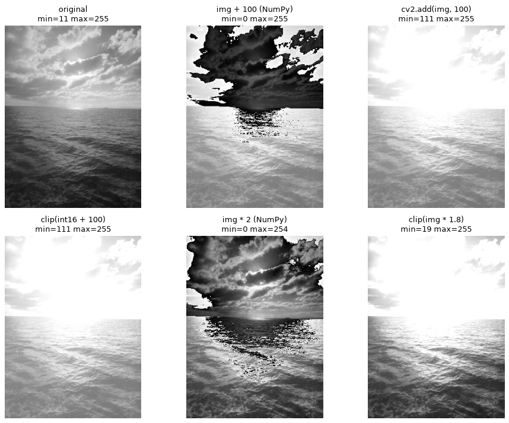{height=600}

## Exercise

Exercises 4–6 in the exercises file.

# Indexing and vectorization

## Indexing and slicing

```python
img[10, 20]          # one pixel: [B G R]
img[10, 20, 2]       # one value: the R of that pixel
img[:, :, 2]         # the R plane, shape (H, W)
img[100:200, 50:150] # a crop: rows 100..199, columns 50..149
img[::2, ::2]        # every second row and column: half size
img[::-1, :]         # rows in reverse: upside down
img[:, ::-1]         # columns in reverse: mirror
```

`start:stop:step` — like Python lists, but one per dimension.

## Views, not copies

```python
crop = img[100:200, 50:150]
crop[:] = 0              # img changes too!

crop = img[100:200, 50:150].copy()
crop[:] = 0              # img does not change
```

- Slicing gives a **view**: a new array object that uses the same memory.
- Fast (nothing is copied), but changes go to the original.
- Use `.copy()` when you need an independent array.

## Broadcasting

```python
img.shape                               # (400, 300, 3)
weights = np.array([0.114, 0.587, 0.299])   # B, G, R
(img * weights).shape                   # (400, 300, 3)
```

- Shapes are compared from the **last** dimension.
- Sizes must be equal, or one of them must be 1 (or missing).
- `(400, 300, 3) * (3,)` → each pixel's 3 values are multiplied by the 3 weights.
- `img + 10` is broadcasting too: a scalar fits any shape.

## Grayscale

The eye is most sensitive to green and least to blue:

$$Y = 0.299\,R + 0.587\,G + 0.114\,B$$

```python
weights = np.array([0.114, 0.587, 0.299])          # B, G, R
gray = (img * weights).sum(axis=2)                 # float64, shape (H, W)
gray = np.clip(gray, 0, 255).astype(np.uint8)

gray_cv = cv2.cvtColor(img, cv2.COLOR_BGR2GRAY)    # OpenCV: almost the same
```

`axis=2` — sum over the channels; the result has one dimension less.

## Boolean masks

```python
mask = gray > 200         # array of True/False, same shape as gray
mask.sum()                # how many pixels are brighter than 200
gray[mask] = 255          # set only those pixels
gray[gray < 50] = 0       # in one line

result = np.where(mask, 255, 0).astype(np.uint8)   # if / else for every pixel
```

## Timing code

```python
import time

start = time.perf_counter()
result = brighten_loop(img, 50)
elapsed = time.perf_counter() - start
print(f"{elapsed * 1000:.2f} ms")
```

- Measure, don't guess.
- Measure more than once — the first run is often slower.
- `code/loop_vs_numpy.py`

## Class exercise

Exercises 7–10 in the exercises file.
