# Introduction

## The human eye

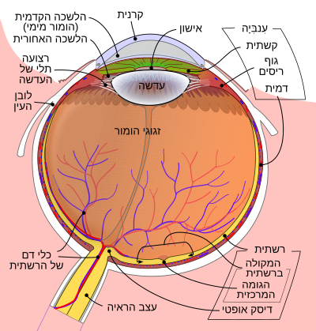{height=530 fig-align="center"}

[Source: Rhcastilhos, translated by benherz and Jmarchn, [Wikimedia Commons](https://commons.wikimedia.org/wiki/File:Schematic_diagram_of_the_human_eye_he.svg), CC BY-SA 3.0]{.small}

## The retina

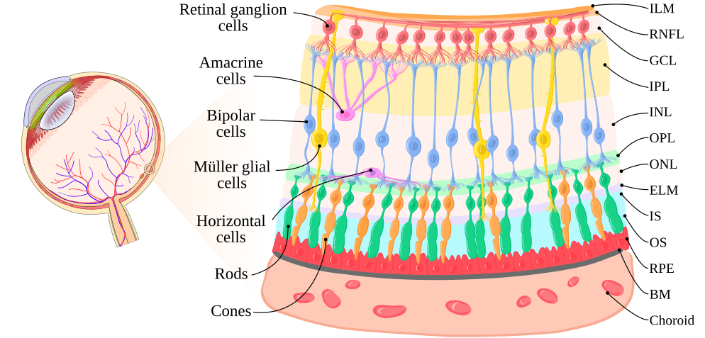{height=520 fig-align="center"}

[Source: Bfazek, [Wikimedia Commons](https://commons.wikimedia.org/wiki/File:Schematic_diagram_of_the_eye_and_retina.svg), CC BY-SA 4.0]{.small}

## Sensitivity to color

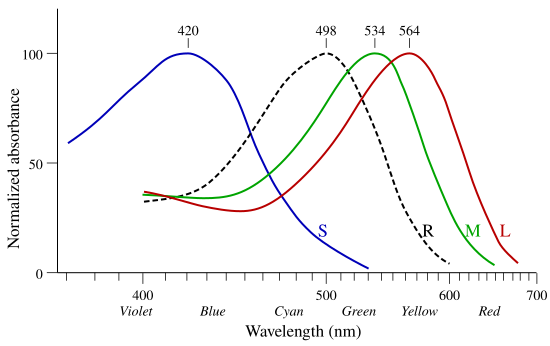{width=80%}

[Source: Maxim Razin, DrBob and Zeimusu (after Bowmaker and Dartnall, 1980), [Wikimedia Commons](https://commons.wikimedia.org/wiki/File:Cone-response-en.svg), CC BY-SA 3.0]{.small}

## RGB color model

:::: {.columns}
::: {.column width="35%"}
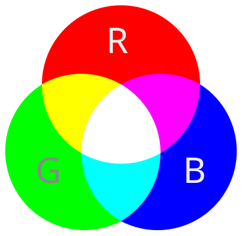{width=100%}
:::
::: {.column width="65%"}
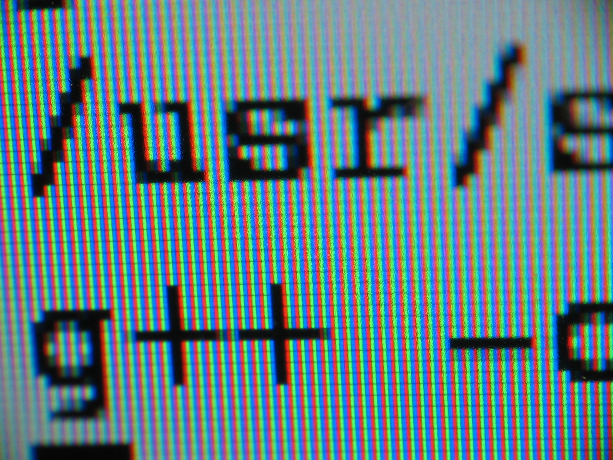{width=100%}
:::
::::

[Sources: Immanuelle, [Venn diagram rgb](https://commons.wikimedia.org/wiki/File:Venn_diagram_rgb.svg), CC BY-SA 4.0; Daniel Schwen, [LCD Pixels Macro](https://commons.wikimedia.org/wiki/File:LCD_Pixels_Macro.jpg), CC BY-SA 2.5 (both Wikimedia Commons)]{.small}

## RGB vs CMYK

:::: {.columns}
::: {.column width="50%"}
{width=100%}
:::
::: {.column width="50%"}
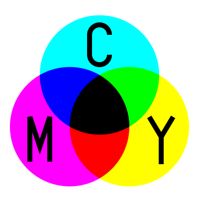{width=100%}
:::
::::

[Sources: Immanuelle, [Venn diagram rgb](https://commons.wikimedia.org/wiki/File:Venn_diagram_rgb.svg), CC BY-SA 4.0; SharkD and others, [SubtractiveColor](https://commons.wikimedia.org/wiki/File:SubtractiveColor.svg), public domain (both Wikimedia Commons)]{.small}

## CMYK: four inks

{width=100%}

[Source: Magica, [Subtractive color synthesis CMYK](https://commons.wikimedia.org/wiki/File:Subtractive_color_synthesis_CMYK.jpg), Wikimedia Commons, CC BY-SA 4.0]{.small}

# Images in memory

## An image as a 3D array

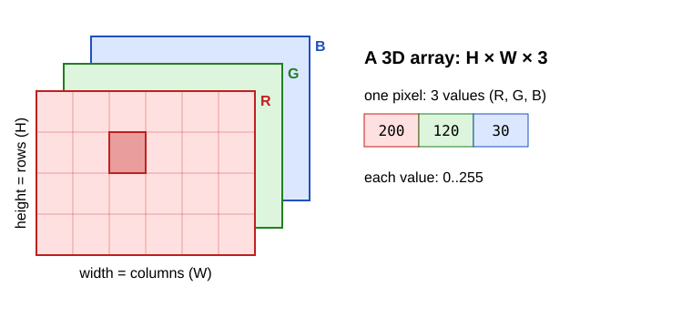{width=100%}

## An image is an array of numbers

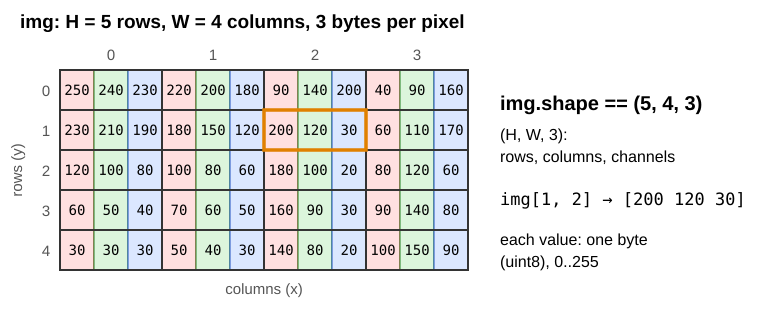{width=100%}

## In memory: one block of bytes

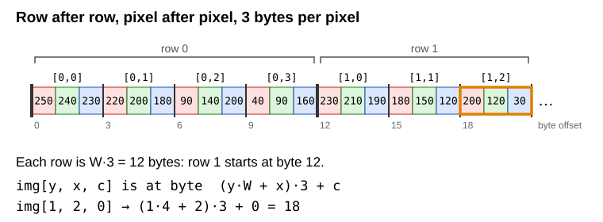{width=100%}

## Three planes: a logical view

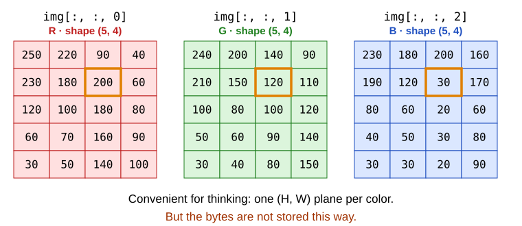{width=100%}

## One channel is a view

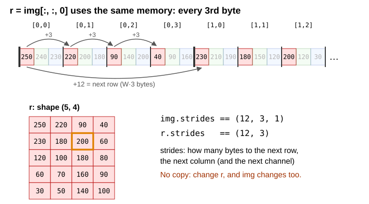{width=100%}

## OpenCV: B, G, R

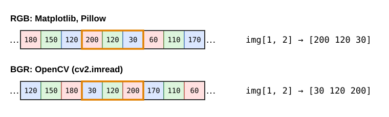{width=85%}

- `cv2.imread` gives **B, G, R**: `img[:, :, 0]` is the **blue** channel.
- Matplotlib expects R, G, B: `cv2.cvtColor(img, cv2.COLOR_BGR2RGB)`.
- Why? History: OpenCV started at Intel in 1999, when B, G, R was common
  in cameras and in Windows bitmaps (BMP files store B, G, R). It stayed for compatibility.

## Three planes, or one

- Color image: `shape == (H, W, 3)` — rows, columns, channels.
- Grayscale image: `shape == (H, W)` — one plane.
- Rows first: `img[row, col]` — that is `img[y, x]`, **not** `img[x, y]`.
- Size: 1920 × 1080 × 3 = 6,220,800 bytes ≈ 6 MB (before compression).
- JPEG/PNG files are compressed; in memory the image is the full array.

## A byte

- 8 bits → 2^8^ = 256 values → `0 .. 255`.
- `00000000` = 0, `11111111` = 255.
- 0 = no light (black), 255 = full intensity.
- What is 255 + 1 in one byte?

. . .

`11111111 + 1 = 1 00000000` → the 9th bit does not fit → **0**

# NumPy

## Why not Python lists?

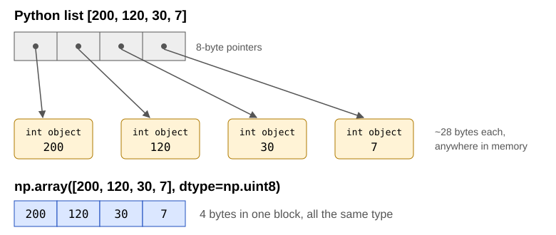{width=100%}

## Why not Python loops?

Brighten a 300 × 400 color image (360,000 values):

| | time |
|---|---|
| Python loop | ~100 ms |
| NumPy | ~1 ms |

- About 100× faster. A 12-megapixel photo with a loop: **~10 seconds**.
- NumPy runs the loop in compiled C code, over one block of memory of one type.
- See `code/loop_vs_numpy.py`.

## Every array has a type: `dtype`

```python
import numpy as np

a = np.array([[10, 100, 200],
              [50, 150, 250]], dtype=np.uint8)
```

| dtype | bytes | range |
|---|---|---|
| `np.uint8` | 1 | 0 .. 255 |
| `np.int16` | 2 | −32,768 .. 32,767 |
| `np.int32` | 4 | about ±2.1 billion |
| `np.float32` | 4 | ~7 significant digits |
| `np.float64` | 8 | ~16 significant digits |

Images are almost always `uint8`.

## Array attributes

```python
a.dtype      # uint8
a.shape      # (2, 3)  -> (rows, columns)
a.ndim       # 2       -> number of dimensions
a.size       # 6       -> number of elements
a.itemsize   # 1       -> bytes per element
a.nbytes     # 6       -> size * itemsize
a[1, 2]      # 250     -> row 1, column 2
```

For a color image: `shape == (H, W, 3)`, `ndim == 3`.

## Creating arrays

```python
np.zeros((3, 4), dtype=np.uint8)            # all 0
np.ones((3, 4), dtype=np.float32)           # all 1.0
np.full((3, 4), 7, dtype=np.uint8)          # all 7
np.arange(12)                               # 0, 1, ..., 11
np.arange(12).reshape(3, 4)                 # same values, shape (3, 4)
np.zeros((480, 640, 3), dtype=np.uint8)     # a black color image
```

## Operations are elementwise

```python
a + 10        # adds 10 to every element
a * 2         # multiplies every element
a + a         # element by element
a.min(), a.max(), a.mean(), a.sum()
a.max(axis=0) # max of each column
a.max(axis=1) # max of each row
```

No loops: one expression works on the whole array.

## `max(axis=...)`: the axis you name disappears

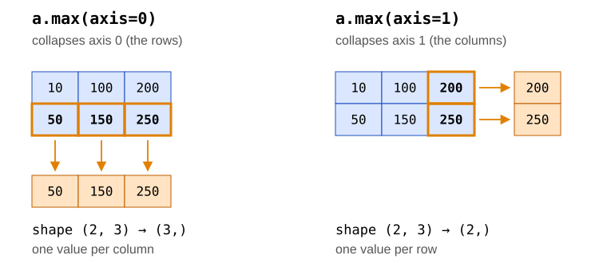{width=100%}

- The axis you give is the one that is **collapsed**: all values along it become one value.
- `axis=0` runs down the rows → one result per column. `axis=1` runs along a row → one result per row.
- The same for `min`, `sum`, `mean`, ...

## A 3D array: `axis=1`

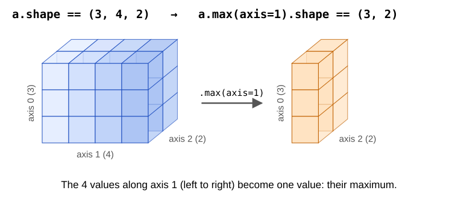{width=100%}

- Shape `(3, 4, 2)` without axis 1 → `(3, 2)`. Rule: remove the named axis from the shape.

## `axis=1`, with numbers

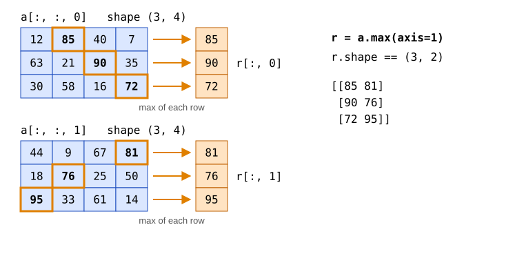{width=100%}

Each depth slice `a[:, :, d]` is a 2D plane — like a color channel `img[:, :, c]`.

## Images: `axis` can be a tuple

For an image `img` with shape `(H, W, 3)`:

```python
img.max(axis=2)          # (H, W): the brightest channel of each pixel
img.mean(axis=(0, 1))    # (3,):   the mean of each channel (B, G, R)
img.max(axis=(0, 1))     # (3,):   the max of each channel
img.max()                # one number: the max of everything
```

- `axis=(0, 1)` collapses rows **and** columns: all H × W values of a channel become one number.
- The result has one value per channel: shape `(3,)`, a 1D array of 3 values.
- `img.max(axis=(0, 1))` gives the same as `img.max(axis=0).max(axis=0)`, in one step.
- No `axis` at all: every axis disappears, and the result is one number.

## Overflow: `uint8` wraps around

```python
a = np.array([[10, 100, 200],
              [50, 150, 250]], dtype=np.uint8)
a + 10
# [[ 20 110 210]
#  [ 60 160   4]]     <- 250 + 10 = 260 = 256 + 4
a - 20
# [[246  80 180]     <- 10 - 20 = -10 = 246 - 256
#  [ 30 130 230]]
```

- The result of `uint8 + int` is `uint8`, computed **modulo 256**.
- No error, no warning.

## Other surprises

```python
a + 300       # OverflowError: Python integer 300 out of bounds for uint8
a * 1.5       # float64 array: [[ 15. 150. 300.] [ 75. 225. 375.]]
a.sum()       # 760 (NumPy uses a bigger type for sums)
```

The safe way back to an image:

```python
b = a * 1.5                                  # float64
c = np.clip(b, 0, 255).astype(np.uint8)      # [[ 15 150 255] [ 75 225 255]]
```

- `np.clip` — values below 0 become 0, above 255 become 255.
- `astype` — converts to another type. Without `clip`, out-of-range values give garbage.

## Exercises

Exercises 1–3 in the exercises file.

# Libraries

## Python image libraries

- **Pillow (PIL)**: "object oriented", keeps metadata, easy to install, slower.
- **OpenCV (`cv2`)**: written in C/C++ with a Python wrapper. Industry standard, optimized for speed.
  Images are NumPy arrays.
- **NumPy**: n-dimensional arrays with fast operations.
- **Matplotlib**: plots — and showing images.

```bash
pip install numpy opencv-python matplotlib pillow
```

## Command-line arguments: `sys.argv`

```bash
python ex04.py ../images/ocean.jpg
```

```python
import sys

print(sys.argv)          # ['ex04.py', '../images/ocean.jpg']
filename = sys.argv[1]   # the first argument after the program name
```

- `sys.argv` is a list of strings: the program name, then each word typed after it.
- No argument → `sys.argv` is `['ex04.py']`, and `sys.argv[1]` raises `IndexError`.
- A name with spaces needs quotes: `python ex04.py "my photo.jpg"`.
- The path is relative to the folder the terminal is in, not to the `.py` file.

## Checking the arguments

```python
import sys

if len(sys.argv) != 2:
    print("Usage: python ex04.py <image file>")
    sys.exit(1)

filename = sys.argv[1]
```

- `sys.exit(1)` stops the program. A non-zero value means "something went wrong".
- In VS Code, the ▷ Run button passes no arguments: run the program from the terminal instead.

## Reading an image with OpenCV

```python
import sys
import cv2

filename = sys.argv[1]      # check len(sys.argv) first, as before
img = cv2.imread(filename)
if img is None:
    print("failed to read", filename)
    sys.exit(1)
print(type(img), img.dtype, img.shape)
# <class 'numpy.ndarray'> uint8 (400, 300, 3)
print(img[0, 0])
# [122 133 117]   <- B, G, R !
```

- `cv2.imread` does **not** raise an error for a missing file — it returns `None`.
- `cv2.imread(name, cv2.IMREAD_GRAYSCALE)` → 2D array.

## Showing an image with Matplotlib

```python
import matplotlib.pyplot as plt

rgb = cv2.cvtColor(img, cv2.COLOR_BGR2RGB)   # OpenCV: BGR, Matplotlib: RGB
plt.imshow(rgb)
plt.savefig("rgb.png")    # save the figure to a file
plt.show()

gray = cv2.imread(filename, cv2.IMREAD_GRAYSCALE)
plt.imshow(gray, cmap="gray", vmin=0, vmax=255)
plt.show()
```

- Without `vmin=0, vmax=255`, Matplotlib stretches each gray image to its own min..max —
  and brightness changes become invisible.
- Call `plt.savefig` **before** `plt.show()`: once the window is closed, the figure is gone.

## The channels

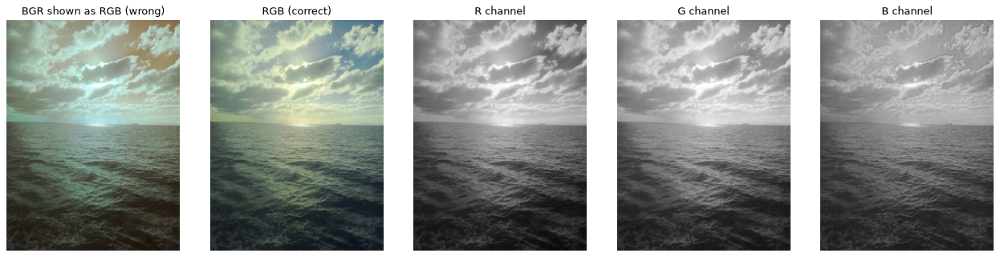{width=100%}

`code/show_image.py`

## Brightness and contrast

- **Brightness**: add a constant to every pixel — `img + b`.
- **Contrast**: multiply every pixel by a factor — `img * k`.
- What happens to pixels that go above 255?

## NumPy vs OpenCV

```python
img + 100                  # NumPy: wraps around (modulo 256)
cv2.add(img, 100)          # OpenCV: saturates — above 255 becomes 255
```

NumPy, done right:

```python
img16 = img.astype(np.int16)           # room for values above 255
bright16 = img16 + 100                 # int16: no wrap-around
clipped = np.clip(bright16, 0, 255)    # back into 0..255 (still int16)
bright = clipped.astype(np.uint8)      # an image again
```

- Why `int16`? Because `uint8 + 100` already wrapped around before `clip` could see it.
- `code/brightness_contrast.py`

## The result

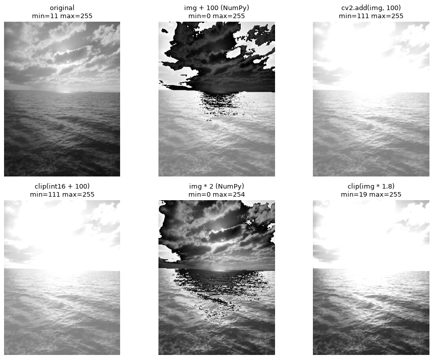{height=600}

## Exercise

Exercises 4–6 in the exercises file.

# Indexing and vectorization

## Indexing and slicing

```python
img[10, 20]          # one pixel: [B G R]
img[10, 20, 2]       # one value: the R of that pixel
img[:, :, 2]         # the R plane, shape (H, W)
img[100:200, 50:150] # a crop: rows 100..199, columns 50..149
img[::2, ::2]        # every second row and column: half size
img[::-1, :]         # rows in reverse: upside down
img[:, ::-1]         # columns in reverse: mirror
```

`start:stop:step` — like Python lists, but one per dimension.

## Views, not copies

```python
crop = img[100:200, 50:150]
crop[:] = 0              # img changes too!

crop = img[100:200, 50:150].copy()
crop[:] = 0              # img does not change
```

- Slicing gives a **view**: a new array object that uses the same memory.
- Fast (nothing is copied), but changes go to the original.
- Use `.copy()` when you need an independent array.

## 💡 Is it a view?

```python
crop = img[100:200, 50:150]
crop2 = img[100:200, 50:150].copy()

img.flags.owndata              # True: img owns its memory
crop.flags.owndata             # False: crop uses img's memory
crop.base is img               # True: base = the array that owns the memory
crop2.base                     # None: a copy owns its memory
np.shares_memory(img, crop)    # True
np.shares_memory(img, crop2)   # False
```

## 💡 View or copy?

```python
r = img[:, :, 2]               # one channel
np.shares_memory(img, r)       # True: a view
r[:] = 0                       # img has no red now

mask = img < 80
dark = img[mask]               # the dark values, shape (n,)
np.shares_memory(img, dark)    # False: a boolean mask gives a copy
dark[:] = 0                    # img does not change
img[mask] = 0                  # but this writes into img
```

## Broadcasting

```python
img.shape                               # (400, 300, 3)
weights = np.array([0.114, 0.587, 0.299])   # B, G, R
(img * weights).shape                   # (400, 300, 3)
```

- Shapes are compared from the **last** dimension.
- Sizes must be equal, or one of them must be 1 (or missing).
- `(400, 300, 3) * (3,)` → each pixel's 3 values are multiplied by the 3 weights.
- `img + 10` is broadcasting too: a scalar fits any shape.

## 💡 Broadcasting along other axes

```python
img.shape                               # (400, 300, 3)
m = img.mean(axis=2)                    # (400, 300): mean of each pixel
img - m                                 # ValueError!
m = img.mean(axis=2, keepdims=True)     # (400, 300, 1)
(img - m).shape                         # (400, 300, 3)
```

- `(400, 300)` is lined up from the right: 300 against 3 → error.
- `keepdims=True` keeps the squashed axis, with size 1.
- A size-1 axis is stretched to match: each pixel's mean is subtracted from its 3 channels.

## Broadcasting example: grayscale

The eye is most sensitive to green and least to blue:

$$Y = 0.299\,R + 0.587\,G + 0.114\,B$$

```python
weights = np.array([0.114, 0.587, 0.299])          # B, G, R
gray = (img * weights).sum(axis=2)                 # float64, shape (H, W)
gray = np.clip(gray, 0, 255).astype(np.uint8)

gray_cv = cv2.cvtColor(img, cv2.COLOR_BGR2GRAY)    # OpenCV: almost the same
```

- `img * weights` is **broadcasting**: `(H, W, 3) * (3,)` → each pixel's B, G, R times the 3 weights.
- `axis=2` — sum over the channels; the result has one dimension less.

## Boolean masks

```python
mask = gray > 200         # array of True/False, same shape as gray
mask.sum()                # how many pixels are brighter than 200
gray[mask] = 255          # set only those pixels
gray[gray < 50] = 0       # in one line

result = np.where(mask, 255, 0).astype(np.uint8)   # if / else for every pixel
```

## Timing code

```python
import time

start = time.perf_counter()
result = brighten_loop(img, 50)
elapsed = time.perf_counter() - start
print(f"{elapsed * 1000:.2f} ms")
```

- Measure, don't guess.
- Measure more than once — the first run is often slower.
- `code/loop_vs_numpy.py`

## Exercises

Exercises 7–10 in the exercises file.

# Point operations

## Point operations

The new value of a pixel depends only on its old value: `out = f(img)`.

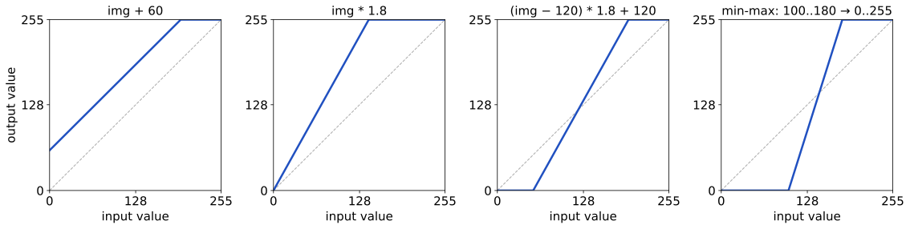{width=100%}

- Dashed: `out = img` (no change). Above 255 or below 0: clipped.
- Brightness moves the line up; contrast makes it steeper.

## Contrast around the mean

```python
f = img.astype(np.float64)
m = f.mean()
out = (f - m) * 1.8 + m                        # stretch around the mean
out = np.clip(out, 0, 255).astype(np.uint8)
```

- `img * 1.8` stretches around **0**: the image also gets brighter (mean 123 → 221).
- `(img - m) * 1.8 + m` keeps the mean: dark gets darker, bright gets brighter.

## Min-max normalization

$$out = \frac{img - min}{max - min} \cdot 255$$

```python
f = img.astype(np.float64)
out = (f - f.min()) / (f.max() - f.min()) * 255
out = np.round(out).astype(np.uint8)            # already 0..255: no clip

out = cv2.normalize(img, None, 0, 255, cv2.NORM_MINMAX)   # OpenCV: the same
```

- The darkest pixel becomes 0, the brightest becomes 255.
- One very dark or very bright pixel is enough to spoil it.

## Min-max: an example

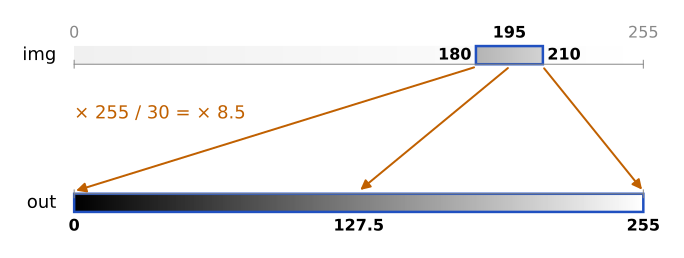{width=100%}

- A pale image: min = 180, max = 210, a range of only 30.
- Min-max stretches it to 0..255: each step of 1 becomes a step of 255 / 30 = 8.5.

## Min-max: the numbers

$$out = \frac{img - 180}{210 - 180} \cdot 255 = (img - 180) \cdot 8.5$$

| `img` | `img − 180` | `× 8.5` | `out` (rounded) |
|---|---|---|---|
| 180 | 0 | 0 | **0** |
| 190 | 10 | 85 | 85 |
| 195 | 15 | 127.5 | **128** |
| 200 | 20 | 170 | 170 |
| 210 | 30 | 255 | **255** |

- 195, halfway between min and max, goes to halfway between 0 and 255.
- 127.5 is not a `uint8` value: `np.round` and `cv2.normalize` both give 128.

## Min-max: the result

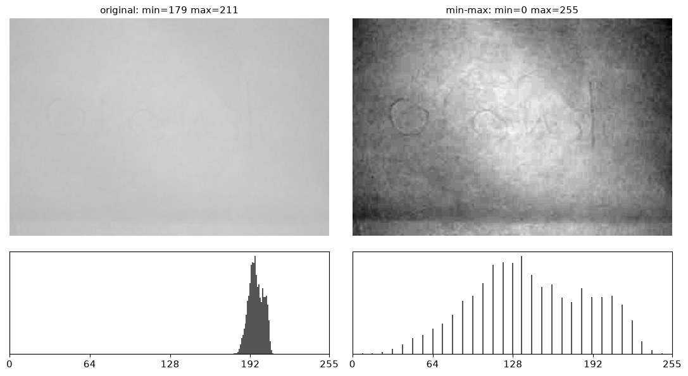{height=600}

# Histograms

## What is a histogram?

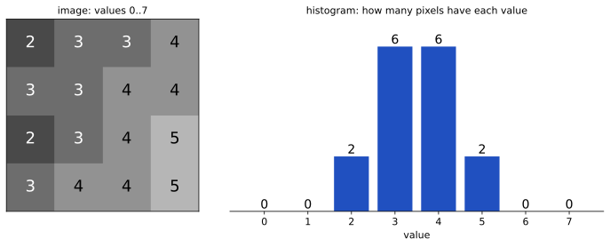{width=100%}

- For each value: how many pixels have it.
- The sum of the histogram is the number of pixels (16 here).
- Where the pixels are is lost — only how many.

## Computing a histogram: a loop

```python
hist = np.zeros(256, dtype=np.int64)
for v in img.ravel():
    hist[v] += 1
```

- `ravel()` — the image as one long 1D array.
- One Python step per pixel: 120,000 steps for a 400 × 300 image, ~25 ms.
- Why `int64`? A count can be as large as the number of pixels: `uint8` stops at 255, `int16` at 32,767.

## 💡 A loop over a list is faster

```python
hist = np.zeros(256, dtype=np.int64)   # a NumPy array
for v in img.ravel():                  # a NumPy array
    hist[v] += 1                       # ~25 ms

hist = [0] * 256                       # a Python list
for v in img.ravel().tolist():         # a list of Python ints
    hist[v] += 1                       # ~3 ms
```

- One element of a NumPy array is read as a new NumPy object (`np.uint8`, `np.int64`), and converted back when written: slow.
- A list holds Python `int`s: no conversions.
- NumPy is fast on whole arrays, slow one element at a time. Fastest: no Python loop at all (`np.bincount`, next).

## Computing a histogram: `np.bincount`

```python
hist = np.bincount(img.ravel(), minlength=256)   # ~0.15 ms
# hist: int64, shape (256,)

np.bincount(np.array([3, 3, 5]))                 # [0 0 0 2 0 1]
```

- Returns `hist`, where `hist[v]` = the number of pixels with value `v`.
- `minlength=256` — without it, the result stops at the largest value (5 above).
- Integers ≥ 0 only: a `float` image raises `TypeError`.

## Computing a histogram: `np.histogram`

```python
hist, edges = np.histogram(img, bins=256, range=(0, 256))   # ~2 ms
# hist: int64, shape (256,)
# edges: float64, shape (257,): 0, 1, 2, ..., 256

hist, edges = np.histogram(img, bins=8, range=(0, 256))
edges[:4]                # [ 0. 32. 64. 96.]: 8 bins, 32 values each
```

- Returns two arrays: the counts, and the bin edges (one more than the bins).
- Works with any numbers (also `float` images) and with wider bins.
- No `ravel()` needed: it flattens the image by itself.

## Computing a histogram: `cv2.calcHist`

```python
hist = cv2.calcHist([img], [0], None, [256], [0, 256])   # ~0.05 ms
hist.dtype            # float32
hist.shape            # (256, 1) in OpenCV 4, (256,) in OpenCV 5
hist = hist.ravel()   # (256,) in both
```

- The arguments are lists: images, channels, mask, number of bins, range.
- `[0]` — the channel; for a color image `[2]` is R (B, G, R!).
- Mask: `None` counts all pixels; a `uint8` mask counts only where it is not 0.
- Counts come back as `float32`, not integers.

## Drawing a histogram

```python
plt.bar(np.arange(256), hist, width=1)
plt.xlim(0, 255)
plt.show()

plt.hist(img.ravel(), bins=256, range=(0, 256))    # counts and draws
```

For a color image: one histogram per channel, `img[:, :, c]`.

## What a histogram tells

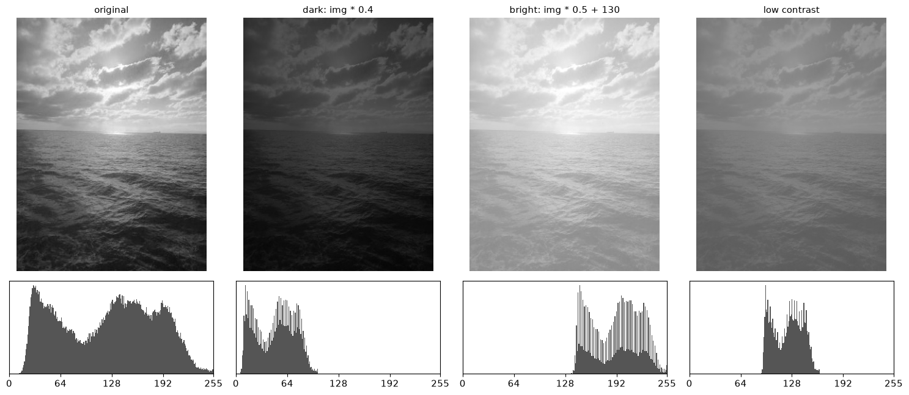{width=100%}

- Dark: on the left. Bright: on the right. Low contrast: narrow.
- Spikes and gaps: a point operation sent several values to one value, or skipped values.

# Histogram equalization

## An 8 × 8 image

:::: {.columns}
::: {.column width="50%"}
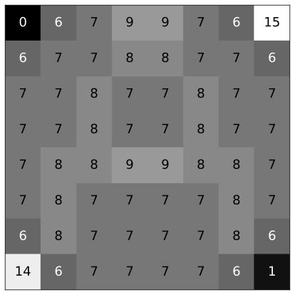{width=100%}
:::
::: {.column width="50%"}
- 64 pixels, values 0..15 (4 bits, easier to read than 0..255).
- Do you see a letter? Its pixels are 8 and 9; the background is 6 and 7.
- In the corners: one 0, one 1, one 14, one 15.
- Min-max does nothing: the min is already 0, the max already 15.
:::
::::

## The idea

- Min-max stretches linearly: a narrow histogram becomes wide, but keeps its shape.
- Equalization: about the same number of pixels for every range of values.
- Values that many pixels have — get more room.
- The tool: the cumulative histogram (CDF).

## Its histogram

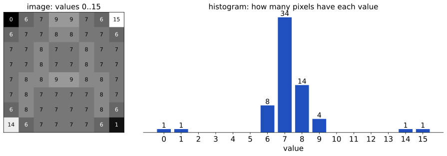{width=100%}

- Crowded: 6..9 hold 60 of the 64 pixels.
- Empty: 2..5 and 10..13. Rare: 0, 1, 14, 15 (the corners).

## The CDF, step by step

| value | 0 | 1 | 2 | 3 | 4 | 5 | 6 | 7 | 8 | 9 | 10 | 11 | 12 | 13 | 14 | 15 |
|---|---|---|---|---|---|---|---|---|---|---|---|---|---|---|---|---|
| `hist` | 1 | 1 | 0 | 0 | 0 | 0 | 8 | 34 | 14 | 4 | 0 | 0 | 0 | 0 | 1 | 1 |
| `cdf` | 1 | 2 | 2 | 2 | 2 | 2 | 10 | 44 | 58 | 62 | 62 | 62 | 62 | 62 | 63 | 64 |

- `cdf[v]` = how many pixels are ≤ `v`.
- Each step adds the pixels of one value: `cdf[v] = cdf[v − 1] + hist[v]`. In NumPy: `hist.cumsum()`.
- An empty value: the CDF stays flat. The last value: all 64 pixels.

## The CDF, drawn

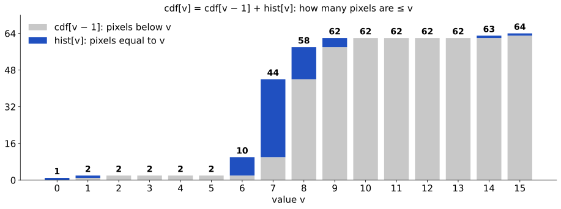{width=100%}

- Gray: the pixels below `v`. Blue: the pixels equal to `v`, added on top.

## 16 levels: cut the CDF into 16 bands

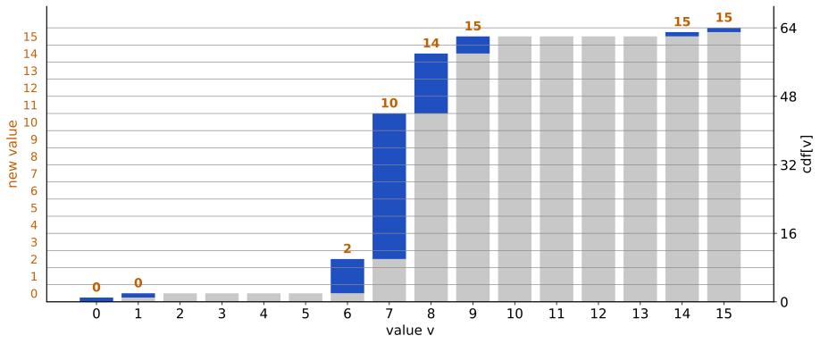{width=100%}

- 64 pixels, 16 levels: 4 pixels per level. Cut the height of the CDF into 16 bands of 4.
- New value = the band where the bar ends: 7 (`cdf` = 44) → band 10.
- Tall steps (many pixels) move far apart. Short steps (few pixels) end in the same band: merged.

## The mapping

$$new = round\left(15 \cdot \frac{cdf[v] - 1}{64 - 1}\right)$$

| value | 0 | 1 | 6 | 7 | 8 | 9 | 14 | 15 |
|---|---|---|---|---|---|---|---|---|
| `cdf` | 1 | 2 | 10 | 44 | 58 | 62 | 63 | 64 |
| exact | 0 | 0.24 | 2.14 | 10.24 | 13.57 | 14.52 | 14.76 | 15 |
| new | **0** | **0** | 2 | 10 | 14 | **15** | **15** | **15** |

- 1 is the first non-zero `cdf`: the darkest value goes to 0, the brightest to 15.
- Here it gives exactly the bands of the previous slide.
- Values with no pixels are left out: their new value does not matter.

## The result

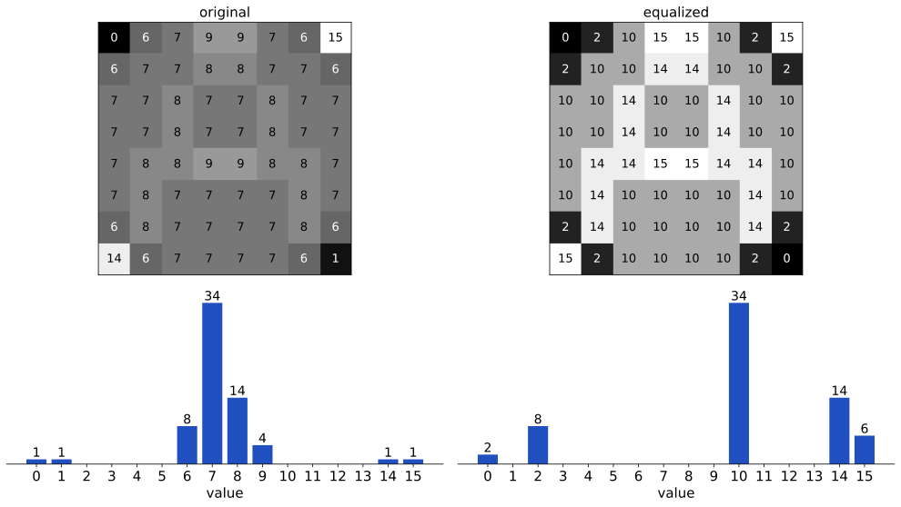{height=560}

## The result: what happened

- The letter appeared: background 7 → 10, letter 8 → 14. One level apart before, four after.
- The background has most of the pixels, so it gets most of the range: it turns light gray.
- Stretched: 6..9 (4 values) now cover 2..15.
- The corners lost: 0, 1 → 0 and 14, 15 → 15 (one pixel each), and 9 joined them at 15.
  Min-max kept them apart and could not stretch anything.
- Gaps closed: 2..5 had no pixels, so 6 moved down to 2.
- Not flat: all 34 pixels of 7 still have one value. Equalization moves values apart or merges them; it never splits one.

## Equalization in NumPy

```python
hist = np.bincount(img.ravel(), minlength=256)
cdf = hist.cumsum()
cdf_min = cdf[cdf > 0].min()                     # the first non-zero value
lut = np.round(255 * (cdf - cdf_min) / (cdf[-1] - cdf_min))
lut = np.clip(lut, 0, 255).astype(np.uint8)
eq = lut[img]                                    # each pixel: lut[its value]

eq_cv = cv2.equalizeHist(img)                    # OpenCV: exactly the same
```

- `cdf[-1]` — the last value of the CDF: the number of pixels.
- `lut[img]` — an array as an index: each value in `img` picks its new value from `lut` (a *lookup table*).

## Equalization: the result

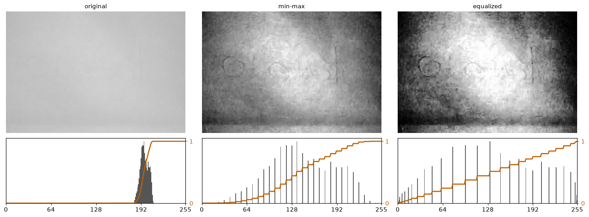{width=100%}

- Orange: the CDF (0 to 1). After equalization it is close to a straight line.
- Not linear: it can also amplify noise and change the look of an image.

# Color models

## An example: dark red

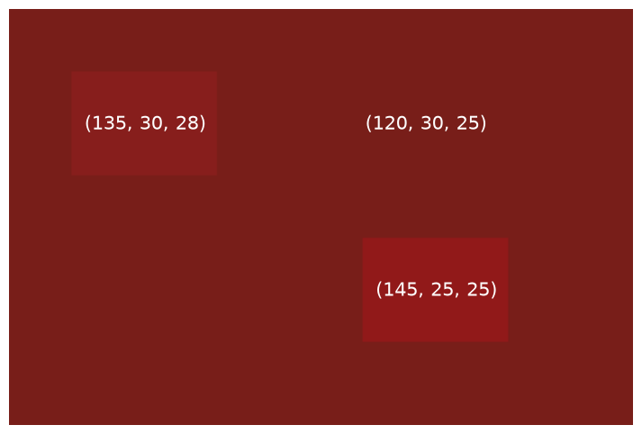{height=400}

- Three regions, all dark red, with low contrast. The (R, G, B) of each region is written on it.
- The file: `images/red_rectangles.png` (PNG, so the values are exact).

## Stretching R, G, B separately

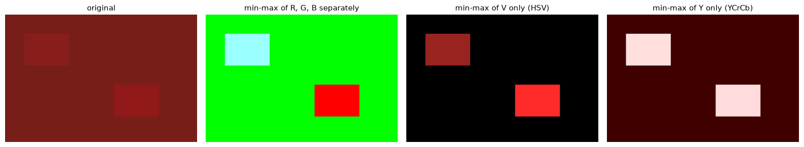{width=100%}

- Min-max on each channel separately: R, G and B are each stretched to 0..255.
- The original is all dark red, but the result is green, light cyan and red. Why? Next slide.

## Stretching R, G, B separately: the numbers

| region | original (R, G, B) | after stretching |
|---|---|---|
| background | <span class="swatch" style="background: rgb(120, 30, 25)"></span> (120, 30, 25) | <span class="swatch" style="background: rgb(0, 255, 0)"></span> (0, 255, 0) |
| top-left rectangle | <span class="swatch" style="background: rgb(135, 30, 28)"></span> (135, 30, 28) | <span class="swatch" style="background: rgb(153, 255, 255)"></span> (153, 255, 255) |
| bottom-right rectangle | <span class="swatch" style="background: rgb(145, 25, 25)"></span> (145, 25, 25) | <span class="swatch" style="background: rgb(255, 0, 0)"></span> (255, 0, 0) |

- Ranges: R 120..145, G 25..30, B 25..28. Each one becomes 0..255.
- G = 30 is the **largest** G in the image → 255, although 30 is very little green.
- A difference of 5 levels in G (invisible) becomes a difference of 255.
- The ratio between R, G and B is the color. To keep the color, change only the brightness.

## Stretching around each channel's mean

```python
f = img.astype(np.float64)
m = f.mean(axis=(0, 1))               # one mean per channel, shape (3,)
out = np.clip((f - m) * 2 + m, 0, 255).astype(np.uint8)
```

| region | original | ×2 | ×5 |
|---|---|---|---|
| background | <span class="swatch" style="background: rgb(120, 30, 25)"></span> (120, 30, 25) | <span class="swatch" style="background: rgb(117, 30, 24)"></span> (117, 30, 24) | <span class="swatch" style="background: rgb(110, 31, 24)"></span> (110, 31, 24) |
| top-left rectangle | <span class="swatch" style="background: rgb(135, 30, 28)"></span> (135, 30, 28) | <span class="swatch" style="background: rgb(147, 30, 30)"></span> (147, 30, 30) | <span class="swatch" style="background: rgb(185, 31, 39)"></span> (185, 31, 39) |
| bottom-right rectangle | <span class="swatch" style="background: rgb(145, 25, 25)"></span> (145, 25, 25) | <span class="swatch" style="background: rgb(167, 20, 24)"></span> (167, 20, 24) | <span class="swatch" style="background: rgb(235, 6, 24)"></span> (235, 6, 24) |

- A gentler stretch: differences are multiplied by 2 (or 5), not blown up to 255.
- The regions stay red. With ×5, the small differences start to show as color.

## The RGB color cube

:::: {.columns}
::: {.column width="55%"}
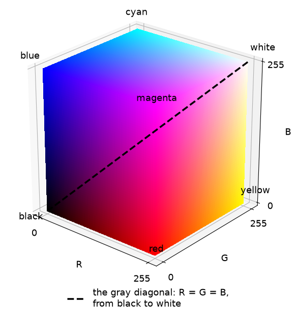{width=100%}
:::
::: {.column width="45%"}
- Every color is a point (R, G, B) in a cube, 0..255 on each axis.
- Corners: black, white, red, green, blue, and their mixes: yellow, cyan, magenta.
- The diagonal from black to white: R = G = B, all the grays.
- Along the diagonal: brightness. Away from it: color.
:::
::::

## Looking along the gray diagonal

:::: {.columns}
::: {.column width="55%"}
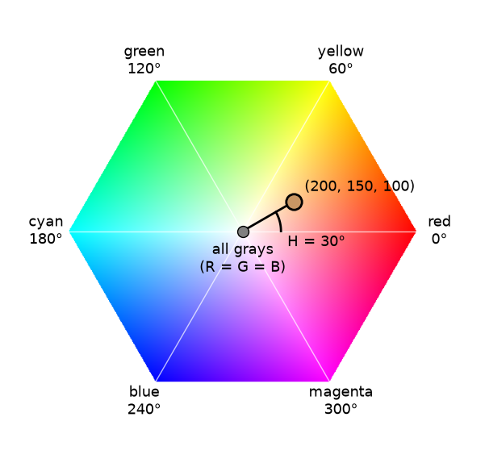{width=100%}
:::
::: {.column width="45%"}
- Look at the cube from white toward black: a hexagon. All grays fall on the center.
- **Hue** (H): the angle around the center. Red 0°, yellow 60°, green 120°, ...
- The distance from the center is `max − min`: 0 for gray.
- **Saturation** (S): that distance, relative to the brightness.
:::
::::

## HSV of one pixel

(R, G, B) = (200, 150, 100): max = 200 (R), min = 100 (B).

$$V = \max(R, G, B) = 200$$

$$S = \frac{\max - \min}{\max} = \frac{100}{200} = 0.5$$

$$H = 60° \cdot \frac{G - B}{\max - \min} = 60° \cdot \frac{50}{100} = 30°$$

- In OpenCV (`uint8`): S → 0.5 · 255 → 127, and H → 30 / 2 = 15.
- This formula for H is for R as the max: the next slides show why, and the other cases.
- Gray (max = min): S = 0, and H has no meaning (OpenCV gives 0).

## How H is computed: remove the gray

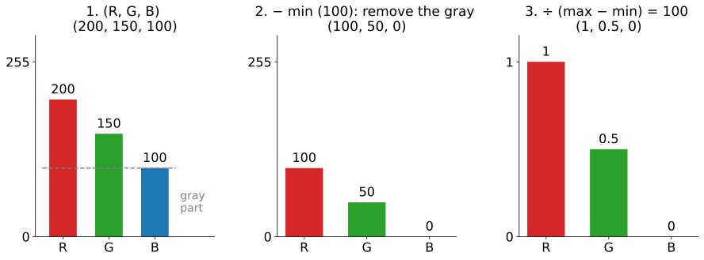{width=100%}

- Subtract the min: one channel becomes 0. What is left is a mix of two channels (here R and G).
- Divide by max − min: the largest becomes 1. The result is (1, 0.5, 0).

## How H is computed: walk along the edge

:::: {.columns}
::: {.column width="58%"}
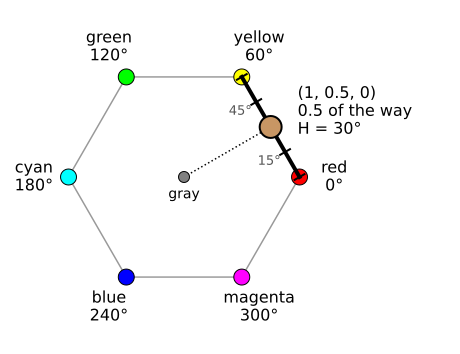{width=100%}
:::
::: {.column width="42%"}
- (1, t, 0) for t from 0 to 1: from red (1, 0, 0) to yellow (1, 1, 0), along one edge of the hexagon.
- Each edge is 60°. t = 0.5: halfway, H = 0° + 0.5 · 60° = 30°.
- R is the max, so t = (G − B) / (max − min), and H = t · 60°.
:::
::::

[G is the max: the edges next to green, starting from 120°. B is the max: next to blue, from 240°.
H moves evenly along the edge; away from its middle, the true angle differs a little (t = 0.75: H = 45°, the angle is 46°).]{.small}

## Calculating the angle: the red corner

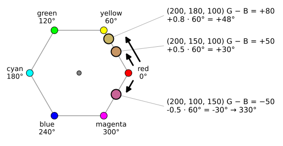{width=100%}

- R is the max: start at red (0°). G > B: walk toward yellow. B > G: toward magenta.
- How far: (G − B) / (max − min) of an edge (60°). Below 0°: add 360°.

## Calculating the angle: the three corners

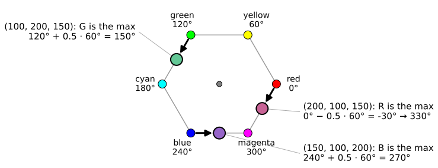{width=100%}

The max picks the corner. The other two channels pick the direction, and how far.

## The formula for H

$$
H = \begin{cases}
\phantom{120° + {}} 60° \cdot \dfrac{G - B}{\max - \min} & \text{if } R \text{ is the max} \\[2ex]
120° + 60° \cdot \dfrac{B - R}{\max - \min} & \text{if } G \text{ is the max} \\[2ex]
240° + 60° \cdot \dfrac{R - G}{\max - \min} & \text{if } B \text{ is the max} \\[2ex]
0 & \text{if } R = G = B
\end{cases}
$$

- A negative H (only when R is the max and B > G): add 360°.
- OpenCV (`uint8`) stores H / 2, so 0..179.

## Where the RGB point lies

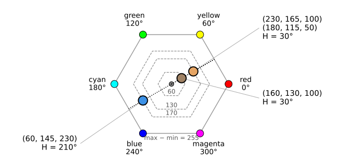{width=100%}

- More gray does not move the point: (180, 115, 50) + 50 = (230, 165, 100), the same spot.
- The distance from the center is max − min. The angle, H, is the same at every distance.

## HSV

- **H** (hue): which color — the angle around the gray center.
- **S** (saturation): how strong the color is, `(max − min) / max`. 0 = gray.
- **V** (value): the brightness, `max(R, G, B)`.

```python
hsv = cv2.cvtColor(img, cv2.COLOR_BGR2HSV)
```

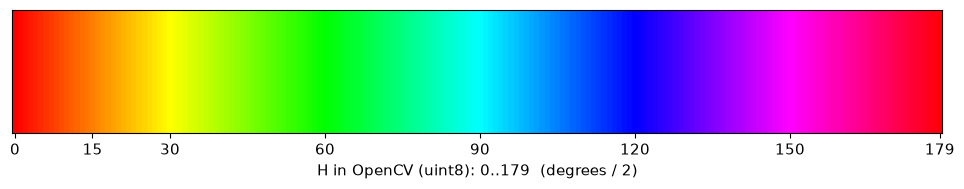{width=75%}

- In `uint8`, H is **0..179** (degrees / 2): 360 does not fit in a byte. S and V are 0..255.

## HSV: the channels

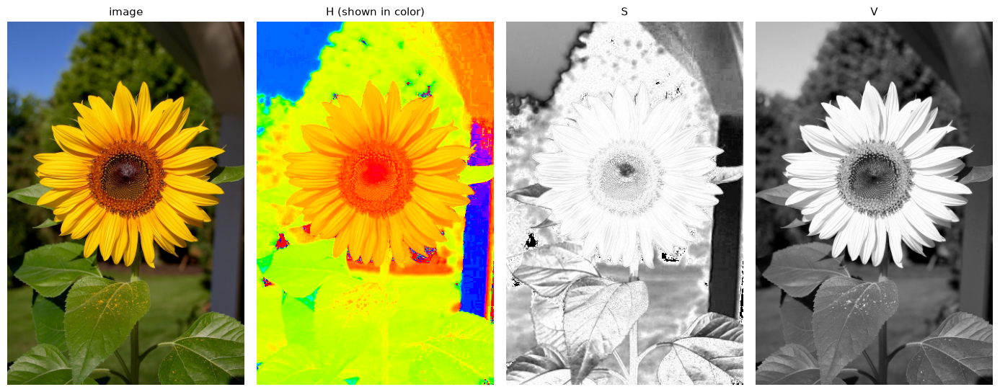{width=100%}

## YCrCb

- **Y**: the brightness — the grayscale formula `0.299 R + 0.587 G + 0.114 B`.
- **Cr**, **Cb**: how much more red / blue than gray. 128 = none.

```python
ycc = cv2.cvtColor(img, cv2.COLOR_BGR2YCrCb)    # the order: Y, Cr, Cb
y = ycc[:, :, 0]                                # the same as COLOR_BGR2GRAY
```

- Used in JPEG and in video: the eye is less sensitive to color than to brightness,
  so Cr and Cb can be stored with less detail.

## Change only the brightness

```python
hsv = cv2.cvtColor(img, cv2.COLOR_BGR2HSV)
hsv[:, :, 2] = cv2.equalizeHist(hsv[:, :, 2])    # or min-max on V
out = cv2.cvtColor(hsv, cv2.COLOR_HSV2BGR)

ycc = cv2.cvtColor(img, cv2.COLOR_BGR2YCrCb)
ycc[:, :, 0] = cv2.equalizeHist(ycc[:, :, 0])    # Y
out = cv2.cvtColor(ycc, cv2.COLOR_YCrCb2BGR)
```

- Convert, change one channel, convert back.
- H and S (or Cr and Cb) are not touched: the color stays.

## A real photo at night

```python
def stretch(ch):                          # one channel, uint8
    lo, hi = np.percentile(ch, [1, 99])   # skip the extreme 1%
    out = (ch.astype(np.float64) - lo) / (hi - lo) * 255
    return np.clip(out, 0, 255).astype(np.uint8)

per_channel = np.dstack([stretch(img[:, :, c]) for c in range(3)])
hsv[:, :, 2] = stretch(hsv[:, :, 2])      # only V
```

- Plain min-max does nothing here: the street lights are 255, and some shadows are 0.
- `np.percentile(ch, [1, 99])` — the values below which 1% and 99% of the pixels are.
- `np.dstack` — stacks the 3 stretched channels back into one `(H, W, 3)` image.

## A real photo at night: the result

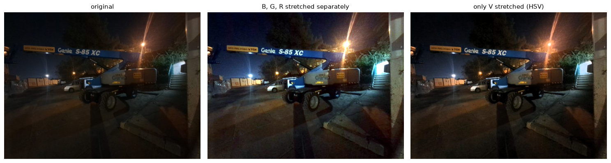{width=100%}

- 1%..99% ranges: B 2..111, G 6..118, R 4..146. B is stretched the most.
- B, G, R separately: average B / R goes from 0.70 to 0.94 — the orange cast of the street lights
  is mostly gone. The colors change (sometimes wanted: a simple white balance).
- Only V: average B / R stays 0.69 — the colors stay as they were, only brighter.

## Selecting by color

```python
hsv = cv2.cvtColor(img, cv2.COLOR_BGR2HSV)
h, s, v = hsv[:, :, 0], hsv[:, :, 1], hsv[:, :, 2]
mask = (h >= 15) & (h <= 35) & (s >= 100) & (v >= 100)   # yellow

gray = cv2.cvtColor(img, cv2.COLOR_BGR2GRAY)
out = cv2.cvtColor(gray, cv2.COLOR_GRAY2BGR)   # gray, but 3 channels
out[mask] = img[mask]                          # color only in the mask
```

- `&` — "and", element by element. The parentheses are required.
- Red is at both ends of H: `(h <= 10) | (h >= 170)`.
- `cv2.inRange(hsv, (15, 100, 100), (35, 255, 255))` — the same mask, as 0 / 255.

## Selecting by color: the result

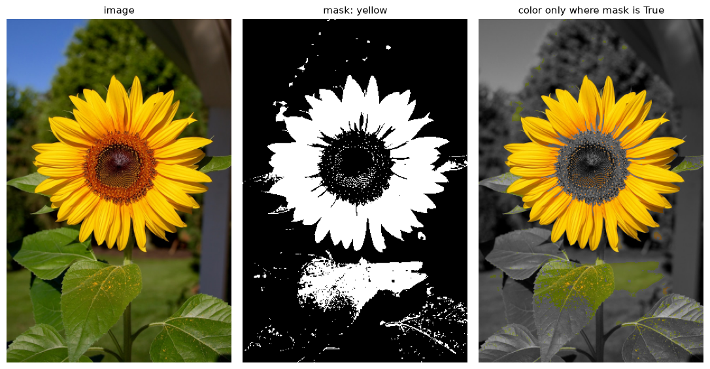{height=600}

# Geometric transformations

## What we want to do

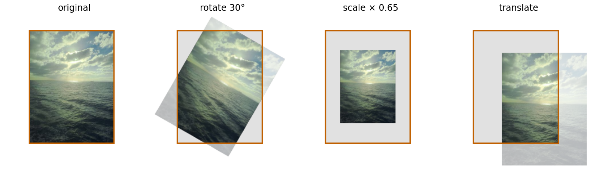{width=100%}

## Moving pixels

- Point operations change the **values** of the pixels.
- Geometric transformations change their **positions**: scale, rotate, translate, mirror.

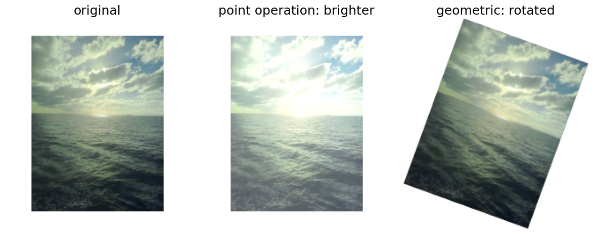{width=100%}

## Linear algebra reminder: matrix times a point

::: {.r-stack .big-math}
::: {.fragment .fade-out fragment-index=1}
$$
\begin{bmatrix}
\bbox[6px,border:2px solid transparent]{a \quad b} \\
\bbox[6px,border:2px solid transparent]{c \quad d}
\end{bmatrix}
\left[ \bbox[6px,border:2px solid transparent]{\begin{matrix} x \\ y \end{matrix}} \right] =
\begin{bmatrix}
\bbox[6px,border:2px solid transparent]{a x + b y} \\
\bbox[6px,border:2px solid transparent]{c x + d y}
\end{bmatrix}
$$
:::
::: {.fragment .fade-in-then-out fragment-index=1}
$$
\begin{bmatrix}
\bbox[#fbe0c4,6px,border:2px solid #c06000]{a \quad b} \\
\bbox[6px,border:2px solid transparent]{c \quad d}
\end{bmatrix}
\left[ \bbox[#fbe0c4,6px,border:2px solid #c06000]{\begin{matrix} x \\ y \end{matrix}} \right] =
\begin{bmatrix}
\bbox[#fbe0c4,6px,border:2px solid #c06000]{a x + b y} \\
\bbox[6px,border:2px solid transparent]{c x + d y}
\end{bmatrix}
$$
:::
::: {.fragment .fade-in fragment-index=2}
$$
\begin{bmatrix}
\bbox[6px,border:2px solid transparent]{a \quad b} \\
\bbox[#d6e2fb,6px,border:2px solid #2050c0]{c \quad d}
\end{bmatrix}
\left[ \bbox[#d6e2fb,6px,border:2px solid #2050c0]{\begin{matrix} x \\ y \end{matrix}} \right] =
\begin{bmatrix}
\bbox[6px,border:2px solid transparent]{a x + b y} \\
\bbox[#d6e2fb,6px,border:2px solid #2050c0]{c x + d y}
\end{bmatrix}
$$
:::
:::

## Linear algebra reminder: identity

::: {.big-math}
$$
\begin{bmatrix} 1 & 0 \\ 0 & 1 \end{bmatrix}
\begin{bmatrix} x \\ y \end{bmatrix} =
\begin{bmatrix} 1 \cdot x + 0 \cdot y \\ 0 \cdot x + 1 \cdot y \end{bmatrix} =
\begin{bmatrix} x \\ y \end{bmatrix}
$$
:::

## Linear algebra reminder: scale

**Uniform scale**

::: {.mid-math}
$$
\begin{bmatrix} s & 0 \\ 0 & s \end{bmatrix}
\begin{bmatrix} x \\ y \end{bmatrix} =
\begin{bmatrix} s \cdot x + 0 \cdot y \\ 0 \cdot x + s \cdot y \end{bmatrix} =
\begin{bmatrix} s x \\ s y \end{bmatrix}
$$
:::

**Non-uniform scale**

::: {.mid-math}
$$
\begin{bmatrix} s_x & 0 \\ 0 & s_y \end{bmatrix}
\begin{bmatrix} x \\ y \end{bmatrix} =
\begin{bmatrix} s_x \cdot x + 0 \cdot y \\ 0 \cdot x + s_y \cdot y \end{bmatrix} =
\begin{bmatrix} s_x x \\ s_y y \end{bmatrix}
$$
:::

## Linear algebra reminder: rotation

$$
R(\theta) = \begin{bmatrix} \cos\theta & -\sin\theta \\ \sin\theta & \cos\theta \end{bmatrix}
$$

For θ = 30°: cos 30° ≈ 0.866, sin 30° = 0.5.

$$
R(30°) = \begin{bmatrix} \cos 30° & -\sin 30° \\ \sin 30° & \cos 30° \end{bmatrix}
= \begin{bmatrix} 0.866 & -0.5 \\ 0.5 & 0.866 \end{bmatrix}
$$

## Linear algebra reminder: rotating a rectangle

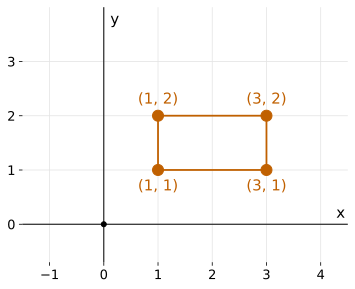{width=75% fig-align="center"}

- Rotate it by 30° around the origin: multiply each corner by R(30°).

## Linear algebra reminder: rotating each corner

Rotate it by 30° around the origin: multiply each corner by R(30°).

$$
\begin{aligned}
\begin{bmatrix} 0.866 & -0.5 \\ 0.5 & 0.866 \end{bmatrix}
\begin{bmatrix} {\color{#c06000}{1}} \\ {\color{#c06000}{1}} \end{bmatrix}
&= \begin{bmatrix} 0.866 \cdot 1 - 0.5 \cdot 1 \\ 0.5 \cdot 1 + 0.866 \cdot 1 \end{bmatrix} =
\begin{bmatrix} {\color{#2050c0}{0.366}} \\ {\color{#2050c0}{1.366}} \end{bmatrix}
\\[8pt]
\begin{bmatrix} 0.866 & -0.5 \\ 0.5 & 0.866 \end{bmatrix}
\begin{bmatrix} {\color{#c06000}{1}} \\ {\color{#c06000}{2}} \end{bmatrix}
&= \begin{bmatrix} 0.866 \cdot 1 - 0.5 \cdot 2 \\ 0.5 \cdot 1 + 0.866 \cdot 2 \end{bmatrix} =
\begin{bmatrix} {\color{#2050c0}{-0.134}} \\ {\color{#2050c0}{2.232}} \end{bmatrix}
\\[8pt]
\begin{bmatrix} 0.866 & -0.5 \\ 0.5 & 0.866 \end{bmatrix}
\begin{bmatrix} {\color{#c06000}{3}} \\ {\color{#c06000}{1}} \end{bmatrix}
&= \begin{bmatrix} 0.866 \cdot 3 - 0.5 \cdot 1 \\ 0.5 \cdot 3 + 0.866 \cdot 1 \end{bmatrix} =
\begin{bmatrix} {\color{#2050c0}{2.098}} \\ {\color{#2050c0}{2.366}} \end{bmatrix}
\\[8pt]
\begin{bmatrix} 0.866 & -0.5 \\ 0.5 & 0.866 \end{bmatrix}
\begin{bmatrix} {\color{#c06000}{3}} \\ {\color{#c06000}{2}} \end{bmatrix}
&= \begin{bmatrix} 0.866 \cdot 3 - 0.5 \cdot 2 \\ 0.5 \cdot 3 + 0.866 \cdot 2 \end{bmatrix} =
\begin{bmatrix} {\color{#2050c0}{1.598}} \\ {\color{#2050c0}{3.232}} \end{bmatrix}
\end{aligned}
$$

## Linear algebra reminder: before and after

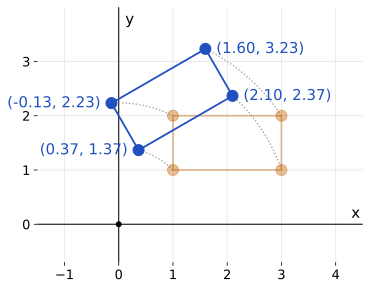{width=75% fig-align="center"}

- Each point turned 30° counter-clockwise around the origin (dotted: its path, on a circle).

## Linear algebra reminder: try it

```{=html}
<div class="tryit">
  <div class="tryit-calc">
    <div class="tryit-eq">
      <table class="tryit-mat">
        <tr><td><input id="ti-a" value="0.866"></td><td><input id="ti-b" value="-0.5"></td></tr>
        <tr><td><input id="ti-c" value="0.5"></td><td><input id="ti-d" value="0.866"></td></tr>
      </table>
      <table class="tryit-mat">
        <tr><td><input id="ti-x" value="3" class="tryit-in"></td></tr>
        <tr><td><input id="ti-y" value="1" class="tryit-in"></td></tr>
      </table>
      <span class="tryit-op">=</span>
      <table class="tryit-mat">
        <tr><td id="ti-nx" class="tryit-out"></td></tr>
        <tr><td id="ti-ny" class="tryit-out"></td></tr>
      </table>
    </div>
    <div id="ti-steps" class="tryit-steps"></div>
    <p class="tryit-note">Change the point (orange) or the matrix. Faded: the rectangle, moved by the same matrix.</p>
    <button id="ti-reset">back to: rotate 30°, point (3, 1)</button>
  </div>
  <svg id="ti-plot" viewBox="0 0 420 420" width="480" height="480"></svg>
</div>
<script>
(function () {
  const ids = ["a", "b", "c", "d", "x", "y"];
  const start = {a: "0.866", b: "-0.5", c: "0.5", d: "0.866", x: "3", y: "1"};
  const rect = [[1, 1], [1, 2], [3, 1], [3, 2]];
  const el = id => document.getElementById("ti-" + id);
  const fmt = v => String(parseFloat(v.toFixed(3))).replace("-", "−");
  const par = v => v < 0 ? "(" + fmt(v) + ")" : fmt(v);
  const R = 5, S = 42, C = 210;                  // range -5..5, 42 px per unit, origin at the center
  const X = x => C + S * x, Y = y => C - S * y;  // math axes: y up
  const NS = "http://www.w3.org/2000/svg";
  function add(svg, tag, attrs, text) {
    const e = document.createElementNS(NS, tag);
    for (const k in attrs) e.setAttribute(k, attrs[k]);
    if (text !== undefined) e.textContent = text;
    svg.appendChild(e);
  }
  function draw(v, nx, ny) {
    const svg = el("plot");
    svg.innerHTML = "";
    for (let i = -R; i <= R; i++) {
      add(svg, "line", {x1: X(i), y1: Y(-R), x2: X(i), y2: Y(R), stroke: "#e4e4e4"});
      add(svg, "line", {x1: X(-R), y1: Y(i), x2: X(R), y2: Y(i), stroke: "#e4e4e4"});
    }
    add(svg, "line", {x1: X(-R), y1: Y(0), x2: X(R), y2: Y(0), stroke: "black"});
    add(svg, "line", {x1: X(0), y1: Y(-R), x2: X(0), y2: Y(R), stroke: "black"});
    add(svg, "text", {x: X(R) - 4, y: Y(0) - 6, "text-anchor": "end", "font-size": 19}, "x");
    add(svg, "text", {x: X(0) + 6, y: Y(R) + 16, "font-size": 19}, "y");
    if (!isFinite(nx) || !isFinite(ny)) return;
    const moved = rect.map(([px, py]) => [v.a * px + v.b * py, v.c * px + v.d * py]);
    for (const [pts, color] of [[rect, "#c06000"], [moved, "#2050c0"]]) {   // the rectangle, before and after
      const loop = [0, 2, 3, 1].map(i => X(pts[i][0]) + "," + Y(pts[i][1])).join(" ");
      add(svg, "polygon", {points: loop, fill: "none", stroke: color, "stroke-width": 1.5, opacity: 0.35});
      for (const [px, py] of pts) add(svg, "circle", {cx: X(px), cy: Y(py), r: 5, fill: color, opacity: 0.35});
    }
    for (const [px, py, color] of [[v.x, v.y, "#c06000"], [nx, ny, "#2050c0"]]) {
      add(svg, "line", {x1: X(0), y1: Y(0), x2: X(px), y2: Y(py), stroke: color, "stroke-dasharray": "4 4"});
      add(svg, "circle", {cx: X(px), cy: Y(py), r: 7, fill: color});
      const right = px > 2;                      // labels of points near the right edge go to the left
      add(svg, "text", {x: X(px) + (right ? -10 : 10), y: Y(py) - 10, fill: color, "font-size": 19,
                        "text-anchor": right ? "end" : "start"},
          "(" + fmt(px) + ", " + fmt(py) + ")");
    }
  }
  function update() {
    const v = {};
    for (const id of ids) v[id] = parseFloat(el(id).value.replace("−", "-"));
    const ok = ids.every(id => isFinite(v[id]));
    const nx = v.a * v.x + v.b * v.y, ny = v.c * v.x + v.d * v.y;
    el("nx").textContent = ok ? fmt(nx) : "?";
    el("ny").textContent = ok ? fmt(ny) : "?";
    el("steps").innerHTML = ok
      ? "new x = " + fmt(v.a) + " · " + par(v.x) + " + " + par(v.b) + " · " + par(v.y) + " = " + fmt(nx) + "<br>" +
        "new y = " + fmt(v.c) + " · " + par(v.x) + " + " + par(v.d) + " · " + par(v.y) + " = " + fmt(ny)
      : "Type a number in every box.";
    draw(v, ok ? nx : NaN, ok ? ny : NaN);
  }
  for (const id of ids) el(id).addEventListener("input", update);
  el("reset").addEventListener("click", () => { for (const id of ids) el(id).value = start[id]; update(); });
  update();
})();
</script>
```

## Linear algebra reminder: two transformations

First rotate by 30°, then stretch x by 2:

$$
\begin{aligned}
R \begin{bmatrix} {\color{#c06000}{3}} \\ {\color{#c06000}{1}} \end{bmatrix}
&= \begin{bmatrix} 0.866 & -0.5 \\ 0.5 & 0.866 \end{bmatrix}
\begin{bmatrix} {\color{#c06000}{3}} \\ {\color{#c06000}{1}} \end{bmatrix} =
\begin{bmatrix} 2.098 \\ 2.366 \end{bmatrix}
\\[12pt]
S \begin{bmatrix} 2.098 \\ 2.366 \end{bmatrix}
&= \begin{bmatrix} 2 & 0 \\ 0 & 1 \end{bmatrix}
\begin{bmatrix} 2.098 \\ 2.366 \end{bmatrix} =
\begin{bmatrix} {\color{#2050c0}{4.196}} \\ {\color{#2050c0}{2.366}} \end{bmatrix}
\end{aligned}
$$

Two multiplications for every point:

$$
S \, (R \, p)
$$

## Linear algebra reminder: combine the matrices

$$
S \, (R \, p) = (S \, R) \, p
$$

::: {.r-stack}
::: {.fragment .fade-out fragment-index=1}
$$
\begin{aligned}
S \, R &= \left[ \begin{matrix} \bbox[6px,border:2px solid transparent]{2 \quad 0} \\ \bbox[6px,border:2px solid transparent]{0 \quad 1} \end{matrix} \right]
\left[ \bbox[6px,border:2px solid transparent]{\begin{matrix} 0.866 \\ 0.5 \end{matrix}} \; \bbox[6px,border:2px solid transparent]{\begin{matrix} -0.5 \\ 0.866 \end{matrix}} \right]
\\[8pt]
&= \begin{bmatrix} \bbox[6px,border:2px solid transparent]{2 \cdot 0.866 + 0 \cdot 0.5} & \bbox[6px,border:2px solid transparent]{2 \cdot (-0.5) + 0 \cdot 0.866} \\ \bbox[6px,border:2px solid transparent]{0 \cdot 0.866 + 1 \cdot 0.5} & \bbox[6px,border:2px solid transparent]{0 \cdot (-0.5) + 1 \cdot 0.866} \end{bmatrix}
\\[8pt]
&= \begin{bmatrix} \bbox[6px,border:2px solid transparent]{1.732} & \bbox[6px,border:2px solid transparent]{-1} \\ \bbox[6px,border:2px solid transparent]{0.5} & \bbox[6px,border:2px solid transparent]{0.866} \end{bmatrix}
\end{aligned}
$$
:::
::: {.fragment .fade-in-then-out fragment-index=1}
$$
\begin{aligned}
S \, R &= \left[ \begin{matrix} \bbox[#fbe0c4,6px,border:2px solid #c06000]{2 \quad 0} \\ \bbox[6px,border:2px solid transparent]{0 \quad 1} \end{matrix} \right]
\left[ \bbox[#fbe0c4,6px,border:2px solid #c06000]{\begin{matrix} 0.866 \\ 0.5 \end{matrix}} \; \bbox[6px,border:2px solid transparent]{\begin{matrix} -0.5 \\ 0.866 \end{matrix}} \right]
\\[8pt]
&= \begin{bmatrix} \bbox[#fbe0c4,6px,border:2px solid #c06000]{2 \cdot 0.866 + 0 \cdot 0.5} & \bbox[6px,border:2px solid transparent]{2 \cdot (-0.5) + 0 \cdot 0.866} \\ \bbox[6px,border:2px solid transparent]{0 \cdot 0.866 + 1 \cdot 0.5} & \bbox[6px,border:2px solid transparent]{0 \cdot (-0.5) + 1 \cdot 0.866} \end{bmatrix}
\\[8pt]
&= \begin{bmatrix} \bbox[#fbe0c4,6px,border:2px solid #c06000]{1.732} & \bbox[6px,border:2px solid transparent]{-1} \\ \bbox[6px,border:2px solid transparent]{0.5} & \bbox[6px,border:2px solid transparent]{0.866} \end{bmatrix}
\end{aligned}
$$
:::
::: {.fragment .fade-in-then-out fragment-index=2}
$$
\begin{aligned}
S \, R &= \left[ \begin{matrix} \bbox[#fbe0c4,6px,border:2px solid #c06000]{2 \quad 0} \\ \bbox[6px,border:2px solid transparent]{0 \quad 1} \end{matrix} \right]
\left[ \bbox[6px,border:2px solid transparent]{\begin{matrix} 0.866 \\ 0.5 \end{matrix}} \; \bbox[#fbe0c4,6px,border:2px solid #c06000]{\begin{matrix} -0.5 \\ 0.866 \end{matrix}} \right]
\\[8pt]
&= \begin{bmatrix} \bbox[6px,border:2px solid transparent]{2 \cdot 0.866 + 0 \cdot 0.5} & \bbox[#fbe0c4,6px,border:2px solid #c06000]{2 \cdot (-0.5) + 0 \cdot 0.866} \\ \bbox[6px,border:2px solid transparent]{0 \cdot 0.866 + 1 \cdot 0.5} & \bbox[6px,border:2px solid transparent]{0 \cdot (-0.5) + 1 \cdot 0.866} \end{bmatrix}
\\[8pt]
&= \begin{bmatrix} \bbox[6px,border:2px solid transparent]{1.732} & \bbox[#fbe0c4,6px,border:2px solid #c06000]{-1} \\ \bbox[6px,border:2px solid transparent]{0.5} & \bbox[6px,border:2px solid transparent]{0.866} \end{bmatrix}
\end{aligned}
$$
:::
::: {.fragment .fade-in-then-out fragment-index=3}
$$
\begin{aligned}
S \, R &= \left[ \begin{matrix} \bbox[6px,border:2px solid transparent]{2 \quad 0} \\ \bbox[#d6e2fb,6px,border:2px solid #2050c0]{0 \quad 1} \end{matrix} \right]
\left[ \bbox[#d6e2fb,6px,border:2px solid #2050c0]{\begin{matrix} 0.866 \\ 0.5 \end{matrix}} \; \bbox[6px,border:2px solid transparent]{\begin{matrix} -0.5 \\ 0.866 \end{matrix}} \right]
\\[8pt]
&= \begin{bmatrix} \bbox[6px,border:2px solid transparent]{2 \cdot 0.866 + 0 \cdot 0.5} & \bbox[6px,border:2px solid transparent]{2 \cdot (-0.5) + 0 \cdot 0.866} \\ \bbox[#d6e2fb,6px,border:2px solid #2050c0]{0 \cdot 0.866 + 1 \cdot 0.5} & \bbox[6px,border:2px solid transparent]{0 \cdot (-0.5) + 1 \cdot 0.866} \end{bmatrix}
\\[8pt]
&= \begin{bmatrix} \bbox[6px,border:2px solid transparent]{1.732} & \bbox[6px,border:2px solid transparent]{-1} \\ \bbox[#d6e2fb,6px,border:2px solid #2050c0]{0.5} & \bbox[6px,border:2px solid transparent]{0.866} \end{bmatrix}
\end{aligned}
$$
:::
::: {.fragment .fade-in fragment-index=4}
$$
\begin{aligned}
S \, R &= \left[ \begin{matrix} \bbox[6px,border:2px solid transparent]{2 \quad 0} \\ \bbox[#d6e2fb,6px,border:2px solid #2050c0]{0 \quad 1} \end{matrix} \right]
\left[ \bbox[6px,border:2px solid transparent]{\begin{matrix} 0.866 \\ 0.5 \end{matrix}} \; \bbox[#d6e2fb,6px,border:2px solid #2050c0]{\begin{matrix} -0.5 \\ 0.866 \end{matrix}} \right]
\\[8pt]
&= \begin{bmatrix} \bbox[6px,border:2px solid transparent]{2 \cdot 0.866 + 0 \cdot 0.5} & \bbox[6px,border:2px solid transparent]{2 \cdot (-0.5) + 0 \cdot 0.866} \\ \bbox[6px,border:2px solid transparent]{0 \cdot 0.866 + 1 \cdot 0.5} & \bbox[#d6e2fb,6px,border:2px solid #2050c0]{0 \cdot (-0.5) + 1 \cdot 0.866} \end{bmatrix}
\\[8pt]
&= \begin{bmatrix} \bbox[6px,border:2px solid transparent]{1.732} & \bbox[6px,border:2px solid transparent]{-1} \\ \bbox[6px,border:2px solid transparent]{0.5} & \bbox[#d6e2fb,6px,border:2px solid #2050c0]{0.866} \end{bmatrix}
\end{aligned}
$$
:::
:::

## Linear algebra reminder: one matrix

$$
(S \, R) \begin{bmatrix} {\color{#c06000}{3}} \\ {\color{#c06000}{1}} \end{bmatrix} =
\begin{bmatrix} 1.732 & -1 \\ 0.5 & 0.866 \end{bmatrix}
\begin{bmatrix} {\color{#c06000}{3}} \\ {\color{#c06000}{1}} \end{bmatrix} =
\begin{bmatrix} 1.732 \cdot 3 - 1 \cdot 1 \\ 0.5 \cdot 3 + 0.866 \cdot 1 \end{bmatrix} =
\begin{bmatrix} {\color{#2050c0}{4.196}} \\ {\color{#2050c0}{2.366}} \end{bmatrix}
$$

- The same point as in two steps.
- Multiply the matrices once; then one multiplication for every point, however many transformations.

## Linear algebra reminder: the order matters

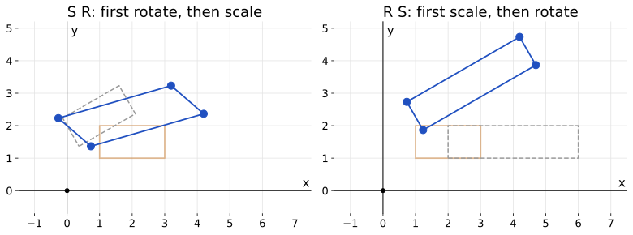{width=100%}

- Faded: the original. Dashed: after the first step. Blue: the result.

## Linear algebra reminder: S R ≠ R S

$$
\begin{aligned}
S \, R &= \begin{bmatrix} 2 & 0 \\ 0 & 1 \end{bmatrix}
\begin{bmatrix} 0.866 & -0.5 \\ 0.5 & 0.866 \end{bmatrix}
= \begin{bmatrix} 1.732 & -1 \\ 0.5 & 0.866 \end{bmatrix}
\\[12pt]
R \, S &= \begin{bmatrix} 0.866 & -0.5 \\ 0.5 & 0.866 \end{bmatrix}
\begin{bmatrix} 2 & 0 \\ 0 & 1 \end{bmatrix}
= \begin{bmatrix} 1.732 & -0.5 \\ 1 & 0.866 \end{bmatrix}
\end{aligned}
$$

- In $S \, R \, p$, the matrix next to the point acts first: $R$, then $S$.

## Linear algebra reminder: translation

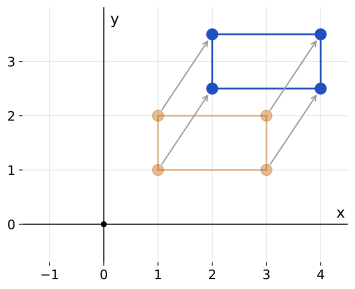{width=75% fig-align="center"}

::: {.mid-math}
$$
\begin{bmatrix} x \\ y \end{bmatrix} \to \begin{bmatrix} x + t_x \\ y + t_y \end{bmatrix}
$$
:::

## Linear algebra reminder: 2×2 can't translate

::: {.mid-math}
$$
\begin{bmatrix} a & b \\ c & d \end{bmatrix} \begin{bmatrix} 0 \\ 0 \end{bmatrix} = \begin{bmatrix} a \cdot 0 + b \cdot 0 \\ c \cdot 0 + d \cdot 0 \end{bmatrix} = \begin{bmatrix} 0 \\ 0 \end{bmatrix}
$$
:::

- A 2×2 matrix never moves the origin, so it cannot translate.

## Homogeneous coordinates

Add a third coordinate, always 1:

::: {.big-math}
$$
\begin{bmatrix} x \\ y \end{bmatrix} \to \begin{bmatrix} x \\ y \\ 1 \end{bmatrix}
$$
:::

## Homogeneous coordinates: translation

::: {.r-stack}
::: {.fragment .fade-out fragment-index=1}
$$
\left[ \begin{matrix} \bbox[6px,border:2px solid transparent]{1 \quad 0 \quad t_x} \\ \bbox[6px,border:2px solid transparent]{0 \quad 1 \quad t_y} \\ \bbox[6px,border:2px solid transparent]{0 \quad 0 \quad 1} \end{matrix} \right]
\left[ \bbox[6px,border:2px solid transparent]{\begin{matrix} x \\ y \\ 1 \end{matrix}} \right] =
\left[ \begin{matrix} \bbox[6px,border:2px solid transparent]{1 \cdot x + 0 \cdot y + t_x \cdot 1} \\ \bbox[6px,border:2px solid transparent]{0 \cdot x + 1 \cdot y + t_y \cdot 1} \\ \bbox[6px,border:2px solid transparent]{0 \cdot x + 0 \cdot y + 1 \cdot 1} \end{matrix} \right] =
\left[ \begin{matrix} \bbox[6px,border:2px solid transparent]{x + t_x} \\ \bbox[6px,border:2px solid transparent]{y + t_y} \\ \bbox[6px,border:2px solid transparent]{1} \end{matrix} \right]
$$
:::
::: {.fragment .fade-in-then-out fragment-index=1}
$$
\left[ \begin{matrix} \bbox[#fbe0c4,6px,border:2px solid #c06000]{1 \quad 0 \quad t_x} \\ \bbox[6px,border:2px solid transparent]{0 \quad 1 \quad t_y} \\ \bbox[6px,border:2px solid transparent]{0 \quad 0 \quad 1} \end{matrix} \right]
\left[ \bbox[#fbe0c4,6px,border:2px solid #c06000]{\begin{matrix} x \\ y \\ 1 \end{matrix}} \right] =
\left[ \begin{matrix} \bbox[#fbe0c4,6px,border:2px solid #c06000]{1 \cdot x + 0 \cdot y + t_x \cdot 1} \\ \bbox[6px,border:2px solid transparent]{0 \cdot x + 1 \cdot y + t_y \cdot 1} \\ \bbox[6px,border:2px solid transparent]{0 \cdot x + 0 \cdot y + 1 \cdot 1} \end{matrix} \right] =
\left[ \begin{matrix} \bbox[#fbe0c4,6px,border:2px solid #c06000]{x + t_x} \\ \bbox[6px,border:2px solid transparent]{y + t_y} \\ \bbox[6px,border:2px solid transparent]{1} \end{matrix} \right]
$$
:::
::: {.fragment .fade-in-then-out fragment-index=2}
$$
\left[ \begin{matrix} \bbox[6px,border:2px solid transparent]{1 \quad 0 \quad t_x} \\ \bbox[#d6e2fb,6px,border:2px solid #2050c0]{0 \quad 1 \quad t_y} \\ \bbox[6px,border:2px solid transparent]{0 \quad 0 \quad 1} \end{matrix} \right]
\left[ \bbox[#d6e2fb,6px,border:2px solid #2050c0]{\begin{matrix} x \\ y \\ 1 \end{matrix}} \right] =
\left[ \begin{matrix} \bbox[6px,border:2px solid transparent]{1 \cdot x + 0 \cdot y + t_x \cdot 1} \\ \bbox[#d6e2fb,6px,border:2px solid #2050c0]{0 \cdot x + 1 \cdot y + t_y \cdot 1} \\ \bbox[6px,border:2px solid transparent]{0 \cdot x + 0 \cdot y + 1 \cdot 1} \end{matrix} \right] =
\left[ \begin{matrix} \bbox[6px,border:2px solid transparent]{x + t_x} \\ \bbox[#d6e2fb,6px,border:2px solid #2050c0]{y + t_y} \\ \bbox[6px,border:2px solid transparent]{1} \end{matrix} \right]
$$
:::
::: {.fragment .fade-in fragment-index=3}
$$
\left[ \begin{matrix} \bbox[6px,border:2px solid transparent]{1 \quad 0 \quad t_x} \\ \bbox[6px,border:2px solid transparent]{0 \quad 1 \quad t_y} \\ \bbox[#d9efd9,6px,border:2px solid #2a7a3a]{0 \quad 0 \quad 1} \end{matrix} \right]
\left[ \bbox[#d9efd9,6px,border:2px solid #2a7a3a]{\begin{matrix} x \\ y \\ 1 \end{matrix}} \right] =
\left[ \begin{matrix} \bbox[6px,border:2px solid transparent]{1 \cdot x + 0 \cdot y + t_x \cdot 1} \\ \bbox[6px,border:2px solid transparent]{0 \cdot x + 1 \cdot y + t_y \cdot 1} \\ \bbox[#d9efd9,6px,border:2px solid #2a7a3a]{0 \cdot x + 0 \cdot y + 1 \cdot 1} \end{matrix} \right] =
\left[ \begin{matrix} \bbox[6px,border:2px solid transparent]{x + t_x} \\ \bbox[6px,border:2px solid transparent]{y + t_y} \\ \bbox[#d9efd9,6px,border:2px solid #2a7a3a]{1} \end{matrix} \right]
$$
:::
:::

## Homogeneous coordinates: rotation and scale

Rotation and scale get one more row and column: zeros, and 1 at the bottom.

$$
\begin{bmatrix} s_x & 0 & {\color{#c06000}{0}} \\ 0 & s_y & {\color{#c06000}{0}} \\ {\color{#c06000}{0}} & {\color{#c06000}{0}} & {\color{#c06000}{1}} \end{bmatrix}\begin{bmatrix} x \\ y \\ 1 \end{bmatrix} = \begin{bmatrix} s_x x \\ s_y y \\ 1 \end{bmatrix}
$$

$$
\begin{bmatrix} \cos\theta & -\sin\theta & {\color{#c06000}{0}} \\ \sin\theta & \cos\theta & {\color{#c06000}{0}} \\ {\color{#c06000}{0}} & {\color{#c06000}{0}} & {\color{#c06000}{1}} \end{bmatrix}\begin{bmatrix} x \\ y \\ 1 \end{bmatrix} = \begin{bmatrix} x \cos\theta - y \sin\theta \\ x \sin\theta + y \cos\theta \\ 1 \end{bmatrix}
$$

- The same results as with 2×2; the 1 stays 1.

## Homogeneous coordinates: everything is 3×3

::: {style="font-size: 85%"}
$$
T = \begin{bmatrix} 1 & 0 & t_x \\ 0 & 1 & t_y \\ 0 & 0 & 1 \end{bmatrix}\qquad R = \begin{bmatrix} \cos\theta & -\sin\theta & 0 \\ \sin\theta & \cos\theta & 0 \\ 0 & 0 & 1 \end{bmatrix}\qquad S = \begin{bmatrix} s_x & 0 & 0 \\ 0 & s_y & 0 \\ 0 & 0 & 1 \end{bmatrix}
$$
:::

Combine transformations by multiplying matrices, as before:

$M = T \, R \, S$ (first $S$, then $R$, then $T$).

With scale and rotation expanded to 3×3, they can be multiplied with translation:
any set of transformations combines into one matrix.

## Rotating around the center

With translation, we can rotate around the rectangle's center $c = (2, 1.5)$.

::: {.r-stack}
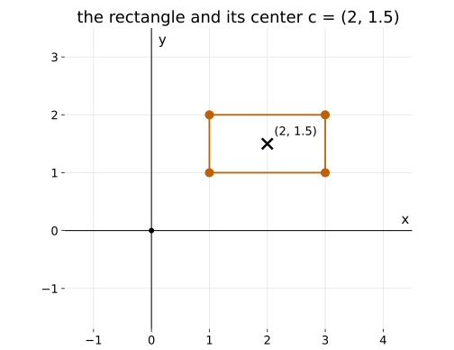{.fragment .fade-out fragment-index=1 width=580px}

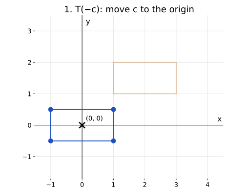{.fragment .fade-in-then-out fragment-index=1 width=580px}

{.fragment .fade-in-then-out fragment-index=2 width=580px}

{.fragment .fade-in fragment-index=3 width=580px}
:::

## Homogeneous coordinates: M = T(c) R T(−c)

$$
\begin{aligned}
M &= T(c) \, R(30°) \, T(-c) \\[8pt]
&= \begin{bmatrix} 1 & 0 & 2 \\ 0 & 1 & 1.5 \\ 0 & 0 & 1 \end{bmatrix}
\begin{bmatrix} 0.866 & -0.5 & 0 \\ 0.5 & 0.866 & 0 \\ 0 & 0 & 1 \end{bmatrix}
\begin{bmatrix} 1 & 0 & -2 \\ 0 & 1 & -1.5 \\ 0 & 0 & 1 \end{bmatrix} \\[8pt]
&= \begin{bmatrix} 0.866 & -0.5 & 1.018 \\ 0.5 & 0.866 & -0.799 \\ 0 & 0 & 1 \end{bmatrix}
\end{aligned}
$$

- Right to left: first $T(-c)$, then $R$, then $T(c)$.
- The translations choose the center of the rotation.

## In NumPy: matrix times a point

```python
np.set_printoptions(precision=3)     # print 3 digits after the point

t = np.deg2rad(30)
R = np.array([[np.cos(t), -np.sin(t)],
              [np.sin(t),  np.cos(t)]])
p = np.array([3, 1])

R @ p          # [2.098 2.366]       matrix times a point
R * p          # [[ 2.598 -0.5  ]    element by element (broadcasting)!
               #  [ 1.5    0.866]]
```

- `@` is matrix multiplication; `*` is not.

## In NumPy: combining matrices

```python
S = np.array([[2, 0],
              [0, 1]])

S @ R          # [[ 1.732 -1.   ]
               #  [ 0.5    0.866]]
R @ S          # [[ 1.732 -0.5  ]    not the same as S @ R
               #  [ 1.     0.866]]

S @ (R @ p)    # [4.196 2.366]       two steps
(S @ R) @ p    # [4.196 2.366]       one matrix: the same point
```

## Multiple coordinates at once

Instead of multiplying each $(x, y)$ on its own: put them as the columns of one matrix $P$, and multiply once.

::: {.r-stack .small-math}
::: {.fragment .fade-out fragment-index=1}
$$
\bbox[6px,border:2px solid transparent]{R \begin{bmatrix} {\color{#c06000}{1}} \\ {\color{#c06000}{1}} \end{bmatrix} = \begin{bmatrix} {\color{#2050c0}{0.366}} \\ {\color{#2050c0}{1.366}} \end{bmatrix}} \quad \bbox[6px,border:2px solid transparent]{R \begin{bmatrix} {\color{#c06000}{1}} \\ {\color{#c06000}{2}} \end{bmatrix} = \begin{bmatrix} {\color{#2050c0}{-0.134}} \\ {\color{#2050c0}{2.232}} \end{bmatrix}} \quad \bbox[6px,border:2px solid transparent]{R \begin{bmatrix} {\color{#c06000}{3}} \\ {\color{#c06000}{1}} \end{bmatrix} = \begin{bmatrix} {\color{#2050c0}{2.098}} \\ {\color{#2050c0}{2.366}} \end{bmatrix}} \quad \bbox[6px,border:2px solid transparent]{R \begin{bmatrix} {\color{#c06000}{3}} \\ {\color{#c06000}{2}} \end{bmatrix} = \begin{bmatrix} {\color{#2050c0}{1.598}} \\ {\color{#2050c0}{3.232}} \end{bmatrix}}
$$

$$
P = \left[ \bbox[6px,border:2px solid transparent]{\begin{matrix} {\color{#c06000}{1}} \\ {\color{#c06000}{1}} \end{matrix}} \; \bbox[6px,border:2px solid transparent]{\begin{matrix} {\color{#c06000}{1}} \\ {\color{#c06000}{2}} \end{matrix}} \; \bbox[6px,border:2px solid transparent]{\begin{matrix} {\color{#c06000}{3}} \\ {\color{#c06000}{1}} \end{matrix}} \; \bbox[6px,border:2px solid transparent]{\begin{matrix} {\color{#c06000}{3}} \\ {\color{#c06000}{2}} \end{matrix}} \right]
$$

$$
R \, P = \begin{bmatrix} 0.866 & -0.5 \\ 0.5 & 0.866 \end{bmatrix} \left[ \bbox[6px,border:2px solid transparent]{\begin{matrix} {\color{#c06000}{1}} \\ {\color{#c06000}{1}} \end{matrix}} \; \bbox[6px,border:2px solid transparent]{\begin{matrix} {\color{#c06000}{1}} \\ {\color{#c06000}{2}} \end{matrix}} \; \bbox[6px,border:2px solid transparent]{\begin{matrix} {\color{#c06000}{3}} \\ {\color{#c06000}{1}} \end{matrix}} \; \bbox[6px,border:2px solid transparent]{\begin{matrix} {\color{#c06000}{3}} \\ {\color{#c06000}{2}} \end{matrix}} \right] = \left[ \bbox[6px,border:2px solid transparent]{\begin{matrix} {\color{#2050c0}{0.366}} \\ {\color{#2050c0}{1.366}} \end{matrix}} \; \bbox[6px,border:2px solid transparent]{\begin{matrix} {\color{#2050c0}{-0.134}} \\ {\color{#2050c0}{2.232}} \end{matrix}} \; \bbox[6px,border:2px solid transparent]{\begin{matrix} {\color{#2050c0}{2.098}} \\ {\color{#2050c0}{2.366}} \end{matrix}} \; \bbox[6px,border:2px solid transparent]{\begin{matrix} {\color{#2050c0}{1.598}} \\ {\color{#2050c0}{3.232}} \end{matrix}} \right]
$$
:::
::: {.fragment .fade-in-then-out fragment-index=1}
$$
\bbox[#fbe0c4,6px,border:2px solid #c06000]{R \begin{bmatrix} {\color{#c06000}{1}} \\ {\color{#c06000}{1}} \end{bmatrix} = \begin{bmatrix} {\color{#2050c0}{0.366}} \\ {\color{#2050c0}{1.366}} \end{bmatrix}} \quad \bbox[6px,border:2px solid transparent]{R \begin{bmatrix} {\color{#c06000}{1}} \\ {\color{#c06000}{2}} \end{bmatrix} = \begin{bmatrix} {\color{#2050c0}{-0.134}} \\ {\color{#2050c0}{2.232}} \end{bmatrix}} \quad \bbox[6px,border:2px solid transparent]{R \begin{bmatrix} {\color{#c06000}{3}} \\ {\color{#c06000}{1}} \end{bmatrix} = \begin{bmatrix} {\color{#2050c0}{2.098}} \\ {\color{#2050c0}{2.366}} \end{bmatrix}} \quad \bbox[6px,border:2px solid transparent]{R \begin{bmatrix} {\color{#c06000}{3}} \\ {\color{#c06000}{2}} \end{bmatrix} = \begin{bmatrix} {\color{#2050c0}{1.598}} \\ {\color{#2050c0}{3.232}} \end{bmatrix}}
$$

$$
P = \left[ \bbox[#fbe0c4,6px,border:2px solid #c06000]{\begin{matrix} {\color{#c06000}{1}} \\ {\color{#c06000}{1}} \end{matrix}} \; \bbox[6px,border:2px solid transparent]{\begin{matrix} {\color{#c06000}{1}} \\ {\color{#c06000}{2}} \end{matrix}} \; \bbox[6px,border:2px solid transparent]{\begin{matrix} {\color{#c06000}{3}} \\ {\color{#c06000}{1}} \end{matrix}} \; \bbox[6px,border:2px solid transparent]{\begin{matrix} {\color{#c06000}{3}} \\ {\color{#c06000}{2}} \end{matrix}} \right]
$$

$$
R \, P = \begin{bmatrix} 0.866 & -0.5 \\ 0.5 & 0.866 \end{bmatrix} \left[ \bbox[#fbe0c4,6px,border:2px solid #c06000]{\begin{matrix} {\color{#c06000}{1}} \\ {\color{#c06000}{1}} \end{matrix}} \; \bbox[6px,border:2px solid transparent]{\begin{matrix} {\color{#c06000}{1}} \\ {\color{#c06000}{2}} \end{matrix}} \; \bbox[6px,border:2px solid transparent]{\begin{matrix} {\color{#c06000}{3}} \\ {\color{#c06000}{1}} \end{matrix}} \; \bbox[6px,border:2px solid transparent]{\begin{matrix} {\color{#c06000}{3}} \\ {\color{#c06000}{2}} \end{matrix}} \right] = \left[ \bbox[#fbe0c4,6px,border:2px solid #c06000]{\begin{matrix} {\color{#2050c0}{0.366}} \\ {\color{#2050c0}{1.366}} \end{matrix}} \; \bbox[6px,border:2px solid transparent]{\begin{matrix} {\color{#2050c0}{-0.134}} \\ {\color{#2050c0}{2.232}} \end{matrix}} \; \bbox[6px,border:2px solid transparent]{\begin{matrix} {\color{#2050c0}{2.098}} \\ {\color{#2050c0}{2.366}} \end{matrix}} \; \bbox[6px,border:2px solid transparent]{\begin{matrix} {\color{#2050c0}{1.598}} \\ {\color{#2050c0}{3.232}} \end{matrix}} \right]
$$
:::
::: {.fragment .fade-in-then-out fragment-index=2}
$$
\bbox[6px,border:2px solid transparent]{R \begin{bmatrix} {\color{#c06000}{1}} \\ {\color{#c06000}{1}} \end{bmatrix} = \begin{bmatrix} {\color{#2050c0}{0.366}} \\ {\color{#2050c0}{1.366}} \end{bmatrix}} \quad \bbox[#fbe0c4,6px,border:2px solid #c06000]{R \begin{bmatrix} {\color{#c06000}{1}} \\ {\color{#c06000}{2}} \end{bmatrix} = \begin{bmatrix} {\color{#2050c0}{-0.134}} \\ {\color{#2050c0}{2.232}} \end{bmatrix}} \quad \bbox[6px,border:2px solid transparent]{R \begin{bmatrix} {\color{#c06000}{3}} \\ {\color{#c06000}{1}} \end{bmatrix} = \begin{bmatrix} {\color{#2050c0}{2.098}} \\ {\color{#2050c0}{2.366}} \end{bmatrix}} \quad \bbox[6px,border:2px solid transparent]{R \begin{bmatrix} {\color{#c06000}{3}} \\ {\color{#c06000}{2}} \end{bmatrix} = \begin{bmatrix} {\color{#2050c0}{1.598}} \\ {\color{#2050c0}{3.232}} \end{bmatrix}}
$$

$$
P = \left[ \bbox[6px,border:2px solid transparent]{\begin{matrix} {\color{#c06000}{1}} \\ {\color{#c06000}{1}} \end{matrix}} \; \bbox[#fbe0c4,6px,border:2px solid #c06000]{\begin{matrix} {\color{#c06000}{1}} \\ {\color{#c06000}{2}} \end{matrix}} \; \bbox[6px,border:2px solid transparent]{\begin{matrix} {\color{#c06000}{3}} \\ {\color{#c06000}{1}} \end{matrix}} \; \bbox[6px,border:2px solid transparent]{\begin{matrix} {\color{#c06000}{3}} \\ {\color{#c06000}{2}} \end{matrix}} \right]
$$

$$
R \, P = \begin{bmatrix} 0.866 & -0.5 \\ 0.5 & 0.866 \end{bmatrix} \left[ \bbox[6px,border:2px solid transparent]{\begin{matrix} {\color{#c06000}{1}} \\ {\color{#c06000}{1}} \end{matrix}} \; \bbox[#fbe0c4,6px,border:2px solid #c06000]{\begin{matrix} {\color{#c06000}{1}} \\ {\color{#c06000}{2}} \end{matrix}} \; \bbox[6px,border:2px solid transparent]{\begin{matrix} {\color{#c06000}{3}} \\ {\color{#c06000}{1}} \end{matrix}} \; \bbox[6px,border:2px solid transparent]{\begin{matrix} {\color{#c06000}{3}} \\ {\color{#c06000}{2}} \end{matrix}} \right] = \left[ \bbox[6px,border:2px solid transparent]{\begin{matrix} {\color{#2050c0}{0.366}} \\ {\color{#2050c0}{1.366}} \end{matrix}} \; \bbox[#fbe0c4,6px,border:2px solid #c06000]{\begin{matrix} {\color{#2050c0}{-0.134}} \\ {\color{#2050c0}{2.232}} \end{matrix}} \; \bbox[6px,border:2px solid transparent]{\begin{matrix} {\color{#2050c0}{2.098}} \\ {\color{#2050c0}{2.366}} \end{matrix}} \; \bbox[6px,border:2px solid transparent]{\begin{matrix} {\color{#2050c0}{1.598}} \\ {\color{#2050c0}{3.232}} \end{matrix}} \right]
$$
:::
::: {.fragment .fade-in-then-out fragment-index=3}
$$
\bbox[6px,border:2px solid transparent]{R \begin{bmatrix} {\color{#c06000}{1}} \\ {\color{#c06000}{1}} \end{bmatrix} = \begin{bmatrix} {\color{#2050c0}{0.366}} \\ {\color{#2050c0}{1.366}} \end{bmatrix}} \quad \bbox[6px,border:2px solid transparent]{R \begin{bmatrix} {\color{#c06000}{1}} \\ {\color{#c06000}{2}} \end{bmatrix} = \begin{bmatrix} {\color{#2050c0}{-0.134}} \\ {\color{#2050c0}{2.232}} \end{bmatrix}} \quad \bbox[#fbe0c4,6px,border:2px solid #c06000]{R \begin{bmatrix} {\color{#c06000}{3}} \\ {\color{#c06000}{1}} \end{bmatrix} = \begin{bmatrix} {\color{#2050c0}{2.098}} \\ {\color{#2050c0}{2.366}} \end{bmatrix}} \quad \bbox[6px,border:2px solid transparent]{R \begin{bmatrix} {\color{#c06000}{3}} \\ {\color{#c06000}{2}} \end{bmatrix} = \begin{bmatrix} {\color{#2050c0}{1.598}} \\ {\color{#2050c0}{3.232}} \end{bmatrix}}
$$

$$
P = \left[ \bbox[6px,border:2px solid transparent]{\begin{matrix} {\color{#c06000}{1}} \\ {\color{#c06000}{1}} \end{matrix}} \; \bbox[6px,border:2px solid transparent]{\begin{matrix} {\color{#c06000}{1}} \\ {\color{#c06000}{2}} \end{matrix}} \; \bbox[#fbe0c4,6px,border:2px solid #c06000]{\begin{matrix} {\color{#c06000}{3}} \\ {\color{#c06000}{1}} \end{matrix}} \; \bbox[6px,border:2px solid transparent]{\begin{matrix} {\color{#c06000}{3}} \\ {\color{#c06000}{2}} \end{matrix}} \right]
$$

$$
R \, P = \begin{bmatrix} 0.866 & -0.5 \\ 0.5 & 0.866 \end{bmatrix} \left[ \bbox[6px,border:2px solid transparent]{\begin{matrix} {\color{#c06000}{1}} \\ {\color{#c06000}{1}} \end{matrix}} \; \bbox[6px,border:2px solid transparent]{\begin{matrix} {\color{#c06000}{1}} \\ {\color{#c06000}{2}} \end{matrix}} \; \bbox[#fbe0c4,6px,border:2px solid #c06000]{\begin{matrix} {\color{#c06000}{3}} \\ {\color{#c06000}{1}} \end{matrix}} \; \bbox[6px,border:2px solid transparent]{\begin{matrix} {\color{#c06000}{3}} \\ {\color{#c06000}{2}} \end{matrix}} \right] = \left[ \bbox[6px,border:2px solid transparent]{\begin{matrix} {\color{#2050c0}{0.366}} \\ {\color{#2050c0}{1.366}} \end{matrix}} \; \bbox[6px,border:2px solid transparent]{\begin{matrix} {\color{#2050c0}{-0.134}} \\ {\color{#2050c0}{2.232}} \end{matrix}} \; \bbox[#fbe0c4,6px,border:2px solid #c06000]{\begin{matrix} {\color{#2050c0}{2.098}} \\ {\color{#2050c0}{2.366}} \end{matrix}} \; \bbox[6px,border:2px solid transparent]{\begin{matrix} {\color{#2050c0}{1.598}} \\ {\color{#2050c0}{3.232}} \end{matrix}} \right]
$$
:::
::: {.fragment .fade-in fragment-index=4}
$$
\bbox[6px,border:2px solid transparent]{R \begin{bmatrix} {\color{#c06000}{1}} \\ {\color{#c06000}{1}} \end{bmatrix} = \begin{bmatrix} {\color{#2050c0}{0.366}} \\ {\color{#2050c0}{1.366}} \end{bmatrix}} \quad \bbox[6px,border:2px solid transparent]{R \begin{bmatrix} {\color{#c06000}{1}} \\ {\color{#c06000}{2}} \end{bmatrix} = \begin{bmatrix} {\color{#2050c0}{-0.134}} \\ {\color{#2050c0}{2.232}} \end{bmatrix}} \quad \bbox[6px,border:2px solid transparent]{R \begin{bmatrix} {\color{#c06000}{3}} \\ {\color{#c06000}{1}} \end{bmatrix} = \begin{bmatrix} {\color{#2050c0}{2.098}} \\ {\color{#2050c0}{2.366}} \end{bmatrix}} \quad \bbox[#fbe0c4,6px,border:2px solid #c06000]{R \begin{bmatrix} {\color{#c06000}{3}} \\ {\color{#c06000}{2}} \end{bmatrix} = \begin{bmatrix} {\color{#2050c0}{1.598}} \\ {\color{#2050c0}{3.232}} \end{bmatrix}}
$$

$$
P = \left[ \bbox[6px,border:2px solid transparent]{\begin{matrix} {\color{#c06000}{1}} \\ {\color{#c06000}{1}} \end{matrix}} \; \bbox[6px,border:2px solid transparent]{\begin{matrix} {\color{#c06000}{1}} \\ {\color{#c06000}{2}} \end{matrix}} \; \bbox[6px,border:2px solid transparent]{\begin{matrix} {\color{#c06000}{3}} \\ {\color{#c06000}{1}} \end{matrix}} \; \bbox[#fbe0c4,6px,border:2px solid #c06000]{\begin{matrix} {\color{#c06000}{3}} \\ {\color{#c06000}{2}} \end{matrix}} \right]
$$

$$
R \, P = \begin{bmatrix} 0.866 & -0.5 \\ 0.5 & 0.866 \end{bmatrix} \left[ \bbox[6px,border:2px solid transparent]{\begin{matrix} {\color{#c06000}{1}} \\ {\color{#c06000}{1}} \end{matrix}} \; \bbox[6px,border:2px solid transparent]{\begin{matrix} {\color{#c06000}{1}} \\ {\color{#c06000}{2}} \end{matrix}} \; \bbox[6px,border:2px solid transparent]{\begin{matrix} {\color{#c06000}{3}} \\ {\color{#c06000}{1}} \end{matrix}} \; \bbox[#fbe0c4,6px,border:2px solid #c06000]{\begin{matrix} {\color{#c06000}{3}} \\ {\color{#c06000}{2}} \end{matrix}} \right] = \left[ \bbox[6px,border:2px solid transparent]{\begin{matrix} {\color{#2050c0}{0.366}} \\ {\color{#2050c0}{1.366}} \end{matrix}} \; \bbox[6px,border:2px solid transparent]{\begin{matrix} {\color{#2050c0}{-0.134}} \\ {\color{#2050c0}{2.232}} \end{matrix}} \; \bbox[6px,border:2px solid transparent]{\begin{matrix} {\color{#2050c0}{2.098}} \\ {\color{#2050c0}{2.366}} \end{matrix}} \; \bbox[#fbe0c4,6px,border:2px solid #c06000]{\begin{matrix} {\color{#2050c0}{1.598}} \\ {\color{#2050c0}{3.232}} \end{matrix}} \right]
$$
:::
:::

## In NumPy: a loop over the points

```python
points = [(1, 1), (1, 2), (3, 1), (3, 2)]

for x, y in points:                  # a Python loop
    print(R @ np.array([x, y]))      # one matrix multiplication per point

# [0.366 1.366]
# [-0.134  2.232]
# [2.098 2.366]
# [1.598 3.232]
```

## In NumPy: all the points at once

```python
P = np.array([[1, 1, 3, 3],          # x of the four points
              [1, 2, 1, 2]])         # y of the four points

R @ P          # [[ 0.366 -0.134  2.098  1.598]
               #  [ 1.366  2.232  2.366  3.232]]
```

- Instead of the loop: one `@` rotates all four points, one in each column.
- NumPy multiplies matrices very fast: for the millions of pixels of an image,
  one `@` on a matrix of coordinates is much faster than a loop over the points.

## In NumPy: homogeneous coordinates

```python
P3 = np.vstack([P, np.ones(4)])      # add a row of 1s

T = np.array([[1, 0, 1],             # translate by (1, 1.5)
              [0, 1, 1.5],
              [0, 0, 1]])

T @ P3         # [[2.  2.  4.  4. ]
               #  [2.5 3.5 2.5 3.5]
               #  [1.  1.  1.  1. ]]
```

## Images: y points down

{width=100%}

- In an image the origin is the top-left pixel, and y grows **downward**.
- The same matrix and the same numbers: on the screen, the rotation now looks **clockwise**.

## Images: (x, y) and img[row, col]

- The pixel in row `r`, column `c` is the point `(x, y) = (c, r)`: x is the column, y is the row.
- NumPy indexes the row first: `img[y, x]`.
- `img.shape` is `(h, w, 3)`: the height (number of rows) first.

```python
img = np.zeros((300, 400, 3), np.uint8)
img.shape          # (300, 400, 3): 300 rows (h), 400 columns (w)
img[10, 50]        # the pixel at x = 50, y = 10
```

## Images: rotating around the center

{width=100%}

- `R` alone rotates around `(0, 0)`, the top-left corner.
- Around the center `c`: move `c` to the origin, rotate, move back: `T(c) @ R @ T(−c)`.

## Rotating around the center: code

```python
cx, cy = (w - 1) / 2, (h - 1) / 2          # the center pixel
to_origin = np.array([[1, 0, -cx],
                      [0, 1, -cy],
                      [0, 0, 1]])
back = np.array([[1, 0, cx],
                 [0, 1, cy],
                 [0, 0, 1]])
M = back @ rotate @ to_origin               # rotate: R as a 3x3 matrix
```

- The center stays in place; every other point turns around it.

## OpenCV: coordinates

- OpenCV uses image coordinates: the origin is the top-left pixel, x to the right, **y down**. Nothing is flipped.
- Everything is in **(x, y)** order, the column first, the reverse of `img[row, col]`:
  - a point is `(x, y)`;
  - a size is `(width, height)`, the reverse of `img.shape`;
  - a transformation is the top two rows of our 3×3 matrix, `M[:2]`, applied to `(x, y, 1)`.

```python
h, w = img.shape[:2]
out = cv2.warpAffine(img, M[:2], (w, h))     # the size: (width, height)
```

- So the matrices from the previous slides work as they are.

## OpenCV: which way does it rotate?

- Our `R(θ)` with θ > 0 turns **clockwise** on the screen, because y points down.
- `cv2.getRotationMatrix2D(center, angle, scale)` turns **counter-clockwise** on the screen for angle > 0:
  it builds `R(−angle)`.

```python
cv2.getRotationMatrix2D((0, 0), -30, 1.0)
# [[ 0.866 -0.5    0.   ]
#  [ 0.5    0.866  0.   ]]      our R(30°), with a third column of 0s

cv2.getRotationMatrix2D((cx, cy), -30, 1.0)
# the same as M[:2] from "Rotating around the center: code"
```

## OpenCV: a test

```python
img = np.zeros((21, 21), np.uint8)
img[10, 15] = 255           # one pixel, right of the center (10, 10)

M = cv2.getRotationMatrix2D((10, 10), 90, 1.0)
out = cv2.warpAffine(img, M, (21, 21))
np.argwhere(out == 255)     # [[ 5 10]]: row 5, above the center

M = cv2.getRotationMatrix2D((10, 10), -90, 1.0)   # our R(90°)
out = cv2.warpAffine(img, M, (21, 21))
np.argwhere(out == 255)     # [[15 10]]: row 15, below the center
```

- With angle 90 the pixel goes up (counter-clockwise); with our `R(90°)` it goes down (clockwise).

# Warping images

## Forward mapping: holes

{height=420}

- Forward: for each **source** pixel, compute where it goes, and round.
- Some output pixels get no value (holes), others get two.

## Backward mapping

- For each **output** pixel `(x, y)`: where did it come from?
  `(sx, sy, 1) = M⁻¹ (x, y, 1)` — the inverse matrix.
- Every output pixel gets exactly one value: no holes.
- `(sx, sy)` is usually not a whole number → interpolation.
- If `(sx, sy)` is outside the source image: black.

## Backward mapping: a loop

```python
M_inv = np.linalg.inv(M)                 # the inverse, computed once
out = np.zeros_like(img)
for y in range(h):
    for x in range(w):
        sx, sy, _ = M_inv @ (x, y, 1)    # where does (x, y) come from?
        c, r = round(sx), round(sy)      # the nearest source pixel
        if 0 <= r < h and 0 <= c < w:
            out[y, x] = img[r, c]
```

- `round` — **nearest neighbor**: the value of the closest pixel.
- About 1 second for a 400 × 300 image.

## Interpolation

{width=100%}

- **Nearest neighbor**: the closest pixel. Fast, blocky.
- **Bilinear**: a weighted average of the 4 surrounding pixels. Smooth.
- **Bicubic**: 16 pixels (4 × 4). Sharper edges, slower.

## Bilinear interpolation

:::: {.columns}
::: {.column width="45%"}
{width=100%}
:::
::: {.column width="55%"}
- `fx`, `fy` — the fractional parts of `sx`, `sy`.
- Top, along x: 10 + 0.3 · (20 − 10) = 13.
- Bottom, along x: 30 + 0.3 · (40 − 30) = 33.
- Then along y: 13 + 0.6 · (33 − 13) = **25**.
- The closer a corner, the larger its weight.
:::
::::

## Where exactly is a pixel?

{.nostretch width=42%}

- Resize ×2, matching the **centers**: `src = (dst + 0.5) / 2 − 0.5`.
- `cv2.resize`: `[0 100 200 250]` → `[0 25 75 125 175 212.5 237.5 250]`
- `src = dst / 2`: `[0 50 100 150 200 225 250 250]` — half a pixel off.
- No 0.5: `cv2.warpAffine`, `INTER_NEAREST`. With 0.5: `INTER_NEAREST_EXACT`.

## A vectorized warp

```python
ys, xs = np.indices((h, w))                  # y, x of every output pixel
coords = np.stack([xs.ravel(), ys.ravel(), np.ones(h * w)])   # (3, h*w)
sx, sy, _ = np.linalg.inv(M) @ coords        # all pixels in one product
c = np.round(sx).astype(int).reshape(h, w)
r = np.round(sy).astype(int).reshape(h, w)

inside = (r >= 0) & (r < h) & (c >= 0) & (c < w)
out = np.zeros_like(img)
out[inside] = img[r[inside], c[inside]]      # all pixels at once
```

- `np.indices((2, 3))` → y: `[[0 0 0] [1 1 1]]`, x: `[[0 1 2] [0 1 2]]`.
- `img[r, c]` with arrays `r`, `c`: one pixel for each pair `(r[i], c[i])`.

## The result

{width=100%}

- Bilinear in NumPy and bilinear in `cv2.warpAffine` differ by at most 1–2 inside the image.

## OpenCV

```python
M = cv2.getRotationMatrix2D((cx, cy), 30, 1.0)               # 2x3
out = cv2.warpAffine(img, M, (w, h))                          # bilinear
out = cv2.warpAffine(img, M, (w, h), flags=cv2.INTER_NEAREST)

small = cv2.resize(img, None, fx=0.5, fy=0.5, interpolation=cv2.INTER_AREA)
big = cv2.resize(img, (2 * w, 2 * h), interpolation=cv2.INTER_CUBIC)
```

- Sizes in OpenCV are **(width, height)** — the opposite of `img.shape`.
- Shrinking: `INTER_AREA` averages the pixels; nearest and bilinear skip pixels.

## How fast?

Rotating a 400 × 300 color image by 30°:

| | time |
|---|---|
| Python loop, nearest | ~1000 ms |
| NumPy, nearest | ~10 ms |
| NumPy, bilinear | ~45 ms |
| `cv2.warpAffine`, bilinear | ~0.3 ms |

- Loop → NumPy: ~100× faster. NumPy → OpenCV: ~100× faster again.
- OpenCV's first call is slower (~100 ms): measure more than once.
